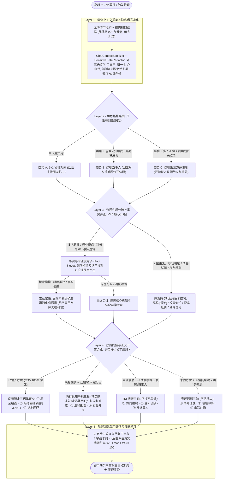

# TypeFree v3.5 · 「✦ Jev 军师」五层决策树与反装蠢架构白皮书

> **核心设计命题**：为什么市面上大多数「AI 帮回键盘」一进真实微信群或职场私聊就会让人脚趾抠地？
> 因为它们通常只有一层扁平提示词，极易陷入三大灾难：**① 客服跪舔腔**（把机主当成卑微乙方）、**② 群聊角色错乱**（把群友 A 怼群友 B 的战火当成冲着机主来的）、**③ 知识探讨装蠢**（遇到技术或行业暴论时，只会用「哇好形象，是这样吗？😂」傻白甜反问）。

在 **TypeFree v3.5.0** 中，「✦ Jev 军师」被重构为一棵严格的 **五层正交决策树（5-Layer Orthogonal Decision Tree）**，从端侧隐私信号清洗、群聊拓扑识别、事实逻辑筛查到博弈三轴合成与后置胜率加冕，逐层消除错位与降智感。

---

## 一、五层决策树全景架构

---

## 二、逐层设计机制详解

### Layer 1 · 端侧上下文采集与隐私信号净化
1. **多模态视口裁剪 + 自动降级**：针对微信（`MMNeat7extView`）与 QQ NT（`AIO`）自绘 `Canvas` 聊天气泡无法被传统节点树读取的问题，按需调用 `AccessibilityService.takeScreenshot()` 截取聊天可视区（自动裁除顶部系统状态栏与底部键盘区，仅在内存中处理，零落盘）；若用户当前配置的模型不支持多模态图像输入，自动缓存特征并无缝降级为纯文本通道。
2. **结构化群聊去噪 (`ChatContextSanitizer`)**：自动剥离群等级头衔（如 `Lv.8 活跃`、`群主`、`管理员`）、门牌昵称前缀、引用回复残影，并将针对机主的 `@` 显式归一化为 `[@我]`，针对其他群友的 `@` 标注为 `[@群友名]`。
3. **端侧 PII 脱敏闭环 (`SensitiveDataRedactor`)**：在请求发出前，本地正则引擎自动将手机号、身份证号、银行卡号、邮箱、微信号等替换为 `[手机号_1]`、`[微信号_1]` 占位符；云端返回候选回复后再于本地无感还原，支持在面板内点击「隐私透明检视」实时核查真实上云载荷。

### Layer 2 · 群聊与私聊角色拓扑路由 (`Role Topology`)
在生成任何回复前，先锁定机主在当前对话图谱中的真实站位：
- **态势 A（`1v1` 私聊）**：左气泡默认直接冲着机主发话，重点识别对方诉求与潜台词。
- **态势 B（群聊当事人）**：有人明确 `[@我]`、引用右侧本机气泡，或机主近期正在高频参与对线——既要精准回应对方，又要兼顾群内公开场合的分寸与面子。
- **态势 C（群聊第三方旁观者）**：群内多人在互相争论、吐槽或占口头便宜，且机主全程 `0` 发言、无人点名——强制进入**旁观者安全隔离态**，严禁替别人认领战火、严禁莫名其妙接别人的辈分梗或道歉。

### Layer 3 · 议题性质分流与「事实筛子」(`Epistemic Fact Sieve`，v3.5 新增)
这是根治高认知用户觉得 AI「装蠢、降智」的分水岭。在角色判定之后、生成策略之前，系统强制对当前话题做性质分流：
- **分支 1：认知 / 技术 / 观点探讨局**
  - 启动 **事实与专业度筛子（Fact Sieve）**：调动大模型自身知识库审视对方言论在概念、因果与边界上是否严密。
  - 若对方存在**概念偷换、粗略民科类比或事实漏洞**，局势雷达客观犀利点破其简化之处（绝不盲目定性为「群友正在科普」），并锁定机主为**平视内行同行**。
- **分支 2：人情 / 利益 / 情绪拉扯局**
  - 启动 **微表情与反话潜台词雷达**：重点解码死亡微笑 `[微笑]`、冷暴力反话（*“没事你先忙吧”*、*“都行看你”*）、职场越界甩锅与二手交易屠龙刀压价。

### Layer 4 · 底牌门控与正交三策合成 (`Bottom-Line Gate & Tri-Axis Synthesis`)
根据用户是否按住底部麦克风输入了「底牌」（如 *“底价 850 自提少 30”*、*“周六要陪家人去不了”*），路由至四组完全正交的三策生成矩阵：

| 机主底牌状态 | Layer 3 议题类型 | Layer 2 角色拓扑 | 激活的正交三策模型 | 语言铁律 |
| :--- | :--- | :--- | :--- | :--- |
| **未输底牌** | **认知 / 技术 / 观点局** | 任意（私聊 / 当事人 / 旁观） | **① 同频升维 · ② 温和勘误 · ③ 极客外推** | **笃定平视陈述句**；严禁 `…吧？` 装傻请教；严禁烂谐音梗与 `😂` |
| **未输底牌** | **人情 / 利益 / 情绪局** | 私聊 `1v1` / 群聊当事人 | **① 协同破局 · ② 温和设限 · ③ 升维重构** | 识别微表情反话；严禁客服腔与越界油腻 |
| **未输底牌** | **人情 / 吃瓜 / 闲聊局** | 群聊第三方旁观者 | **① 场外递梗 · ② 顺题聊事 · ③ 幽默转场** | 战火未及机主，严禁替人认领辈分或口头便宜 |
| **已输底牌** | 任意议题 | 任意角色 | **① 周全给面 · ② 松弛直给 · ③ 锚定闭环** | 100% 锁死机主底牌，按缓冲分寸与字数颗粒度拉开 |

### Layer 5 · 后置因果效用评估与加冕置顶 (`Post-hoc Causal Utility`)
为避免大模型「先拍脑袋编数字、再按数字凑文本」导致概率虚标，JSON 输出契约强制采用**先文后数（Causal Ordering）**：
1. 先完整推演出 3 条地道口语回复正文与贴合当前语境的鲜活 4 字战术标签；
2. 再站回当前局势后置评估三条策略达成沟通目标的相对胜率 `W1 + W2 + W3 = 100`；
3. 客户端按最高胜率自动加冕 `★` 并置顶展示。

---

## 三、真实案例对比：为什么 Layer 3 能根治「装蠢感」？

以技术社群典型讨论为例——群友连续发言：
> *“假设全世界的文本里都说张三是一条狗，那么你问大模型，大模型会告诉你张三是一条狗，因为在文本里张三和狗的距离最近。”*

| 决策节点 | 传统扁平帮回 / 旧版路径 | TypeFree v3.5 五层决策树路径 |
| :--- | :--- | :--- |
| **Layer 2 角色定位** | 群聊旁观者 | 群聊第三方旁观者（`0` 发言未点名） |
| **Layer 3 事实筛查** | **缺失！默认顺从吹捧对方** 误判为：*“群友正在科普大模型基于文本距离理解语义的原理”* | **命中「认知探讨局」→ 启动事实筛子** 精准定性：*“群友用字面词距粗略类比语料偏见，忽略了注意力语义权重与对齐机制”* |
| **Layer 4 三策生成** | 套用低姿态提问与谐音烂梗： ❌ *“所以大模型很容易被带偏，需要额外做事实核查层？”*（装学生请教） ❌ *“很形象，但实际会通过更多维度避免吧？”*（卑微反问句） ❌ *“那要是都说张三是单身狗怎么理解？😂”*（陈年谐音烂梗） | 激活 **「内行认知平视三轴」**（笃定陈述句，零装傻）： ✅ **同频升维**：*本质是预训练语料投毒，所以现在大厂才死磕高质量数据清洗和后训练对齐* ✅ **温和勘误**：*严格说是条件概率和注意力权重，真光看字面距离的话“张三不是狗”也得判成狗了* ✅ **极客外推**：*懂了，这就去全网发帖写满某人是亿万富翁，给下一代基座模型喂点新常识* |

---

## 四、核心源码映射

| 模块职责 | 源码路径 |
| :--- | :--- |
| **五层决策树系统提示词与后置权重解析** | [`app/src/main/java/com/typefree/ime/ai/PromptBuilder.kt`](../app/src/main/java/com/typefree/ime/ai/PromptBuilder.kt) |
| **群聊节点去噪、引用剥离与角色拓扑提取** | [`app/src/main/java/com/typefree/ime/accessibility/ChatContextSanitizer.kt`](../app/src/main/java/com/typefree/ime/accessibility/ChatContextSanitizer.kt) |
| **端侧敏感隐私信息正则脱敏与无损还原** | [`app/src/main/java/com/typefree/ime/privacy/SensitiveDataRedactor.kt`](../app/src/main/java/com/typefree/ime/privacy/SensitiveDataRedactor.kt) |
| **Jev 军师卡片 UI、底牌按住说与隐私检视弹窗** | [`app/src/main/java/com/typefree/ime/ime/ui/JevCopilotPanel.kt`](../app/src/main/java/com/typefree/ime/ime/ui/JevCopilotPanel.kt) |
| **v3.5 决策树、纯净帮写与顶栏问 AI 回归测试集** | [`app/src/test/java/com/typefree/ime/V350PureHelpWriteAskAiAndJevEpistemicTest.kt`](../app/src/test/java/com/typefree/ime/V350PureHelpWriteAskAiAndJevEpistemicTest.kt) |
