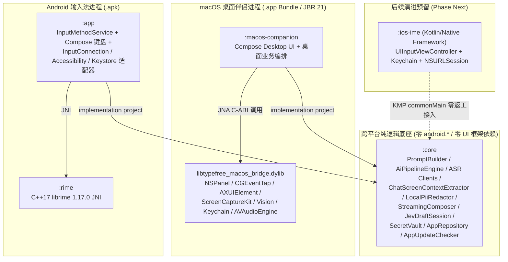
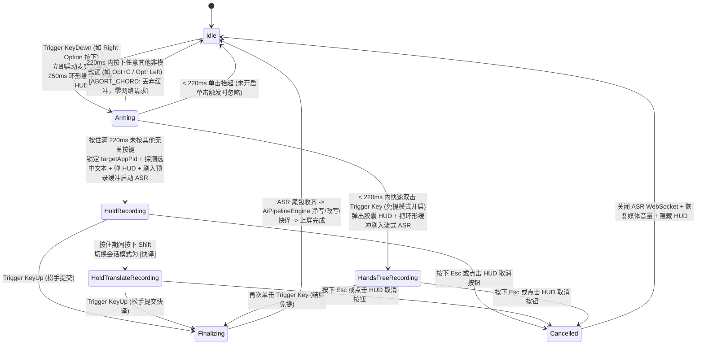
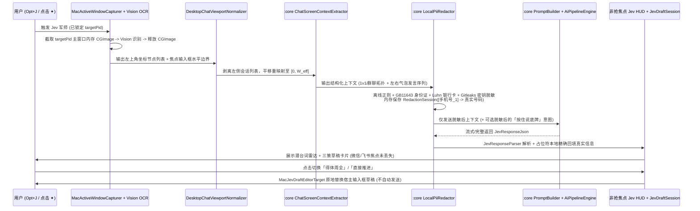

# TypeFree 核心模块解耦与 macOS 桌面伴侣版开发设计方案书

- **文档基线版本**：TypeFree v3.5.1（Kotlin 2.0 + Jetpack Compose 1.7）
- **目标演进版本**：TypeFree v3.6.0（Multi-Module Core + macOS Companion）
- **适用对象**：跨平台客户端研发工程师、编码实现 Agent、独立验收 QA Agent
- **设计约束**：严格基于现有 `:app`（64 个 Kotlin 源文件，约 5.1 万行代码，34 套纯 JVM 单元测试）与 `:rime`（`librime 1.17.0` JNI 模块）真实代码库展开，不引入虚构中间层，不移植传统打字输入法引擎至桌面端。

---

## 第一章 总体架构与多模块解耦方案（`:core` / `:app` / `:macos-companion`）

### 1.1 工程模块划分与构建拓扑

在保留现有 Android `:app` 与 `:rime` 构建链路稳定性的前提下，将单仓工程重构为四层结构（3 个 Gradle 模块 + 1 个受 Gradle 托管编译的 macOS 原生桥接动态库）：

1. **`:core`（纯 Kotlin 跨平台核心模块）**
   - **插件类型**：当前阶段采用 `org.jetbrains.kotlin.jvm`，字节码目标强制锁定为 `JvmTarget.JVM_17`（确保 Android AGP D8/R8 编译器与桌面端 JBR 21 运行时双向兼容，避免 ClassFile Version 65 编译报错）。
   - **职责边界**：承载全部 AI 编排管线（`AiPipelineEngine`、`PromptBuilder`）、流式语音识别客户端（`StreamingAsrClient` 及三家实现）、Jev 军师核心（`ChatScreenContextExtractor`、`JevModels`、`JevResponseParser`、`JevDraftSession`）、端侧隐私脱敏（`LocalPiiRedactor`）、流式上屏状态机（`StreamingComposer`）、配置与密钥仓库抽象（`AppRepository`、`SecretVault`、`UnifiedProviderCatalog`、`EndpointResolver`、`SnippetMatcher`、`Models`）、剪贴板结构化提取（`ClipboardSmartExtractor`、`ClipboardBigBangTokenizer`）及版本检查（`AppUpdateChecker`）。
   - **演进预留**：内部接口严格遵循 Kotlin Multiplatform `commonMain` 编码禁令，后续接入 `:ios-ime` 时仅需将插件切换为 `kotlin("multiplatform")`，将纯逻辑移入 `commonMain`，将 `OkHttp` 传输实现移入 `jvmMain` 并补充 `iosMain`（`NSURLSession`），上层业务代码零改动。

2. **`:app`（Android 宿主与 IME 模块）**
   - **插件类型**：`com.android.application` + `org.jetbrains.kotlin.android` + `org.jetbrains.kotlin.plugin.compose`。
   - **职责边界**：保留 `InputMethodService`、26 键/九宫格 Compose 软键盘 UI、`:rime` JNI 绑定、Android 无障碍读屏节点采集、Android `AudioRecord` 采集、`InputConnection` 编辑器适配器、`AndroidKeystore` 加密实现与 `SharedPreferences` 存储实现。依赖 `:core` 与 `:rime`。

3. **`:rime`（C++17 原生引擎模块，维持现状不改动）**
   - **职责边界**：仅服务于 `:app` 的 `librime 1.17.0` CMake/JNI 编译，不参与 `:core` 与 `:macos-companion` 构建。

4. **`:macos-companion`（macOS 桌面伴侣宿主模块 + 原生桥接库）**
   - **插件类型**：`org.jetbrains.kotlin.jvm` + `org.jetbrains.kotlin.plugin.compose` + `org.jetbrains.compose`（Compose Multiplatform Desktop 1.7.x），运行于捆绑裁剪后的 JetBrains Runtime 21（JBR 21）。
   - **原生桥接子目录（`:macos-companion/native-bridge`）**：采用 Swift 5.10 编写极薄的 `@_cdecl` C-ABI 动态库 `libtypefree_macos_bridge.dylib`，由 Gradle `Exec` 任务调用系统 `swiftc` 编译并打入 App Bundle，Kotlin 侧通过 JNA（`net.java.dev.jna:jna:5.14.0`）直接映射 C 函数指针。相比在 JVM 侧用 JNA 手写脆弱的 `objc_msgSend` 变参调用，C-ABI 桥接能安全封装 `NSPanel` 样式篡改、`CGEventTap` 实时回调、`AXUIElement` 树读写、`ScreenCaptureKit` / `CGWindowListCreateImage` 截图、`Vision` OCR 与 `Security.framework` Keychain 操作。

#### 模块依赖流向图



#### 根工程 `settings.gradle.kts` 调整规范

```kotlin
pluginManagement {
    repositories {
        google()
        mavenCentral()
        gradlePluginPortal()
    }
}

rootProject.name = "TypeFree"
include(":core")
include(":app")
include(":rime")

// 仅在 macOS 开发机或指定 CI 参数时挂载桌面模块，避免 Linux/Windows 纯 Android 编译环境因缺少 swiftc 失败
val enableMacCompanion = System.getProperty("os.name").contains("Mac", ignoreCase = true) ||
    providers.gradleProperty("typefree.enableMacCompanion").orNull == "true"
if (enableMacCompanion) {
    include(":macos-companion")
}
```

---

### 1.2 包名保持策略（零回归迁移原则）

`:app` 现有 64 个源文件与 34 套纯 JVM 单测大量引用 `com.typefree.ime.*` 包路径。为实现**零无意义 Import 改动、零 Git Blame 污染、34 套现有单测 100% 零回归**，严格执行**原包名跨模块保留策略**：

1. **禁止重命名已有核心类包名**：迁入 `:core` 的类继续保留原有的 `com.typefree.ime.network`、`com.typefree.ime.network.asr`、`com.typefree.ime.data`、`com.typefree.ime.ime`、`com.typefree.ime.ime.jev`、`com.typefree.ime.ime.clipboard`、`com.typefree.ime.bubble`、`com.typefree.ime.privacy` 包声明。
2. **避免 Split-Package 冲突（JPMS / R8 安全）**：尽管 Kotlin/JVM 允许不同模块使用相同包名，但提取回 `:app` 的 Android 专属平台适配器统一放入 `.platform` 或保留在 `:app` 对应包下且**类名不重名**（例如 `:core` 保留 `JevDraftSession.kt`，`:app` 拆分出 `InputConnectionDraftTarget.kt`；`:core` 新增纯接口包 `com.typefree.ime.core.spi` 存放跨平台反转接口）。
3. **macOS 新增代码命名空间**：`:macos-companion` 模块内部全部新增代码统一使用 `com.typefree.macos.*`（子包：`ui`、`window`、`hotkey`、`audio`、`ax`、`jev`、`storage`、`sync`、`bridge`），与 `:core` 的 `com.typefree.ime.*` 形成清晰隔离。
4. **单测归属迁移**：原 `:app/src/test` 下针对 `PromptBuilder`、`ChatScreenContextExtractor`、`LocalPiiRedactor`、`StreamingComposer`、`JevResponseParser`、`JevDraftSession`、`ClipboardSmartExtractor`、`SnippetMatcher`、`AppUpdateChecker` 等纯逻辑单测随源码同步迁入 `:core/src/test`，`:app/src/test` 保留 Android 适配器与 IME 状态编排单测，两侧合计单测覆盖率不降反升。

---

### 1.3 面向未来 KMP `commonMain` 的 `:core` 编码禁令

所有进入 `:core` 的新增接口与改造代码必须遵守以下 6 条硬性编码约束，确保日后升级 iOS KMP 时无需二次重构：

| 约束维度 | 严禁在 `:core` 业务层直接使用的 API | 强制替代方案（`:core` 标准接口） |
| :--- | :--- | :--- |
| **1. 平台与 UI 框架** | `android.*`、`androidx.*`、`java.awt.*`、`javax.swing.*`、`dalvik.*` | 通过 `com.typefree.ime.core.spi.*` 纯 Kotlin 接口构造器注入 |
| **2. 时间与单调时钟** | `System.currentTimeMillis()`、`System.nanoTime()`、`java.time.*`、`java.util.Date` | 注入 `ClockProvider` 接口（提供 `nowEpochMillis(): Long` 与 `monotonicMillis(): Long`，默认实现由 `PlatformClock` 提供） |
| **3. 编码与摘要** | `android.util.Base64`、`java.util.Base64`、`java.nio.charset.StandardCharsets` | 统一使用 Kotlin 2.0 标准库 `kotlin.io.encoding.Base64`、`String.encodeToByteArray()` / `ByteArray.decodeToString()` |
| **4. 并发与锁原语** | 新增代码中禁止引入 `java.util.concurrent.*`、`Executors`、`ThreadLocal`、`synchronized` | 统一使用 `kotlinx.coroutines`（`Mutex`、`StateFlow`、`SharedFlow`、`SupervisorJob`）及注入的 `CoroutineDispatchersProvider` |
| **5. 文件与持久化** | 在仓库层直接硬编码 `java.io.File` / `SharedPreferences` | 统一通过 `KeyValueStore` 与 `BinaryBlobStore` 接口读写配置与缓存 |
| **6. 网络与序列化边界** | 禁止在 `AiPipelineEngine` 或上层状态机中暴露 `okhttp3.Response`、`okhttp3.WebSocket`、`com.google.gson.JsonElement` 类型 | **分阶段策略**：业务层仅依赖纯数据类与 `LlmTransportClient` / `StreamingAsrClient` 接口；当前 `:core` 内部保留 `OkHttp` + `Gson` 作为 JVM 默认传输实现（供 Android 与 macOS 直接零成本复用），但将其严格收敛在 `com.typefree.ime.network.transport.okhttp` 包内，不向包外泄露任何第三方网络库类型 |

---

### 1.4 逐文件解耦改造表与核心 SPI 接口定义

#### 逐文件迁移与反转映射表

| 原模块与类路径 (`:app`) | 目标模块与路径 | 耦合诊断 | 抽取的纯接口签名 (`com.typefree.ime.core.spi`) | Android 实现 (`:app`) | macOS 实现 (`:macos-companion`) |
| :--- | :--- | :--- | :--- | :--- | :--- |
| `network/PromptBuilder.kt` | `:core` 同包路径 | 零 `android.*` | 无需新增（核查内部时间/字符串工具符合禁令） | 直接复用 `:core` | 直接复用 `:core` |
| `ime/clipboard/ClipboardSmartExtractor.kt`<br/>`ClipboardBigBangTokenizer.kt` | `:core` 同包路径 | 零 `android.*` | 无需新增 | 直接复用 `:core` | 直接复用 `:core` |
| `data/UnifiedProviderCatalog.kt`<br/>`EndpointResolver.kt`<br/>`SnippetMatcher.kt`<br/>`Models.kt` | `:core` 同包路径 | 极个别平台默认常量 | 将平台设备标识/User-Agent 抽为 `ClientRuntimeMetadata(platformName, appVersion, osVersion)` 值对象 | 传入 `"Android"` + `BuildConfig.VERSION_NAME` | 传入 `"macOS"` + 桌面版本号 |
| `ime/jev/JevModels.kt`<br/>`JevResponseParser.kt` | `:core` 同包路径 | 零 `android.*` | 无需新增 | 直接复用 `:core` | 直接复用 `:core` |
| `network/AppUpdateChecker.kt` | `:core` 同包路径 | 零 `android.*` | 扩展资产过滤参数 `ReleaseAssetSelector(arch, extension)`（默认匹配 `.apk`，桌面端匹配 `.dmg`） | 筛选 `arm64-v8a` / `.apk` | 筛选 `arm64` 或 `x64` 的 `.dmg` |
| `network/AiPipelineEngine.kt`<br/>`network/asr/StreamingAsrClient.kt`<br/>`GeminiLiveTranscribeClient.kt`<br/>`DashScopeStreamingAsrClient.kt`<br/>`VolcengineSaucAsrClient.kt` | `:core` 同包路径 | 基于 `OkHttp` + `Gson`，无 `android.*` | 抽取 `HttpStreamTransport` 与 `WebSocketTransport` 接口；现有 `OkHttp` 实现封装为 `OkHttpTransportFactory` 留驻 `:core` 供双端 JVM 复用 | 共享 `OkHttpClient` 连接池注入 | 共享桌面 `OkHttpClient`（支持系统代理读取）注入 |
| `bubble/ChatScreenContextExtractor.kt`（1,636 行） | `:core` 同包路径 | 仅 1 处 `android.content.Context` 包名转应用名 | `fun interface AppLabelResolver { fun resolveAppName(appIdentifier: String): String? }` | `AndroidPackageLabelResolver(context.packageManager)` | `MacBundleLabelResolver`（映射 Bundle ID 如 `com.tencent.xinWeChat` -> `"微信"`，兜底调 `NSRunningApplication.localizedName`） |
| `privacy/LocalPiiRedactor.kt`（638 行） | `:core` 同包路径 | 可选调用 Android `TextClassifier` | `interface SecondaryNerDetector { suspend fun detectEntities(text: String): List<DetectedPiiSpan> }`（默认值为 `NoOpSecondaryNerDetector`） | `AndroidTextClassifierNerDetector(textClassifier)` | 默认注入 `NoOpSecondaryNerDetector`（纯离线正则+GB11643+Luhn+Gitleaks），预留可选 `NLTagger` 扩展 |
| `ime/jev/JevDraftSession.kt` | `JevDraftSession` + `JevDraftEditorTarget` 迁入 `:core`；`InputConnectionDraftTarget` 拆回 `:app` | 同文件内含 `InputConnection` 适配器 | 沿用现有 `JevDraftEditorTarget` 接口（定义草稿写入、替换上一版草稿、清空草稿、读取当前前缀方法） | `InputConnectionDraftTarget`（位于 `:app/.../ime/jev/`） | `MacJevDraftEditorTarget`（基于 `MacAccessibilityEditorBridge`） |
| `ime/StreamingComposer.kt` | `StreamingComposer` + 桥接接口迁入 `:core`；`InputConnection` 适配器留在 `:app` | 同文件内含 `InputConnection` 适配器 | 沿用/标准化现有 `StreamingEditorBridge` 接口（`onComposingUpdate`、`onCommitFinal`、`onCancelComposing`） | `InputConnectionStreamingBridge`（位于 `:app/.../ime/`） | `MacStreamingBridgeAdapter`（HUD 实时预览 + 终态双通道上屏 / 原生 Cocoa 原地替换） |
| `data/SecretVault.kt` | `:core` 同包路径 | 强绑定 `AndroidKeyStore` | `interface SecretCipher { fun encrypt(keyAlias: String, plaintext: ByteArray): ByteArray; fun decrypt(keyAlias: String, ciphertext: ByteArray): ByteArray }` | `AndroidKeystoreSecretCipher`（AES/GCM/NoPadding 硬件密钥库） | `MacKeychainSecretCipher`（macOS Login Keychain 托管 256-bit 主密钥 + JVM AES-GCM） |
| `data/AppRepository.kt` | 核心配置与热词/口令读写逻辑迁入 `:core`；IME 专属键盘皮肤/震动项拆为扩展或默认项 | 强绑定 `SharedPreferences` | `interface KeyValueStore`（支持原子批量事务读写与 `Flow<Set<String>>` 变更订阅） | `SharedPreferencesKeyValueStore` | `JsonFileKeyValueStore`（存储于 `~/Library/Application Support/TypeFree/config/prefs.json`，`0600` 权限原子替换） |

#### 核心抽取 SPI 接口精确签名（`:core/src/main/kotlin/com/typefree/ime/core/spi/`）

```kotlin
package com.typefree.ime.core.spi

import kotlinx.coroutines.CoroutineDispatcher
import kotlinx.coroutines.flow.Flow

/** 1. 时钟提供者：替代 System.currentTimeMillis() 与 System.nanoTime() */
interface ClockProvider {
    fun nowEpochMillis(): Long
    fun monotonicMillis(): Long
}

/** 2. 协程调度器提供者：便于单测注入 StandardTestDispatcher 及未来 KMP 适配 */
interface CoroutineDispatchersProvider {
    val main: CoroutineDispatcher
    val io: CoroutineDispatcher
    val default: CoroutineDispatcher
}

/** 3. 宿主应用名称解析器：剥离 ChatScreenContextExtractor 对 android.content.Context 的唯一依赖 */
fun interface AppLabelResolver {
    /**
     * @param appIdentifier Android 传入 packageName（如 com.tencent.mm），macOS 传入 bundleIdentifier（如 com.tencent.xinWeChat）
     * @return 人类可读应用名（如 "微信"、"飞书"），未知时返回 null 由调用方回退处理
     */
    fun resolveAppName(appIdentifier: String): String?
}

/** 4. 二级可选命名实体识别器：剥离 LocalPiiRedactor 对 Android TextClassifier 的可选依赖 */
data class DetectedPiiSpan(
    val startInclusive: Int,
    val endExclusive: Int,
    val category: PiiCategory, // PERSON_NAME, ADDRESS, ORGANIZATION, PHONE, CUSTOM
    val confidence: Float
)

enum class PiiCategory { PERSON_NAME, ADDRESS, ORGANIZATION, PHONE, CUSTOM }

interface SecondaryNerDetector {
    suspend fun detectEntities(text: String): List<DetectedPiiSpan>

    object NoOp : SecondaryNerDetector {
        override suspend fun detectEntities(text: String): List<DetectedPiiSpan> = emptyList()
    }
}

/** 5. 平台密钥加解密器：支撑 SecretVault 双端零逻辑分叉 */
interface SecretCipher {
    @Throws(SecurityException::class)
    fun encrypt(keyAlias: String, plaintext: ByteArray): ByteArray

    @Throws(SecurityException::class)
    fun decrypt(keyAlias: String, ciphertext: ByteArray): ByteArray
}

/** 6. 键值配置持久化抽象：支撑 AppRepository 双端复用 */
interface KeyValueStore {
    val changedKeysFlow: Flow<Set<String>>
    fun getString(key: String, defaultValue: String? = null): String?
    fun getBoolean(key: String, defaultValue: Boolean = false): Boolean
    fun getInt(key: String, defaultValue: Int = 0): Int
    fun getLong(key: String, defaultValue: Long = 0L): Long
    fun getStringSet(key: String, defaultValue: Set<String> = emptySet()): Set<String>
    fun edit(block: MutableStoreTransaction.() -> Unit)

    interface MutableStoreTransaction {
        fun putString(key: String, value: String?)
        fun putBoolean(key: String, value: Boolean)
        fun putInt(key: String, value: Int)
        fun putLong(key: String, value: Long)
        fun putStringSet(key: String, value: Set<String>)
        fun remove(key: String)
        fun clear()
    }
}

/** 7. 网络传输边界接口：隔离 OkHttp 以便未来 iOS KMP 切换 NSURLSession */
data class RawHttpRequest(
    val url: String,
    val method: String,
    val headers: Map<String, String>,
    val bodyUtf8: String? = null,
    val connectTimeoutMs: Long = 10_000L,
    val readTimeoutMs: Long = 60_000L
)

interface HttpStreamTransport {
    suspend fun executeUnary(request: RawHttpRequest): RawHttpResponse
    suspend fun executeServerSentEvents(
        request: RawHttpRequest,
        onEventData: suspend (dataLine: String) -> Boolean
    )
}

data class RawHttpResponse(
    val statusCode: Int,
    val headers: Map<String, List<String>>,
    val bodyUtf8: String
)
```

---

## 第二章 macOS 桌面伴侣版核心子系统详细设计

### 2.1 子系统 A · 非抢焦点悬浮 HUD 与菜单栏宿主

#### 2.1.1 核心痛点与焦点防抢夺机理
在 Compose Multiplatform Desktop（底层基于 AWT/JBR `AWTWindow`）中，即使声明 `Window(undecorated = true, transparent = true, alwaysOnTop = true, focusable = false)`，一旦用户用鼠标点击悬浮胶囊上的「取消」或 Jev 军师的「三策草稿卡片」，macOS AppKit 默认仍会向窗口发送 `makeKeyAndOrderFront:` 或触发进程激活，导致当前活跃的微信、飞书或 Cursor 输入框瞬间失去焦点（光标消失、选区丢失，甚至触发宿主失焦收起输入框）。

为彻底根除焦点抢夺，采用**「进程激活策略隔离 + 原生 `NSPanel` 非激活样式桥接 + 前台宿主 PID 锚定」三保险机制**：

1. **进程级激活策略控制（`NSApplicationActivationPolicy`）**
   - 应用启动默认执行 `NSApp.setActivationPolicy(.accessory)`（同时 `Info.plist` 设置 `LSUIElement = true`）：不显示 Dock 图标，不参与 `Cmd+Tab` 应用切换，点击其非激活面板不会把宿主应用挤出 `active` 状态。
   - 仅当用户主动打开「偏好设置 / API 密钥配置 / 权限向导」标准窗口时，临时切换为 `.regular` 并调用 `NSApp.activate(ignoringOtherApps: true)` 以支持正常的中文输入法打字与 `Cmd+V` 粘贴密钥；当设置窗口全部关闭时，立即切回 `.accessory`，并将焦点归还给先前记录的宿主进程。

2. **窗口级 `NSPanel` 原生改造（`libtypefree_macos_bridge.dylib`）**
   - 在 Compose `Window` 完成 `addNotify()` 创建底层 AppKit 窗口指针后，通过 JNA 获取 `ComposeWindow` 的原生窗口句柄（通过 `awt.peer` 反射读取 `CPlatformWindow.ptr` 或通过唯一窗口标题在 `NSApp.windows` 中匹配，JBR 21 下 `java.desktop/sun.lwawt` + `sun.lwawt.macosx` 通过 JVM 启动参数 `--add-opens` 稳定暴露 `nsWindowPtr`）。
   - 在 JBR 21 中，当 AWT 窗口初始化前设置 `focusableWindowState = false` 且 `type = Window.Type.POPUP` 时，底层实例化的已经是 `NSPanel` 子类 `AWTWindow_Panel`；Swift 桥接层对该指针执行强校验与属性覆写：

```swift
// :macos-companion/native-bridge/Sources/WindowBridge.swift
import AppKit

@_cdecl("tf_configure_nonactivating_hud_panel")
public func tfConfigureNonActivatingHudPanel(nsWindowPtr: UnsafeMutableRawPointer) -> Bool {
    let rawObj = Unmanaged<AnyObject>.fromOpaque(nsWindowPtr).takeUnretainedValue()
    guard let window = rawObj as? NSWindow else { return false }

    DispatchQueue.main.sync {
        // 1. 注入 NonactivatingPanel 掩码 (1 << 7)，确保鼠标点击绝不激活本进程、不抢夺外部焦点
        window.styleMask.insert(.nonactivatingPanel)
        window.styleMask.insert(.borderless)

        // 2. 如果是 NSPanel 子类，开启浮动与按需 Key 属性
        if let panel = window as? NSPanel {
            panel.isFloatingPanel = true
            panel.becomesKeyOnlyIfNeeded = true
            panel.worksWhenModal = true
        }

        // 3. 层级高于全屏应用与普通浮窗 (NSPopUpMenuWindowLevel = 101)
        window.level = .popUpMenu
        window.collectionBehavior = [
            .canJoinAllSpaces,
            .fullScreenAuxiliary,
            .stationary,
            .ignoresCycle
        ]
        window.isOpaque = false
        window.backgroundColor = .clear
        window.hasShadow = true
        window.hidesOnDeactivate = false
    }
    return true
}
```

3. **前台宿主 PID 实时跟踪器（`FrontmostHostTracker`）**
   - 注册 `NSWorkspace.shared.notificationCenter` 监听 `NSWorkspace.didActivateApplicationNotification`。
   - 每当激活的 `NSRunningApplication.processIdentifier != ProcessInfo.processInfo.processIdentifier` 时，原子更新 `lastActiveExternalApp(pid, bundleId, localizedName)`。
   - 后续全部 `AXUIElement` 读写、窗口截图与按键注入均直接锁定 `lastActiveExternalApp.pid`，绝不在点击 HUD 瞬间临时查询 `frontmostApplication`，从根源上消除竞态。

#### 2.1.2 菜单栏常驻与悬浮胶囊状态机
- **菜单栏宿主（`NSStatusItem`）**：使用原生 `NSStatusBar.system.statusItem` 挂载单色矢量模板图标（自动适配 macOS 浅色/深色菜单栏），点击弹出原生 `NSMenu`，提供：当前模式指示、快捷呼叫 `✦ Jev 军师`、切换默认模型提供商、打开设置中心、权限状态自检、检查更新、退出。
- **HUD 形态与定位策略**：
  - `Hidden`：平时完全隐藏（设置窗口帧移出或 `orderOut(nil)`，零 GPU 合成开销）。
  - `VoiceCapsule`（`280dp × 48dp`）：录音/转写态，展示 30fps 音频声波、实时流式字幕预览、当前模式徽章（`净写` / `改写` / `快译`）与取消按钮。优先跟随当前输入框光标矩形正下方 `12pt` 处（通过 `kAXBoundsForRangeParameterizedAttribute` 获取）；若目标应用不支持光标坐标查询，则定位于鼠标所在显示器（`NSScreen`）底部居中上方 `96pt`，并执行 `NSScreen.visibleFrame` 边缘防溢出夹紧。
  - `JevStrategistCard`（`420dp × 自适应高度，最大 520dp`）：展示目标应用徽章 + `已端侧脱敏 N 项` 绿盾标识、潜台词雷达摘要、三策可点击卡片（`[得体周全]` / `[直接推进]` / `[幽默化解]`，点击即通过 `JevDraftSession` 预览注入宿主输入框且不失焦）、底部 `[按住说底牌]` 语音重生成按钮与关闭按钮。

---

### 2.2 子系统 B · 全局快捷键与低延迟音频采集管线

#### 2.2.1 全局热键状态机（`MacHotkeyController`）
通过 `CGEvent.tapCreate(tap: .cgSessionEventTap, place: .headInsertEventTap, options: .listenOnly 或 .defaultTap, ...)` 监听全局键盘事件（包括独立修饰键如 `Right Option` / `Fn` 的 `flagsChanged` 事件，以及普通组合键如 `Option + Space`、`Option + J`）。当辅助功能尚未授权时，自动降级为 Carbon `RegisterEventHotKey` 以保证组合键可用。

为防止用户日常使用 `Option + 方向键`（跳词）或 `Option + 字母`（输入特殊符号）时误触发语音录音，状态机内置 **`220ms` 组合键防误触守卫（Chord Cancellation Guard）** 与 **`250ms` 预录环形缓冲区（Pre-roll Ring Buffer）**：



**会话路由判定规则（在进入 `HoldRecording` / `HandsFreeRecording` 瞬间自动决策）**：
1. 读取宿主当前选中文本 `selectedText = editorBridge.readSelectedText(allowClipboardFallback = false)`：
   - 若 `selectedText` 非空且用户未切入快译键：自动进入 **「跨应用选中文本语音改写」** 模式（对应 `PromptBuilder` 改写分支：将 `selectedText` 作为原文，用户口述内容如“语气改委婉一点”作为指令）。
   - 若 `selectedText` 非空且用户按下了快译组合键（如 `Option + Shift + Space`）：若直接松手未说话则直接执行文本快译；若按住说话则按语音补充要求快译。
   - 若 `selectedText` 为空：默认进入 **「流式口述净写」**（或按住加 `Shift` 进入 **「语音同传快译」**），先匹配 `SnippetMatcher`（支持 `;xx` 口令短语或语音口令展开）与个人热词库，再经 `AiPipelineEngine` 输出结果。
2. 独立快捷键（默认 `Option + J`）：直接触发 **「`✦ Jev 军师` 窗口读屏」** 管线。

> **macOS `CGEventTap` 超时断连自愈机制**：若主线程偶发阻塞导致 macOS 内核向回调发送 `kCGEventTapDisabledByTimeout` 或 `kCGEventTapDisabledByUserInput`，C-ABI 回调内立即调用 `CGEvent.tapEnable(tap: eventTap, enable: true)` 原地重连，确保常驻数天热键永不静默失效。

#### 2.2.2 低延迟 `16kHz` 音频采集、耳语增益与媒体避让
1. **重采样与帧切分规格**
   - 首选原生 `AVAudioEngine`（通过 `libtypefree_macos_bridge.dylib` 封装，监听 `AVAudioEngineConfigurationChange` 自动无感处理 AirPods 蓝牙耳机插拔切换），备选 `javax.sound.sampled.TargetDataLine`。
   - 硬件输入节点（通常为 `48kHz` 或蓝牙 HFP `24kHz` Float32）经 `AVAudioConverter` 实时重采样为标准 **`16,000 Hz, 16-bit Signed PCM Little-Endian, Mono`**。
   - 每 `20ms`（`320 samples` = `640 bytes`）回调一次 Kotlin 层 `AudioFrameConsumer`，由缓冲聚合器按当前选用的 `StreamingAsrClient` 最优分片（如 `100ms` = `3,200 bytes`）推入 `GeminiLiveTranscribeClient`、`DashScopeStreamingAsrClient` 或 `VolcengineSaucAsrClient`。

2. **耳语软限幅增益算法（`WhisperSoftLimiterProcessor`，纯 Kotlin 编写，单测 100% 可覆盖）**
   - 针对开放办公区用户压低声音口述（输入电平仅 `-38 dBFS ~ -24 dBFS`）的场景，对每个 `20ms` PCM 帧执行三段式 DSP 处理：
     - **噪声门限（Noise Gate）**：计算帧 RMS 分贝 $L_{\text{dB}} = 20 \log_{10}(\text{rms} / 32768.0)$；低于 `-52 dBFS` 时保持 `1.0x` 增益（不放大环境空调底噪）。
     - **自适应包络增益（AGC）**：当 $-52\text{ dBFS} \le L_{\text{dB}} < -18\text{ dBFS}$ 时，目标电平锚定 `-16 dBFS`，最大增益上限锁定为 `+12 dB`（即线性倍数 $G_{\max} = 3.98$），采用快起慢放平滑滤波（`attack = 5ms` 防止爆破音削顶，`release = 160ms` 防止字间呼吸抽吸效应）。
     - **双曲正切软限幅（Soft-Knee Limiter）**：增益放大后的归一化样本 $x \in (-\infty, +\infty)$ 在 $|x| > 0.707$（`-3 dBFS`）区间进入软饱和曲线：
       $$y = \tanh(x) \times 32767$$
       彻底杜绝硬截断削波失真（Hard Clipping），同时向 UI 发射平滑后的 `0.0f..1.0f` 音量包络驱动声波动画。

3. **macOS 系统媒体播放避让（`MacMediaDuckController`）**
   - 录音启动（越过 `220ms` 防误触阈值后）时，若用户开启「录音时自动压低系统媒体音量」：通过 CoreAudio `AudioObjectGetPropertyData` 读取默认输出设备（`kAudioHardwarePropertyDefaultOutputDevice`）的当前主音量 $V_0$（`kAudioHardwareServiceDeviceProperty_VirtualMainVolume`）。
   - 若 $V_0 > 0.12$ 且未静音，则在 `80ms` 内线性衰减至 $V_{\text{duck}} = V_0 \times 0.25$（约压低 `-12 dB`）；录音结束或取消时，在 `200ms` 内平滑恢复至 $V_0$（若录音期间用户手动调节了系统音量，检测到当前音量 $\neq V_{\text{duck}}$，则尊重用户手动操作放弃覆盖）。
   - 注册 JVM `Runtime.getRuntime().addShutdownHook`，确保进程异常退出时强制还原 $V_0$，绝不遗留系统低音量故障。

---

### 2.3 子系统 C · 跨应用文本注入、流式上屏与选中文本改写（`MacAccessibilityEditorBridge`）

#### 2.3.1 桌面宿主兼容性差异与预处理
macOS 各大应用对 Accessibility（`AXUIElement`）的支持程度存在显著分化：
- **原生 AppKit 控件（Apple 备忘录、TextEdit、Xcode、Safari 原生输入框）**：完整支持 `kAXValueAttribute`、`kAXSelectedTextAttribute`（可读写）与 `kAXSelectedTextRangeAttribute`（可读写），直接改写属性即可原子替换选区并移动光标。
- **Electron / Chromium 内核应用（VS Code、Cursor、飞书桌面版、Chrome / Edge 网页富文本框）**：
  1. 默认惰性关闭无障碍树：必须在首次附着目标 `targetPid` 时调用 `AXUIElementSetAttributeValue(appRef, "AXManualAccessibility" as CFString, kCFBooleanTrue)` 唤醒渲染进程无障碍树（注：严格使用 `AXManualAccessibility` 而非 `AXEnhancedUserInterface`，避免破坏 Rectangle/Magnet 等第三方分屏工具的窗口布局钩子）。
  2. 只读陷阱：虽然唤醒后能准确**读取** `kAXSelectedTextAttribute` 与光标坐标，但在 Monaco Editor 或 ProseMirror/React `contenteditable` 中直接调用 `AXUIElementSetAttributeValue(..., kAXSelectedTextAttribute, ...)` 往往返回 `kAXErrorAttributeUnsupported`，或虽修改了 DOM 文本却未触发 JS `beforeinput`/`input` 事件导致内部状态撕裂。
- **微信 macOS 桌面版（`com.tencent.xinWeChat`）**：聊天输入框可读取 `kAXValueAttribute` 与 `kAXSelectedTextAttribute`，但在包含 `@群成员` 富文本 Token 或多段换行时，剪贴板粘贴通道（`Cmd+V`）对微信内部消息草稿状态的兼容性最稳健。

#### 2.3.2 双通道读写降级状态机设计

```mermaid
flowchart TD
    Start["请求读取选中文本 / 注入文本 (锁定 targetPid)"] --> Wake["对 Electron/Chromium 宿主设置<br/>AXManualAccessibility = true"]
    Wake --> OpType{"操作类型?"}

    %% 读取分支
    OpType -->|读取选中文本 readSelectedText| ReadAX["通道 1: 读取焦点元素 kAXSelectedTextAttribute"]
    ReadAX --> CheckRead{"AXError == .success<br/>且文本非空?"}
    CheckRead -->|是| ReturnText["直接返回选中文本 (零剪贴板触碰)"]
    CheckRead -->|否, 且允许剪贴板回退| CheckRange["检查 kAXSelectedTextRangeAttribute.length"]
    CheckRange -->|length == 0 明确无选区| ReturnEmpty["返回空字符串 (避免无选区误发 Cmd+C 触发终端中断)"]
    CheckRange -->|属性不支持或 length > 0| CopyFallback["通道 2: 快照备份 NSPasteboard 全部 Flavor -> 标记 TransientType<br/>-> 向前台发送模拟 Cmd+C -> 轮询 changeCount (<=80ms) -> 读取文本 -> 立即还原快照"]
    CopyFallback --> ReturnText

    %% 写入分支
    OpType -->|写入/替换文本 injectText| CheckBlacklist{"宿主在剪贴板优先名单?<br/>(微信 / Electron / 浏览器富文本)"}
    CheckBlacklist -->|否 (原生 Cocoa 如备忘录)| CheckSettable["检测 AXUIElementIsAttributeSettable(kAXSelectedTextAttribute)"]
    CheckSettable -->|true| WriteAX["通道 A: 记录注入前 UTF-16 Range -> 设置 kAXSelectedTextAttribute<br/>-> 复核注入后光标/长度变化"]
    WriteAX --> VerifyAX{"AXError == .success<br/>且值或光标已推进?"}
    VerifyAX -->|是| Done["注入成功"]
    VerifyAX -->|否| PasteChannel
    CheckSettable -->|false| PasteChannel
    CheckBlacklist -->|是| PasteChannel

    PasteChannel["通道 B: 快照备份 NSPasteboard 全部 Item/Type (记录 baselineChangeCount)<br/>-> 写入目标 UTF-8 文本 + 附加 org.nspasteboard.TransientType & AutoGeneratedType<br/>-> 记录 injectedChangeCount -> 发送 CGEvent Cmd+V (keyCode 0x09)<br/>-> 延迟 120ms 校验当前 changeCount == injectedChangeCount 后还原原剪贴板快照"] --> Done
```

**剪贴板无痕保护的三项关键工程约束**：
1. **剪贴板历史管理器静默协议**：写入临时粘贴文本时，必须同时在 `NSPasteboardItem` 中写入类型 `org.nspasteboard.TransientType` 与 `org.nspasteboard.AutoGeneratedType`（遵循 `nspasteboard.org` 社区标准），使 Raycast、Paste、Maccy 等剪贴板增强工具自动忽略本次临时写入，绝不污染用户的剪贴板历史列表。
2. **多格式完整快照（`PasteboardSnapshot`）**：备份原剪贴板时，遍历 `NSPasteboard.general.pasteboardItems` 保存每一个 Item 的全部 `NSPasteboard.PasteboardType` 及其原始 `Data`（涵盖纯文本、HTML、RTF、截图 `public.png`/`public.tiff` 以及 Finder 复制的文件引用 `public.file-url`），而非仅备份纯文本。
3. **`120ms` 还原窗口防覆盖校验**：Electron 应用在收到模拟 `Cmd+V` 按键事件后，渲染进程异步读取 `NSPasteboard` 通常耗时 `15ms–60ms`。因此等待 `120ms` 后再执行快照还原；在还原瞬间必须比对 `pasteboard.changeCount == injectedChangeCount`——若用户在 `120ms` 内恰好手动执行了新的复制操作导致 `changeCount` 已递增，则放弃还原，绝不覆盖用户的新剪贴板内容。

#### 2.3.3 对接 `:core` 的 `StreamingComposer` 与 `JevDraftSession`

1. **`StreamingComposer` 对接策略（`MacStreamingBridgeAdapter`）**
   - 在 Android 输入法中，`InputConnection.setComposingText` 可每秒更新数十次下划线预编辑文本且不污染宿主 Undo 栈；而在 macOS 桌面端，若对微信或 VS Code 每秒发送数十次「模拟退格/选区 + `Cmd+V`」，会打爆编辑器的 `Cmd+Z` 撤销历史并引发界面剧烈闪烁。
   - **分级流式策略**：
     - **通用安全模式（默认开启，适用微信、飞书、VS Code、浏览器等全部宿主）**：`StreamingComposer` 的 `onComposingUpdate(composingText)` 实时驱动紧贴光标的**悬浮胶囊 HUD 双行流式预览字幕**（延迟 `<16ms`，宿主 Undo 栈零污染）；当用户松开热键、`StreamingComposer` 经 `AiPipelineEngine` 口语顺滑后回调 `onCommitFinal(finalText)` 时，通过 `MacAccessibilityEditorBridge` 执行**单次原子上屏**（若会话起始处于「选中文本语音改写」模式，该单次上屏直接覆盖原选区文本）。
     - **原生 Cocoa 原地预编辑模式（仅对通过 `AXSettable` 白名单校验的原生 `NSTextView` 如备忘录可选开启）**：在会话开始时读取 `kAXSelectedTextRangeAttribute` 记录起始锚点 `anchorLocation`（注意：`AXUIElement` 的 `CFRange` 严格以 **UTF-16 Code Unit** 计数，与 Kotlin `String.length` 完全一致，含 Emoji 代理对如 `😀` 计为 2 而非 1）；每次 `onComposingUpdate(text)` 先设置 `kAXSelectedTextRangeAttribute = CFRange(anchorLocation, lastInjectedUtf16Len)`，再写入 `kAXSelectedTextAttribute = text`，并更新 `lastInjectedUtf16Len = text.length`。一旦中途检测到 `AXError != .success` 或用户手动移动了光标，立即自动切回 HUD 预览模式。

2. **`JevDraftSession` 对接策略（`MacJevDraftEditorTarget`）**
   - 用户在 Jev 军师卡片上先后点击「策略一：得体周全」与「策略二：直接推进」时，预期行为是将宿主输入框中的策略一草稿**无损替换**为策略二草稿，且**绝不自动发送回车（严禁合成 `Return` / `0x24` 按键事件）**。
   - `MacJevDraftEditorTarget` 实现 `JevDraftEditorTarget` 状态追踪：
     - 维护 `lastInjectedDraft: String?` 与 `draftAnchorUtf16Offset: Int?` 以及会话接管前的输入框快照 `initialInputValue: String?`。
     - **首次点击策略卡注入**：读取当前输入框 `kAXValueAttribute` 记录 `initialInputValue`，调用双通道注入 `draft1`，记录 `lastInjectedDraft = draft1`。
     - **切换策略卡替换草稿（`draft1 -> draft2`）**：
       - **分支 1（支持 `kAXSelectedTextRangeAttribute` 写入的宿主）**：校验当前 `kAXValueAttribute` 在 `[draftAnchorUtf16Offset, draftAnchorUtf16Offset + draft1.length]` 子串仍等于 `draft1`，将该区间设为当前选区后直接注入 `draft2` 覆盖。
       - **分支 2（微信桌面版 / Electron 聊天框等不支持 AX 设选区的宿主）**：读取 `kAXValueAttribute`；若当前输入框全文恰好等于 `draft1`（即注入前输入框为空，占聊天回复场景 95% 以上），向目标窗口发送限定焦点的 `Cmd+A`（全选输入框）紧接通道 B 粘贴 `draft2`，实现毫秒级整框干净替换；若注入前输入框已有用户手写前缀 `prefix` 且当前值为 `prefix + draft1`，则一次性粘贴合成后的 `prefix + draft2`（配合 `Cmd+A`），彻底规避逐字符模拟 `Backspace` 在中英 Emoji 混排下因字素簇（Grapheme Cluster）计数差异导致的删多或删少问题。

---

### 2.4 子系统 D · macOS 端 `✦ Jev 军师` 零跳出窗口读屏与端侧 OCR

#### 2.4.1 隐私边界受控的焦点宿主单窗口截取（`MacActiveWindowCapturer`）
桌面显示器通常同时平铺多个窗口（例如左侧微信、右侧密码管理器或终端）。`✦ Jev 军师` **严禁执行全屏截图**，只截取当前锁定的 `targetPid` 最前端活跃主窗口：

1. **目标窗口定位与过滤**：
   - 调用 `CGWindowListCopyWindowInfo([.optionOnScreenOnly, .excludeDesktopElements], kCGNullWindowID)` 获取按 Z-Order 从前到后排列的屏幕窗口元数据数组。
   - 匹配首条满足以下全部条件的窗口记录，提取其 `kCGWindowNumber`（`CGWindowID`）与逻辑像素包围盒 `windowBoundsPt`：
     - `kCGWindowOwnerPID == targetPid`
     - `kCGWindowLayer == 0`（标准文档/聊天窗口层级，自动剔除菜单、Tooltip、悬浮面板与桌面壁纸）
     - `bounds.width >= 240 && bounds.height >= 200` 且 `kCGWindowAlpha > 0.1`
2. **纯内存位图捕获（零磁盘落盘）**：
   - macOS 14.0+ 优先通过 `ScreenCaptureKit` 的 `SCShareableContent.excludingDesktopWindows(true, onScreenWindowsOnly: true)` 匹配对应 `SCWindow`，构建 `SCContentFilter(desktopIndependentWindow: scWindow)`，调用 `SCScreenshotManager.captureImage(contentFilter:configuration:)`（配置 `showsCursor = false`、`capturesAudio = false`、原始 Retina 物理分辨率）；macOS 13 回退使用 `CGWindowListCreateImage(.null, .optionIncludingWindow, windowID, [.boundsIgnoreFraming, .bestResolution])`。
   - 产出的 `CGImage` 仅驻留原生堆内存供紧随其后的 `Vision` 请求消费，**禁止调用任何 `PNG/JPEG` 文件写入 API**，OCR 完成后在 `defer` 块中立即释放位图引用。

#### 2.4.2 `Vision.framework` 端侧 OCR 与精确坐标换算公式
1. **Vision 识别配置**：
   - 构建 `VNRecognizeTextRequest`，设置：
     - `recognitionLevel = .accurate`
     - `recognitionLanguages = ["zh-Hans", "zh-Hant", "en-US"]`
     - `usesLanguageCorrection = true`
     - `minimumTextHeight = 0.008`（确保高分屏大窗口下微信群聊昵称、群头衔徽章及时间戳小字完整检出，供 `:core` 的群头衔去噪器消费）

2. **Vision 左下角归一化坐标 -> `RawScreenTextNode` 左上角像素坐标精确换算**：
   - `VNRecognizedTextObservation.boundingBox` 返回 `CGRect(x: x_v, y: y_v, width: w_v, height: h_v)`，其坐标系原点位于图像**左下角（Bottom-Left）**，$X$ 轴向右归一化至 $[0, 1]$，$Y$ 轴**向上**归一化至 $[0, 1]$。
   - `:core` 的 `ChatScreenContextExtractor` 输入模型 `RawScreenTextNode` 严格采用屏幕阅读顺序的**左上角原点（Top-Left）整数坐标系**，$X$ 轴向右，$Y$ 轴**向下**，满足 $0 \le \text{left} < \text{right} \le W$ 且 $0 \le \text{top} < \text{bottom} \le H$。
   - 设截取位图的物理像素宽高为 $(W_{\text{px}}, H_{\text{px}})$，窗口的逻辑点宽高为 $(W_{\text{pt}}, H_{\text{pt}})$，Retina 缩放因子 $s = W_{\text{px}} / W_{\text{pt}}$（通常为 `2.0` 或 `1.0`）。为消除不同外接显示器 DPI 差异并对齐 Android 端密度基准，统一先在逻辑点尺度放大固定基准系数 $k = 2.0$（即目标虚拟画布尺寸 $W_0 = \text{round}(2.0 \times W_{\text{pt}})$，$H_0 = \text{round}(2.0 \times H_{\text{pt}})$），对每个置信度 $\text{confidence} \ge 0.35$ 的 `topCandidates(1).first` 执行裁剪与换算：

$$\begin{aligned}
x_{\min} &= \min\big(1.0,\ \max(0.0,\ x_v)\big), & x_{\max} &= \min\big(1.0,\ \max(0.0,\ x_v + w_v)\big) \\
y_{\min} &= \min\big(1.0,\ \max(0.0,\ y_v)\big), & y_{\max} &= \min\big(1.0,\ \max(0.0,\ y_v + h_v)\big)
\end{aligned}$$

$$\begin{aligned}
\text{left} &= \text{round}(x_{\min} \times W_0) \\
\text{right} &= \text{round}(x_{\max} \times W_0) \\
\text{top} &= \text{round}\big((1.0 - y_{\max}) \times H_0\big) \\
\text{bottom} &= \text{round}\big((1.0 - y_{\min}) \times H_0\big)
\end{aligned}$$

   - **合法性过滤**：若换算后 $\text{right} - \text{left} < 2$ 或 $\text{bottom} - \text{top} < 2$ 或识别文本 `trim()` 为空，直接丢弃该噪声框。

3. **桌面多栏聊天窗口视口裁剪归一化（`DesktopChatViewportNormalizer`）**：
   - **桌面端关键几何差异**：手机端聊天窗口占满 100% 宽度，左侧气泡贴近 $x \approx 0$；而微信/飞书/网页 IM 桌面版大多采用**「左侧会话列表栏（约占窗口宽度 $20\%\sim 38\%$）+ 右侧当前聊天主视口（有时最右侧还带群成员侧边栏）」**的双栏或三栏布局。若将整窗 `[0, W_0]` 直接喂入 `ChatScreenContextExtractor`，左侧最近联系人列表会被误判为对方发来的聊天气泡，且真正的对方气泡因起始横坐标位于 $0.32 W_0$ 附近会影响左右聚类中心。
   - **两级视口归一化算法（在不改动 `:core` 聚类核心的前提下完美对齐输入分布）**：
     - **优先通道（AX 容器定界）**：尝试通过 `AXUIElement` 查找目标窗口内包含焦点输入框（`kAXFocusedUIElementAttribute`）的纵向父级面板列（`AXSplitGroup` 子列或输入框自身的 `[inputLeft, inputRight]` 水平投影区间）。在微信与飞书桌面版中，底部聊天输入框的左右边界 `[inputLeft, inputRight]` 与上方聊天消息滚动区的左右边界**严格上下对齐**（误差 `< 16pt`）！
     - **兜底通道（纯几何分栏空白带检测）**：当目标窗口无焦点输入框（例如浏览器只读查看）时，在 $x \in [0.16 W_0,\ 0.42 W_0]$ 区间扫描纵向贯穿度 $> 75\%$ 的无文字空白分割带（Gutter），定位分栏线 $X_{\text{split}}$；若未检出分栏（如微信独立弹出的单聊小窗口），则 $X_{\text{split}} = 0$。
     - **坐标平移重映射**：剔除 $R \le X_{\text{split}}$（左侧会话列表）及 $T \ge Y_{\text{inputTop}}$（底部待发送草稿区）的节点，对保留在聊天主视口 $[X_{\text{split}},\ X_{\text{paneRight}}]$ 内的全部节点执行水平重定原点：
       $$\text{left}' = \max(0,\ \text{left} - X_{\text{split}}),\quad \text{right}' = \min(W_{\text{eff}},\ \text{right} - X_{\text{split}}),\quad W_{\text{eff}} = X_{\text{paneRight}} - X_{\text{split}}$$
     - 重映射后的 `List<RawScreenTextNode>` 连同有效宽高 $(W_{\text{eff}}, H_{\text{inputTop}})$ 在几何拓扑上与手机单屏聊天页完全同构，直接送入 `:core` 的 `ChatScreenContextExtractor` 即可高精度完成左右说话人聚类、群头衔去噪与 `PRIVATE_1V1 / GROUP_INVOLVED_PARTY / GROUP_BYSTANDER` 三态推导。

#### 2.4.3 端到端脱敏与回填闭环管线



---

### 2.5 子系统 E · 凭证安全存储、跨端配置同步、版本检查与权限向导

#### 2.5.1 macOS Keychain 对接 `SecretVault`（单主密钥信封加密）
若将 `UnifiedProviderCatalog` 中十余家厂商的 API Key 逐条存为独立的 Keychain 条目，应用版本升级或重签名时极易触发多次系统钥匙串授权弹窗。因此 `MacKeychainSecretCipher` 采用**「Keychain 托管单主密钥 + 内存缓存 AES-256-GCM 信封加密」**方案：
1. 首次调用时，通过 `Security.framework` 查询 `kSecClassGenericPassword`（`kSecAttrService = "com.typefree.macos.companion"`，`kSecAttrAccount = "vault_master_key_v1"`）。
2. 若不存在，使用 `SecureRandom` 生成 `32 bytes`（256-bit）随机主密钥，设置 `kSecAttrAccessible = kSecAttrAccessibleAfterFirstUnlockThisDeviceOnly` 写入用户登录钥匙串；若已存在，读取入进程内存（整个生命周期仅访问一次 Keychain）。
3. `encrypt(keyAlias, plaintext)` 与 `decrypt(keyAlias, ciphertext)` 使用 `javax.crypto.Cipher`（`AES/GCM/NoPadding`，每次加密生成随机 `12-byte IV`，并将 `keyAlias.encodeToByteArray()` 作为 GCM `AAD` 附加认证数据防止跨槽位密文篡改替换），密文 Base64 编码后通过 `:core` 的 `SecretVault` 持久化在 `~/Library/Application Support/TypeFree/config/vault.json`（文件权限强制 `PosixFilePermissions.fromString("rw-------")`）。

#### 2.5.2 跨端加密配置同步（与 Android 端互通）
定义平台无关的导出/WebDAV 同步包格式 `TypeFreeSyncPayloadV1`（JSON 序列化后可明文导出非敏感词库，或全包加密含 API Vault）：
- **同步范围**：
  1. 个人热词词典（ASR 偏置与 `PromptBuilder` 热词注入列表）
  2. 口令短语库（`SnippetMatcher` 的 `;xx` 快捷短语条目）
  3. 模型提供商路由配置与自定义 Endpoint（`UnifiedProviderCatalog` 配置项）
  4. 可选勾选：API 密钥库（`SecretVault` 导出的明文在离端前强制使用用户设定的 **同步主口令 Sync Passphrase** 执行 `PBKDF2-HMAC-SHA256`（`210,000` 次迭代 + `16-byte` 随机盐）派生密钥并经 `AES-256-GCM` 加密封装，Android 端与 macOS 端通过同一口令解密后各自重新存入本机 Keystore / Keychain，两侧硬件密钥永不外泄）。
- **传输方式**：
  1. **本地文件导入/导出**：支持 `.tfsync` 文件拖拽导入导出（可通过 AirDrop / 微信文件传输助手在手机与 Mac 间秒传）。
  2. **WebDAV 云同步（支持坚果云、Nextcloud、群晖、Alist）**：在 `:core` 中基于 `HttpStreamTransport` 实现轻量 `WebDavSyncClient`（`MKCOL` / `PUT` / `GET`），采用词条级时间戳（`updatedAtEpochMs` + 墓碑标记 `deleted = true`）执行双向增量合并，避免双端增删热词互相覆盖。

#### 2.5.3 复用 `AppUpdateChecker` 实现桌面端版本检查
- `:core` 中的 `AppUpdateChecker` 请求 `[https://api.github.com/repos/dengxuezhao/TypeFree/releases/latest](https://api.github.com/repos/dengxuezhao/TypeFree/releases/latest)`，保留现有语义化版本比对算法。
- 新增 `AssetMatcher` 策略参数：macOS 端根据 `System.getProperty("os.arch")`（`aarch64` 对应 Apple Silicon `arm64`，`x86_64` 对应 Intel `x64`）在 Release `assets` 数组中匹配 `TypeFree-macOS-arm64-*.dmg`（或通用包），在菜单栏展示红点提示与更新日志，点击调用 `NSWorkspace.shared.open(downloadUrl)`。

#### 2.5.4 三项系统权限向导与 DMG 签名公证
1. **首次启动渐进式权限向导（`PermissionOnboardingViewModel`）**：

| 权限项 | 原生检测 API | 触发授权与系统设置深链 | 授权策略与异常处理 |
| :--- | :--- | :--- | :--- |
| **1. 辅助功能（必选）**<br/>用于全局热键、读取选区与文本注入 | `AXIsProcessTrusted()` | `AXIsProcessTrustedWithOptions([kAXTrustedCheckOptionPrompt: true])`<br/>深链：`x-apple.systempreferences:com.apple.preference.security?Privacy_Accessibility` | 向导页开启 `1s` 轮询，授权后自动绿勾亮起；**覆盖升级签名失效处理**：若检测到用户刚升级版本且勾选框假死，引导在系统设置中先 `-` 移除旧条目再重新开关，或提供复制 `tccutil reset Accessibility com.typefree.macos.companion` 排障按钮 |
| **2. 麦克风（必选）**<br/>用于流式语音口述与底牌录入 | `AVCaptureDevice.authorizationStatus(for: .audio)` | `AVCaptureDevice.requestAccess(for: .audio)`<br/>深链：`...Privacy_Microphone` | 若状态为 `.denied`，直接展示跳转系统设置按钮 |
| **3. 录屏与系统录音（按需惰性授权）**<br/>仅 `✦ Jev 军师` 截取宿主聊天窗口需要 | `CGPreflightScreenCaptureAccess()` | `CGRequestScreenCaptureAccess()`<br/>深链：`...Privacy_ScreenCapture` | **首次启动不强制拦截**：仅使用语音口述与选中改写的用户无需开启录屏权限；首次触发 `✦ Jev 军师` 时若未授权则弹出说明卡片并引导授权，附带一键重启应用（`Relaunch`）按钮使新权限立即生效 |

2. **DMG 打包、Hardened Runtime 权限声明与公证**：
   - 使用 Compose Desktop `nativeDistributions` 生成 `.app` 与 `.dmg`（`packageName = "TypeFree"`，`bundleID = "com.typefree.macos.companion"`），通过 `jlink` 仅裁剪打包必需 JDK 模块，控制安装包体积在 `65MB–80MB` 区间。
   - **关键 `entitlements.plist` 声明**（JBR 21 运行时在 Apple Notarization Hardened Runtime 下必须包含以下前三条，否则启动即触发 `SIGBUS / EXC_BAD_ACCESS` 崩溃）：
     - `com.apple.security.cs.allow-jit = true`
     - `com.apple.security.cs.allow-unsigned-executable-memory = true`
     - `com.apple.security.cs.disable-library-validation = true`（允许 JNA 加载动态库）
     - `com.apple.security.device.audio-input = true`（声明麦克风硬件访问）
   - **由内向外签名顺序**：先对 `libtypefree_macos_bridge.dylib`、JNA `libjnidispatch.jnilib` 及捆绑 JBR 内全部 `.dylib` / 可执行文件执行 `codesign --force --timestamp --options runtime`，最后签名外层 `TypeFree.app` 与 `.dmg`，提交 `xcrun notarytool submit --wait` 并执行 `xcrun stapler staple`。

---

## 第三章 分阶段具体开发任务拆解（Work Breakdown Structure）

### Phase 0：核心模块 `:core` 无损解耦（Android 零回归基线）

#### `T0.1` 建立 `:core` Gradle 模块与跨平台基础 SPI 契约
- **涉及文件**：
  - `settings.gradle.kts`、`build.gradle.kts`、`:core/build.gradle.kts`、`:app/build.gradle.kts`
  - `:core/src/main/kotlin/com/typefree/ime/core/spi/ClockProvider.kt`
  - `:core/src/main/kotlin/com/typefree/ime/core/spi/CoroutineDispatchersProvider.kt`
  - `:core/src/main/kotlin/com/typefree/ime/core/spi/AppLabelResolver.kt`
  - `:core/src/main/kotlin/com/typefree/ime/core/spi/SecondaryNerDetector.kt`
  - `:core/src/main/kotlin/com/typefree/ime/core/spi/SecretCipher.kt`
  - `:core/src/main/kotlin/com/typefree/ime/core/spi/KeyValueStore.kt`
  - `:core/src/main/kotlin/com/typefree/ime/core/spi/HttpStreamTransport.kt`
- **关键类/接口定义**：见 1.4 节核心 SPI 接口签名。
- **核心实现要点**：配置 `:core` 为纯 Kotlin JVM 模块（`jvmToolchain(17)`），仅依赖 `kotlinx-coroutines-core`、`okhttp`、`gson` 及测试库 `junit` / `kotlinx-coroutines-test`，严禁引入任何 Android SDK 或 Compose UI 依赖；`:app` 添加 `implementation(project(":core"))`。
- **前置依赖**：无。
- **完成产物**：`:core` 与 `:app` 空载联编通过，基础 SPI 接口编译就绪。

#### `T0.2` 零依赖核心类批量迁入 `:core` 及网络传输层边界收敛
- **涉及文件**：
  - 迁入 `:core/src/main/kotlin/com/typefree/ime/`：`network/PromptBuilder.kt`、`ime/clipboard/ClipboardSmartExtractor.kt`、`ime/clipboard/ClipboardBigBangTokenizer.kt`、`data/UnifiedProviderCatalog.kt`、`data/EndpointResolver.kt`、`data/SnippetMatcher.kt`、`data/Models.kt`、`ime/jev/JevModels.kt`、`ime/jev/JevResponseParser.kt`、`network/AppUpdateChecker.kt`、`network/AiPipelineEngine.kt`、`network/asr/StreamingAsrClient.kt`、`network/asr/GeminiLiveTranscribeClient.kt`、`network/asr/DashScopeStreamingAsrClient.kt`、`network/asr/VolcengineSaucAsrClient.kt`
  - 新增 `:core/.../network/transport/okhttp/OkHttpStreamTransport.kt`
  - 同步迁入对应的 `:app/src/test` 纯逻辑单测至 `:core/src/test`
- **关键类/接口定义**：`ClientRuntimeMetadata`、`ReleaseAssetSelector`、`OkHttpStreamTransport`。
- **核心实现要点**：剥离 `Models.kt` 中极个别平台常量为参数注入；为 `AppUpdateChecker` 增加桌面资产扩展名与架构筛选支持（默认参数保持 `.apk` 以兼容 `:app` 现有调用）；清理内部直接调用的 `System.currentTimeMillis()` 替换为默认 `SystemClockProvider` 注入。
- **前置依赖**：`T0.1`。
- **完成产物**：上述 15 个核心文件及对应单测在 `:core` 下编译并 100% 通过。

#### `T0.3` 解耦 `ChatScreenContextExtractor` 与 `LocalPiiRedactor` 迁入 `:core`
- **涉及文件**：
  - `:core/src/main/kotlin/com/typefree/ime/bubble/ChatScreenContextExtractor.kt`
  - `:core/src/main/kotlin/com/typefree/ime/privacy/LocalPiiRedactor.kt`
  - `:app/src/main/kotlin/com/typefree/ime/platform/AndroidPackageLabelResolver.kt`
  - `:app/src/main/kotlin/com/typefree/ime/platform/AndroidTextClassifierNerDetector.kt`
- **关键类/接口定义**：
  - `ChatScreenContextExtractor(private val appLabelResolver: AppLabelResolver = AppLabelResolver { null })`
  - `LocalPiiRedactor(private val secondaryNerDetector: SecondaryNerDetector = SecondaryNerDetector.NoOp)`
- **核心实现要点**：移除 `ChatScreenContextExtractor`（1,636 行）中唯一的 `android.content.Context` 引用，改为调用 `appLabelResolver.resolveAppName(packageName)`；移除 `LocalPiiRedactor`（638 行）中的 `android.view.textclassifier.TextClassifier` 直接引用，改为调用 `secondaryNerDetector`，确保纯离线正则 + GB 11643-1999 身份证校验 + Luhn 银行卡校验 + Gitleaks 密钥检测 + `[手机号_1]` 占位符回填在默认 `NoOp` 下独立完整运行；在 `:app` 组装处注入 Android 平台适配器。
- **前置依赖**：`T0.1`。
- **完成产物**：两套核心算法迁入 `:core`，原有气泡聚类与隐私脱敏单测在 `:core:test` 全绿通过。

#### `T0.4` 拆分 `StreamingComposer` 与 `JevDraftSession` 编辑器适配器
- **涉及文件**：
  - `:core/src/main/kotlin/com/typefree/ime/ime/StreamingComposer.kt`
  - `:core/src/main/kotlin/com/typefree/ime/ime/jev/JevDraftSession.kt`
  - `:app/src/main/kotlin/com/typefree/ime/ime/InputConnectionStreamingBridge.kt`
  - `:app/src/main/kotlin/com/typefree/ime/ime/jev/InputConnectionDraftTarget.kt`
- **关键类/接口定义**：保留并固化 `StreamingEditorBridge` 与 `JevDraftEditorTarget` 纯接口于 `:core`。
- **核心实现要点**：仅做物理文件拆分，不改动状态机内部的任何状态转移分支与合并逻辑，将依赖 `android.view.inputmethod.InputConnection` 的实现类留在 `:app` 模块。
- **前置依赖**：`T0.1`。
- **完成产物**：`:core` 彻底清零 `android.view.inputmethod.*` 引用，流式上屏与草稿会话单测迁入 `:core:test` 通过。

#### `T0.5` 解耦 `SecretVault` 与 `AppRepository` 存储底座并执行 Phase 0 全量守卫验收
- **涉及文件**：
  - `:core/src/main/kotlin/com/typefree/ime/data/SecretVault.kt`
  - `:core/src/main/kotlin/com/typefree/ime/data/AppRepository.kt`
  - `:app/src/main/kotlin/com/typefree/ime/platform/AndroidKeystoreSecretCipher.kt`
  - `:app/src/main/kotlin/com/typefree/ime/platform/SharedPreferencesKeyValueStore.kt`
- **关键类/接口定义**：`SecretVault(cipher: SecretCipher, store: KeyValueStore)`、`CorePreferencesRepository` / `AppRepository`。
- **核心实现要点**：使用 `kotlin.io.encoding.Base64` 替代 `android.util.Base64`；确保已有 Android 用户升级后，旧有 `SharedPreferences` Key 名称与 `AndroidKeyStore` 密钥别名 100% 向前兼容（零数据丢失、无需重新输入 API Key）。
- **前置依赖**：`T0.1`、`T0.2`、`T0.3`、`T0.4`。
- **完成产物**：`:core` 静态扫描零 `android.*` 引用；34 套历史 JVM 单测（分布在 `:core:test` 与 `:app:testDebugUnitTest`）100% 通过；`:app:assembleDebug`（含 `:rime` JNI）正常产出可用 APK。

---

### Phase 1：macOS 宿主骨架、Keychain 与全局流式语音上屏

#### `T1.1` 搭建 `:macos-companion` 模块与 `libtypefree_macos_bridge.dylib` 自动编译链路
- **涉及文件**：
  - `:macos-companion/build.gradle.kts`
  - `:macos-companion/native-bridge/Sources/BridgeExports.swift`（导出版本探针与内存释放函数 `tf_free_utf8_string`）
  - `:macos-companion/src/main/kotlin/com/typefree/macos/bridge/MacNativeBridge.kt`（JNA 接口声明与动态库加载器）
- **关键类/接口定义**：`interface MacNativeBridge : Library`、`Gradle Task compileMacNativeBridge`。
- **核心实现要点**：在 Gradle 中注册 `compileMacNativeBridge` 任务，调用 `xcrun swiftc -emit-library -O -target arm64-apple-macos13.0`（或根据宿主架构编译 Universal Binary）产出 `libtypefree_macos_bridge.dylib` 并挂载至 `processResources`；配置 JBR 21 启动 JVM 参数 `--add-opens java.desktop/sun.lwawt=ALL-UNNAMED --add-opens java.desktop/sun.lwawt.macosx=ALL-UNNAMED`。
- **前置依赖**：`T0.5`。
- **完成产物**：命令行一键运行 `./gradlew :macos-companion:run` 成功加载 `.dylib` 并打印原生桥接健康状态。

#### `T1.2` 实现菜单栏宿主、前台进程跟踪器与非抢焦点 `NSPanel` 悬浮胶囊
- **涉及文件**：
  - `:macos-companion/native-bridge/Sources/WindowBridge.swift`、`StatusBarBridge.swift`
  - `:macos-companion/src/main/kotlin/com/typefree/macos/window/NonActivatingHudWindow.kt`
  - `:macos-companion/src/main/kotlin/com/typefree/macos/window/FrontmostHostTracker.kt`
  - `:macos-companion/src/main/kotlin/com/typefree/macos/ui/CapsuleHudComposable.kt`
- **关键类/接口定义**：`FrontmostHostTracker`、`NonActivatingHudWindow`、`HudUiState`。
- **核心实现要点**：设置 `NSApplicationActivationPolicyAccessory`；将 Compose 透明无边框窗口底层改造为 `NSWindowStyleMaskNonactivatingPanel` + `NSPopUpMenuWindowLevel` + `canJoinAllSpaces | fullScreenAuxiliary`；实现菜单栏图标状态联动与屏幕边界自适应定位。
- **前置依赖**：`T1.1`。
- **完成产物**：菜单栏常驻运行，弹出悬浮胶囊并用鼠标反复点击胶囊按钮时，微信/VS Code 当前输入框光标持续闪烁、零失焦。

#### `T1.3` 实现 macOS Keychain `SecretCipher` 与本地 JSON 原子配置库
- **涉及文件**：
  - `:macos-companion/native-bridge/Sources/KeychainBridge.swift`
  - `:macos-companion/src/main/kotlin/com/typefree/macos/storage/MacKeychainSecretCipher.kt`
  - `:macos-companion/src/main/kotlin/com/typefree/macos/storage/JsonFileKeyValueStore.kt`
- **关键类/接口定义**：`MacKeychainSecretCipher : SecretCipher`、`JsonFileKeyValueStore : KeyValueStore`。
- **核心实现要点**：实现单主密钥登录钥匙串托管 + `AES/GCM/NoPadding`（含 `keyAlias` AAD 绑定）；`JsonFileKeyValueStore` 采用内存快照读 + `Mutex` 串行化写 `prefs.json.tmp` -> `ATOMIC_MOVE` 落盘，设置 `0600` 文件权限，直接驱动 `:core` 的 `AppRepository` 与 `SecretVault`。
- **前置依赖**：`T0.5`、`T1.1`。
- **完成产物**：桌面端可配置并加密保存 Volcengine / DashScope / Gemini / OpenAI 兼容 API Key，重启进程自动无感解密读取。

#### `T1.4` 实现全局热键状态机（含组合键防误触守卫）与低延迟 `16kHz` 音频管线
- **涉及文件**：
  - `:macos-companion/native-bridge/Sources/HotkeyEventTapBridge.swift`、`AudioEngineBridge.swift`、`CoreAudioDuckBridge.swift`
  - `:macos-companion/src/main/kotlin/com/typefree/macos/hotkey/MacHotkeyController.kt`
  - `:macos-companion/src/main/kotlin/com/typefree/macos/audio/MacAudioCaptureEngine.kt`
  - `:macos-companion/src/main/kotlin/com/typefree/macos/audio/WhisperSoftLimiterProcessor.kt`
  - `:macos-companion/src/main/kotlin/com/typefree/macos/audio/MacMediaDuckController.kt`
- **关键类/接口定义**：`HotkeyGestureStateMachine`、`PreRollPcmRingBuffer(capacityMs = 250)`、`WhisperSoftLimiterProcessor`、`MacMediaDuckController`。
- **核心实现要点**：实现 `220ms` 长按说话、双击免提、`Shift` 切快译、`Esc` 取消、`Opt+其他键` 组合键静默中止（丢弃预录缓冲）以及 `kCGEventTapDisabledByTimeout` 自动重连；实现 `16kHz 16-bit Mono PCM` 重采样、耳语 `+12dB` 软限幅增益与系统媒体音量平滑避让及异常退出还原钩子。
- **前置依赖**：`T1.2`。
- **完成产物**：按住快捷键零吃字采集语音并驱动胶囊 HUD 实时声波，正常使用 `Opt+Left/C/V` 绝不误弹 HUD。

#### `T1.5` 实现基础 `MacAccessibilityEditorBridge` 上屏通道并打通流式口述净写闭环
- **涉及文件**：
  - `:macos-companion/native-bridge/Sources/AccessibilityBridge.swift`
  - `:macos-companion/src/main/kotlin/com/typefree/macos/ax/MacAccessibilityEditorBridge.kt`
  - `:macos-companion/src/main/kotlin/com/typefree/macos/ax/PasteboardSnapshotRestorer.kt`
  - `:macos-companion/src/main/kotlin/com/typefree/macos/ax/MacStreamingBridgeAdapter.kt`
  - `:macos-companion/src/main/kotlin/com/typefree/macos/session/DesktopVoiceSessionCoordinator.kt`
- **关键类/接口定义**：`MacAccessibilityEditorBridge`、`PasteboardSnapshot`、`MacStreamingBridgeAdapter : StreamingEditorBridge`。
- **核心实现要点**：串联 `MacAudioCaptureEngine` -> `:core StreamingAsrClient` -> `:core StreamingComposer` -> `:core SnippetMatcher & PromptBuilder & AiPipelineEngine` -> `MacAccessibilityEditorBridge`（AX 直写 + 剪贴板 `TransientType` 备份粘贴还原双通道）；在 `120ms` 还原点严格校验 `changeCount`。
- **前置依赖**：`T1.3`、`T1.4`。
- **完成产物**：在微信、飞书、VS Code、浏览器、备忘录任意位置按住快捷键说话，HUD 实时流式展示字幕，松手后口语净写文本精准上屏且原剪贴板内容（含图片/文件）毫发无损。

---

### Phase 2：跨应用选中文本改写与桌面 `✦ Jev 军师` 读屏 OCR

#### `T2.1` 完善跨应用选中文本读取与语音改写/快译管线
- **涉及文件**：
  - `:macos-companion/src/main/kotlin/com/typefree/macos/ax/MacAccessibilityEditorBridge.kt`（扩展选区读取与光标屏幕包围盒查询）
  - `:macos-companion/src/main/kotlin/com/typefree/macos/session/DesktopVoiceSessionCoordinator.kt`
- **关键类/接口定义**：`SelectedTextCaptureResult(text: String, anchorBoundsPt: ScreenRect?, sourceChannel: Channel)`。
- **核心实现要点**：注入 `AXManualAccessibility = true` 唤醒 Electron/Chromium 无障碍树；优先读 `kAXSelectedTextAttribute`，对自定义画布且存在选区时降级走无痕 `Cmd+C` 读取并即时还原剪贴板；将 `selectedText` 路由至 `:core PromptBuilder` 的「改写」或「快译」分支，完成后原地覆盖原选中文本。
- **前置依赖**：`T1.5`。
- **完成产物**：在浏览器、VS Code、飞书或微信输入框中划选一段文字，按住热键说出“翻成地道英文”或“语气改专业一点”，松手后选区原地替换为改写结果。

#### `T2.2` 实现目标窗口隐私截图与 `Vision.framework` 端侧 OCR 坐标换算器
- **涉及文件**：
  - `:macos-companion/native-bridge/Sources/WindowCaptureOcrBridge.swift`
  - `:macos-companion/src/main/kotlin/com/typefree/macos/jev/VisionToScreenNodeMapper.kt`
  - `:macos-companion/src/main/kotlin/com/typefree/macos/jev/DesktopChatViewportNormalizer.kt`
  - `:macos-companion/src/main/kotlin/com/typefree/macos/jev/MacBundleLabelResolver.kt`
- **关键类/接口定义**：`RawVisionOcrBox(text, x, y, width, height, confidence)`、`VisionToScreenNodeMapper`、`DesktopChatViewportNormalizer`、`MacBundleLabelResolver : AppLabelResolver`。
- **核心实现要点**：仅截取 `targetPid` 最前端 `layer == 0` 窗口内存 `CGImage`（零落盘），执行 `VNRecognizeTextRequest`（`zh-Hans` / `zh-Hant` / `en-US`，`.accurate`）；严格按 2.4.2 节公式执行左下角归一化到左上角像素坐标换算，并结合输入框水平投影或分栏空白带剥离桌面左侧会话列表栏，输出标准 `List<RawScreenTextNode>`。
- **前置依赖**：`T0.3`、`T1.2`。
- **完成产物**：对微信桌面版与飞书分栏聊天窗一键提取，`:core` 的 `ChatScreenContextExtractor` 准确输出我方/对方气泡序列及 `PRIVATE_1V1 / GROUP_INVOLVED_PARTY / GROUP_BYSTANDER` 拓扑判定。

#### `T2.3` 串联端侧 `LocalPiiRedactor`、Jev 三策卡片 UI 与 `MacJevDraftEditorTarget`
- **涉及文件**：
  - `:macos-companion/src/main/kotlin/com/typefree/macos/jev/DesktopJevCoordinator.kt`
  - `:macos-companion/src/main/kotlin/com/typefree/macos/jev/MacJevDraftEditorTarget.kt`
  - `:macos-companion/src/main/kotlin/com/typefree/macos/ui/JevStrategistCardComposable.kt`
- **关键类/接口定义**：`DesktopJevCoordinator`、`MacJevDraftEditorTarget : JevDraftEditorTarget`。
- **核心实现要点**：将结构化上下文送入 `:core LocalPiiRedactor` 脱敏并在 UI 展示脱敏计数徽章；调用 `PromptBuilder` + `AiPipelineEngine` + `JevResponseParser` 获取潜台词雷达与三策回复后执行本地占位符回填；支持非激活卡片内按住「说底牌」结合语音意图重生成；点击三策卡片通过 `JevDraftSession` 原地写入/切换宿主输入框草稿（严禁自动回车发送）。
- **前置依赖**：`T1.5`、`T2.2`。
- **完成产物**：桌面端 `✦ Jev 军师` 全链路闭环可用，支持三策无失焦来回点击预览注入与语音底牌微调。

---

### Phase 3：UI 打磨、配置同步与 DMG 打包

#### `T3.1` 构建桌面设置中心（API Vault / 热词 / 口令短语 / 快捷键配置）与权限引导向导
- **涉及文件**：
  - `:macos-companion/native-bridge/Sources/PermissionBridge.swift`
  - `:macos-companion/src/main/kotlin/com/typefree/macos/ui/settings/SettingsWindow.kt`
  - `:macos-companion/src/main/kotlin/com/typefree/macos/ui/onboarding/PermissionOnboardingScreen.kt`
- **关键类/接口定义**：`PermissionOnboardingViewModel`、`DesktopSettingsViewModel`。
- **核心实现要点**：窗口打开时自动切 `.regular` 激活策略以支持正常中文输入，关闭后切回 `.accessory`；提供复用 `:core UnifiedProviderCatalog` 的服务商密钥配置测试、个人热词增删、`;xx` 口令管理、自定义快捷键录制，以及辅助功能/麦克风/录屏三项权限实时轮询检测与系统设置一键深链跳转。
- **前置依赖**：`T1.3`、`T2.3`。
- **完成产物**：首次启动引导顺畅，全部桌面配置项可视化可编辑。

#### `T3.2` 实现跨端加密配置同步（`.tfsync` 文件 + WebDAV）与 GitHub Releases 更新检查
- **涉及文件**：
  - `:core/src/main/kotlin/com/typefree/ime/sync/SyncBundleCodec.kt`
  - `:core/src/main/kotlin/com/typefree/ime/sync/WebDavSyncClient.kt`
  - `:macos-companion/src/main/kotlin/com/typefree/macos/update/DesktopUpdateService.kt`
- **关键类/接口定义**：`SyncBundleCodec`（`PBKDF2-HMAC-SHA256` + `AES-256-GCM`）、`WebDavSyncClient`、`DesktopUpdateService`。
- **核心实现要点**：将同步编解码器放入 `:core` 以便 Android 端直接共用同一套 `.tfsync` 协议实现词条级双向合并；接入 `:core AppUpdateChecker` 按当前 Mac CPU 架构匹配最新 `.dmg` 资产。
- **前置依赖**：`T0.2`、`T3.1`。
- **完成产物**：热词、`;xx` 口令与加密 API Vault 可通过文件或坚果云 WebDAV 无损同步，菜单栏版本检查正常运作。

#### `T3.3` 配置 JBR 裁剪、Hardened Runtime 权限清单、DMG 打包与自动化签名脚本
- **涉及文件**：
  - `:macos-companion/build.gradle.kts`（`compose.desktop.application.nativeDistributions`）
  - `:macos-companion/packaging/Info.plist`
  - `:macos-companion/packaging/entitlements.plist`
  - `scripts/package_and_notarize_macos.sh`
- **关键类/接口定义**：Gradle `packageReleaseDmg` 与签名公证 Shell 脚本。
- **核心实现要点**：配置 `jlink` 最小模块集（`java.base,java.desktop,java.logging,java.naming,jdk.crypto.ec,jdk.unsupported`）；注入 `LSUIElement = true`、`NSMicrophoneUsageDescription` 与 JBR 必需的 JIT/Unsigned-Memory Entitlements；编写由内向外 `codesign` + `notarytool` + `stapler` 完整流水线脚本。
- **前置依赖**：`T3.1`、`T3.2`。
- **完成产物**：产出独立可双击安装的 `TypeFree-macOS-3.6.0-arm64.dmg`（及 `x64` 包），脱离开发环境在干净 macOS 机器正常运行。

---

## 第四章 Agent 自动化验收计划（Agent QA & Verification Plan）

### 4.1 静态架构守卫命令（Static Architecture Guard）

编码 Agent 提交每个 Phase 代码后，独立验收 Agent 必须在工程根目录执行以下守卫脚本；**任一命令退出码非 `0` 即判定验收失败**：

```bash
#!/usr/bin/env bash
set -euo pipefail

echo "[Guard 1/4] 检查 :core 主源码严禁包含 Android / AWT / Swing 平台包引用..."
if rg -n '^\s*import\s+(android\.|androidx\.|dalvik\.|java\.awt\.|javax\.swing\.)' core/src/main; then
  echo "FAIL: :core 存在非法平台 UI/系统引用！"
  exit 1
fi

echo "[Guard 2/4] 检查 :core 主源码严禁使用平台耦合 Base64 与裸系统时钟..."
if rg -n '(android\.util\.Base64|java\.util\.Base64|System\.currentTimeMillis\(|System\.nanoTime\()' core/src/main \
   --glob '!**/SystemClockProvider.kt'; then
  echo "FAIL: :core 违反 KMP 预备编码禁令（请改用 kotlin.io.encoding.Base64 与 ClockProvider）！"
  exit 1
fi

echo "[Guard 3/4] 检查 :core Gradle 依赖树纯净度（禁止泄露 compose / androidx 依赖）..."
if ./gradlew :core:dependencies --configuration runtimeClasspath | rg -i '(androidx\.|org\.jetbrains\.compose)'; then
  echo "FAIL: :core runtimeClasspath 混入了 UI 框架依赖！"
  exit 1
fi

echo "[Guard 4/4] 检查 macOS 截图与脱敏管线严禁将聊天窗口图像落盘..."
if [ -d "macos-companion" ]; then
  if rg -n '(ImageIO\.write|writeToURL|pngData\(\)\.write|jpegData.*write|createTempFile.*png)' macos-companion/; then
    echo "FAIL: 检测到疑似截图写盘调用，违反零落盘隐私红线！"
    exit 1
  fi
fi

echo "PASS: 全部静态架构守卫检查通过。"
```

---

### 4.2 Gradle 编译与全量单测执行矩阵

```bash
# 1. 核心跨平台模块编译与全量纯 JVM 单元测试
./gradlew :core:check --rerun-tasks

# 2. Android :app 零回归验证（验证原有 34 套单测零退化 + JNI :rime 联编生成 Debug APK）
./gradlew :app:testDebugUnitTest :app:assembleDebug

# 3. macOS 桌面伴侣模块原生桥接编译、纯 JVM 契约单测与可运行包构建（在 macOS Runner 执行）
./gradlew :macos-companion:compileMacNativeBridge \
          :macos-companion:test --rerun-tasks \
          :macos-companion:createDistributable
```

---

### 4.3 纯 JVM 契约单元测试用例清单（`:core:test` & `:macos-companion:test`）

验收 Agent 需核验以下新增契约测试类均已实现且断言完备（无需依赖真实 GUI 窗口，通过 Fake Native Bridge 在无头 CI 毫秒级运行）：

| 测试套件类名 | 用例编号与场景描述 | 输入数据构造 | 预期精确断言结果 |
| :--- | :--- | :--- | :--- |
| `VisionToScreenNodeMapperTest` | `TC-OCR-01`：左下角归一化坐标转左上角像素坐标 | 图像虚拟宽高 `1000 x 800`，输入 Vision 框 `(x=0.10, y=0.75, w=0.40, h=0.05)`（即距顶部 `20%` 处高 `5%` 的气泡） | 输出 `RawScreenTextNode(left=100, top=160, right=500, bottom=200)`，严格满足 `top < bottom` |
| `VisionToScreenNodeMapperTest` | `TC-OCR-02`：越界框夹紧与退化噪声框过滤 | 输入框 A `(x=-0.03, y=0.98, w=0.20, h=0.05)`；输入框 B `(w=0.0001, h=0.0001)`；输入框 C 空白字符串 | 框 A 被安全夹紧为 `left=0, top=0, right=170, bottom=16`；框 B 与框 C 被直接过滤不进入下游 |
| `DesktopChatViewportNormalizerTest` | `TC-VIEW-01`：微信/飞书左侧会话栏剥离与坐标重映射 | 窗口宽 `1200`，左侧 `x ∈ [16, 280]` 含 6 条会话列表文本，底部焦点输入框投影 `[310, 1180]`，右侧对方气泡 `left=340, right=620`，我方气泡 `left=860, right=1140` | 左侧 6 条会话列表节点被 100% 剔除；对方气泡平移为 `left=30, right=310`，我方气泡平移为 `left=550, right=830`，`W_eff = 870`；喂入真实 `ChatScreenContextExtractor` 准确识别为左右双人对话 |
| `DesktopChatViewportNormalizerTest` | `TC-VIEW-02`：独立弹出的单聊窄窗（无左侧栏）保留全宽 | 窗口宽 `500`，输入框投影 `[12, 488]`，无分栏空白带 | 不误裁任何左侧聊天气泡，`X_split` 保持在视口左缘 |
| `MacAccessibilityEditorBridgeTest` | `TC-AX-01`：AX 直写成功时不触碰系统剪贴板 | Fake AX 返回 `isSettable = true` 且写入返回 `AXError.SUCCESS` | 文本成功写入，Fake Pasteboard 的读写计数均为 `0` |
| `MacAccessibilityEditorBridgeTest` | `TC-AX-02`：Electron 宿主返回 `kAXErrorAttributeUnsupported` 自动降级剪贴板粘贴 | Fake AX 写入返回不支持错误；原剪贴板预置 `PNG 图片二进制 + UTF8 文本` 双 Flavor | 自动写入目标文本并附带 `org.nspasteboard.TransientType`，触发一次 `Cmd+V`，推进虚拟时钟 `120ms` 后原剪贴板的 `PNG + UTF8` 双 Flavor 100% 字节级还原 |
| `PasteboardSnapshotRestorerTest` | `TC-PB-01`：`120ms` 等待窗口内用户并发复制防覆盖 | TypeFree 注入文本后 `changeCount = 10`；在 `80ms` 时模拟用户外部手动复制新内容使 `changeCount = 11` | `120ms` 定时器触发时检测到 `changeCount != 10`，主动放弃还原，保留用户第 `80ms` 新复制的内容 |
| `MacStreamingAndJevTargetTest` | `TC-UTF16-01`：含 Emoji 代理对与中文混排的 UTF-16 `CFRange` 计算与 Jev 三策切换 | 草稿 1 为 `"收到🙏，明早 10 点同步"`（含 2-unit UTF-16 Emoji），紧接切换草稿 2 `"好的，我现在直接拉群推进"` | 原生模式 `CFRange.length` 精确按 UTF-16 `length` 计算不截断半个代理对；Jev 切换后输入框严格等于草稿 2，无草稿 1 残留字符，且全程 `Enter(0x24)` 按键发送次数为 `0` |
| `MacHotkeyStateMachineTest` | `TC-HK-01`：`Opt+C` / `Opt+Left` 组合键防误触守卫 | 按下 `Right Option`（`t=0ms`）-> 按下 `Left Arrow`（`t=90ms`）-> 持续按住至 `t=400ms` | 在 `t=90ms` 立即转入 `Idle (ABORT_CHORD)`，预录环形缓冲清空，HUD 不弹出，ASR 客户端 `connect()` 调用次数为 `0` |
| `WhisperSoftLimiterProcessorTest` | `TC-DSP-01`：耳语放大与高音量防削波测试 | 输入 `-32 dBFS` 正弦波帧与 `-1 dBFS` 大声咆哮脉冲帧 | `-32 dBFS` 帧 RMS 被平滑抬升（增益 $\le +12\text{ dB}$）；`-1 dBFS` 帧所有样本严格落在 `[-32767, 32767]` 内且波形连续无平顶硬截断 |
| `CoreDecouplingParityTest` | `TC-CORE-01`：`LocalPiiRedactor` 离线脱敏与回填幂等性 | 输入含真实格式手机号、合法 18 位身份证（通过 GB 11643 校验位）、Luhn 银行卡号、`sk-proj-...` API 密钥的群聊记录（`SecondaryNerDetector.NoOp`） | 送往 LLM 的文本全部替换为 `[手机号_1]` 等占位符，真实敏感串出现次数为 `0`；模拟 LLM 返回包含 `[手机号_1]` 的三策回复后，本地 100% 还原为原号码 |

---

### 4.4 macOS 本机真机四大宿主冒烟验收矩阵

在真实 macOS（13 Ventura / 14 Sonoma / 15 Sequoia）环境下，针对四大核心宿主逐项执行验收：

| 验收维度 | 微信桌面版 (`com.tencent.xinWeChat`) | VS Code / Cursor (`Electron`) | Chrome / Safari (`Web 飞书 / GitHub`) | Apple 备忘录 (`原生 AppKit`) | 合格标准 |
| :--- | :--- | :--- | :--- | :--- | :--- |
| **1. 胶囊与军师卡片点击不抢焦点** | 聊天输入框光标保持闪烁，点击三策卡片不收起表情/输入栏 | 编辑器光标与当前多行代码选区高亮保持不变 | 网页富文本框焦点不丢失，不触发失焦校验弹窗 | 原生文本视图光标与蓝色选区保持激活 | 连续点击 HUD 5 次，`NSWorkspace.frontmostApplication` 始终保持为目标宿主 |
| **2. 全局长按流式口述净写** | 按住说带口癖长句（“呃那个明天下午三点开会”），松手净写上屏 | 在代码注释或 AI Chat 侧边栏流式口述技术术语（命中个人热词如 `Paimon`、`Flink`） | 在飞书网页文档与 PR 评论框精准插入，不破坏 Markdown 格式 | 支持长段落标点修正与 `;xx` 口令短语展开 | 首字零截断（预录缓冲生效），上屏耗时合理，撤销 `Cmd+Z` 可一键撤回整句 |
| **3. 跨应用划词语音改写/快译** | 划选输入框草稿或聊天文本，按住说“改委婉点”原地替换输入框选区 | 划选英文注释/变量说明，组合键一键快译或语音指令改写 | 划选 Gmail / 飞书草稿，语音指令改写为英文邮件且不破坏上下文 | 原生 AX 通道零剪贴板触碰直接原地替换选区 | 改写结果准确覆盖原选区，无首尾重复字符 |
| **4. `✦ Jev 军师` 读屏、脱敏与三策切换** | 双栏窗口下准确剥离左侧联系人栏，区分群聊/单聊气泡，三策点击来回切换草稿不自动发送 | —（非主场景，触发时优雅提示或分析 IM 插件窗） | Web 版飞书/网页微信分栏窗口 OCR 准确聚类，脱敏徽章正常计数 | — | 抓包/日志核验出网 Payload 零明文隐私；连续切换三策 3 次输入框无残余拼接、零误发 |
| **5. 剪贴板多格式无损保护** | 预先在剪贴板复制一张截图或 Finder 文件，执行 3 次口述上屏后在聊天框按 `Cmd+V` | 预先复制一段代码，执行语音口述上屏后按 `Cmd+V` | 预先复制富文本链接，口述上屏后按 `Cmd+V` | 原生通道完全不读写剪贴板 | 按下 `Cmd+V` 粘贴出的仍是操作前的截图/文件/富文本，剪贴板历史工具无垃圾记录 |

---

### 4.5 阻断级回退判据（Blocker Gate & Rollback Criteria）

出现以下任一 **P0 阻断项（`B-01` ~ `B-08`）** 时，验收 Agent 必须立即拦截合入并打回对应开发任务重修：

- **`B-01`（Android 基线退化）**：`:app:testDebugUnitTest` 或 `:core:test` 中原有的 34 套单测出现哪怕 1 个用例失败，或 `:app:assembleDebug` 编译失败，或现有 Android 用户升级后丢失已存 API Key / 热词配置。
- **`B-02`（跨平台架构破窗）**：静态架构守卫脚本检出 `:core` 含任何 `android.*`、`androidx.*`、`java.awt.*`、`javax.swing.*` 导入。
- **`B-03`（焦点抢夺缺陷）**：点击悬浮胶囊或 Jev 三策卡片导致四大目标宿主中任意一个失去焦点，致使后续文本注入落空或发往错误窗口。
- **`B-04`（自动回车误发事故）**：`MacAccessibilityEditorBridge` 或 `MacJevDraftEditorTarget` 在任何分支下合成或触发了回车发送键，导致未经用户人工确认的 AI 草稿被直接发出。
- **`B-05`（隐私红线失守）**：Jev 窗口截图产生任何本地磁盘临时文件，或包含标准手机号 / 18 位合法身份证号 / 银行卡号 / `sk-` 密钥的原文未经 `LocalPiiRedactor` 脱敏即进入网络请求体。
- **`B-06`（剪贴板永久覆写）**：语音上屏或选区读取完成后，用户原有的剪贴板内容（含图片、文件引用或恢复窗口期内的新复制内容）被覆盖丢失。
- **`B-07`（日常快捷键劫持）**：用户正常使用 `Option + 字母/方向键` 编辑文本时误弹出录音胶囊或吞掉原系统按键事件。
- **`B-08`（系统音量死锁）**：开启媒体避让后，无论正常结束录音、按 `Esc` 取消录音还是强杀进程，系统输出音量未能恢复至录音前水平。