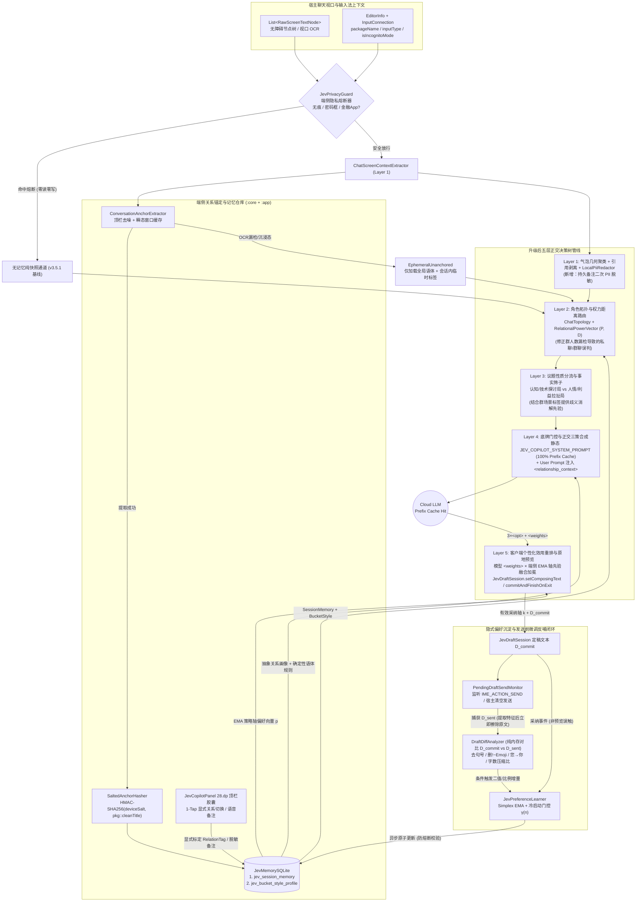

# TypeFree「✦ Jev 军师」端侧关系记忆与个人语体偏好沉淀设计方案书

- **基线版本**：TypeFree v3.5.1
- **目标架构**：`:core`（纯 Kotlin 领域与算法层） + `:app`（Android IME 宿主、SQLite 存储与 Compose UI 层）
- **核心红线约束**：键盘总高恒定 `252.dp` 零跳变；端侧真实备注名/聊天原文零落盘、零上云；`PromptBuilder.JEV_COPILOT_SYSTEM_PROMPT` 保持 100% 编译期静态常量以保障云端 Prefix Cache 命中率。

---

## 第一章 总体架构与五层决策树融合设计

### 1.1 计算社会语言学映射与架构定位

在人际语用学（Brown & Levinson 礼貌原则与受众设计理论）中，得体回复由三个正交参数决定：**权力距离（Power Distance, $P$）**、**社会亲疏距离（Social Distance, $D$）** 与 **诉求强加度（Rank of Imposition, $R$）**，辅以说话人稳定的 **个人语体指纹（Idiolectal Register）**。

TypeFree v3.5.1 现有的五层正交决策树已通过屏幕气泡与 `<user_bottom_line>` 解决了单回合的诉求强加度 $R$ 与议题分类，但因缺乏跨会话锚点与反馈闭环，丢失了静态或半静态的 $(P, D)$ 关系坐标以及用户的个人语体指纹。

本方案在不破坏现有五层正交管线的前提下，引入 **端侧会话身份锚定（Session Anchor）**、**显式关系图谱（Explicit Relational Schema）** 与 **隐式采纳/编辑反哺引擎（Implicit Preference Learner）** 三大旁路子系统，形成「提取—路由修正—约束生成—个性化重排—编辑回流」的端侧闭环。

### 1.2 升级后全链路数据流图



### 1.3 五层决策树融合作用矩阵

| 决策树层级 | v3.5.1 基线职责 | 本方案融合切入点 | 核心修正与增益 | 异常/冷启动回退 |
| :--- | :--- | :--- | :--- | :--- |
| **Layer 1**<br>上下文采集与脱敏 | 扫描 `boundsTop <= 0.16*H` 群人数、左右气泡聚类、引用剥离、`LocalPiiRedactor` | 接入 `ConversationAnchorExtractor` 提取 `sessionAnchorId`；对用户录入的一句话 `customNote` 执行 `LocalPiiRedactor` 脱敏 | 在零原文上云前提下建立跨屏持久会话身份；拦截顶栏 `对方正在输入...` 瞬态抖动 | 顶栏未检出时退化为 `EphemeralUnanchored`，不写库、不串台 |
| **Layer 2**<br>角色拓扑路由 | 判定 `PRIVATE_1V1`、`GROUP_INVOLVED_PARTY`、`GROUP_BYSTANDER` | 引入持久化拓扑纠偏与社会语言学坐标 $(P, D)$（权力高低、内外边界、亲疏度） | 解决群聊开启静音或长群名截断 `(N)` 时误判为 `PRIVATE_1V1` 的顽疾；识别飞书/企微 `外部` 标签提供外部边界提示 | `UNSET` 状态保持纯几何拓扑判定，零额外假设 |
| **Layer 3**<br>议题性质分流 | 区分「认知/技术探讨局」与「人情/利益拉扯局」 | 将群聊场景枚举（如 `TECH_INTEREST_GROUP` vs `WORK_FORMAL_GROUP`）作为模糊上下文下的软先验 | 气泡极少（1~2 条）且议题模糊时，技术社群优先路由内行平视轴，外部对接群优先路由严谨博弈轴 | 屏幕气泡呈现明确利益冲突或技术栈探讨时，实证内容优先级高于场景先验 |
| **Layer 4**<br>底牌门控与三策合成 | 按拓扑/议题/底牌路由四组正交三轴，拼接 System + User Prompt | `JEV_COPILOT_SYSTEM_PROMPT` 维持零插值静态常量；在 User Prompt 尾部结构化注入 `<relationship_context>`（含 `<relationship_memory>` 与 `<user_style_preference>`） | 无需用户按住麦克风交代“这是我老板/死党”，模型自动对齐敬语层级、句长上限、标点禁令与持久备注边界 | 无记忆且无习惯规则命中时，省略 `<relationship_context>` 块，节省 Token |
| **Layer 5**<br>因果效用评估与预览 | 解析 `<weights>W1,W2,W3</weights>` 归一化置顶，`JevDraftSession` 原地预览与定稿 | 客户端效用融合器将模型上下文权重 $\tilde{w}_i$ 与端侧 Simplex EMA 先验 $\hat{p}_i$ 按置信门控 $\gamma(n)$ 加权融合；挂载定稿后发送前编辑差分监听 | 同等合理上下文下自动将用户长期偏爱的策略轴（如熟人局偏爱 `②松弛直给`）加冕至首位；捕获真实删改动作反哺 Layer 4 | 样本数 $n < 5$ 时 $\gamma(n) = 0$，100% 服从模型原始 `<weights>`，杜绝单次点击过拟合 |

---

## 第二章 核心模块详细工程设计

### 2.1 模块 A · 顶栏会话身份锚定与抗噪提取 (`ConversationAnchorExtractor`)

#### 2.1.1 顶栏几何分区与六步抗噪流水线

在 `ChatScreenContextExtractor` 扫描顶栏区域（`boundsTop <= groupHeaderMaxTop`，其中 `groupHeaderMaxTop = (screenHeight * 0.16f).toInt()`）时，输入节点包含系统状态栏、返回图标、左上角未读消息气泡、主标题、在线/输入状态副标题、听筒/静音图标以及右侧更多菜单。`ConversationAnchorExtractor` 按以下确定性流水线提取会话标题：

1. **Step 1：系统状态栏硬裁剪（Status Bar Rejection）**
   - 几何过滤：剔除 `boundsBottom <= screenHeight * 0.042f` 的节点（覆盖主流全面屏挖孔状态栏）。
   - 语义兜底过滤：即便部分 ROM 状态栏偏高，若 `boundsTop <= screenHeight * 0.055f` 且节点文本完全匹配状态栏特征正则 `STATUS_BAR_NOISE_REGEX`（时间 `^\d{1,2}:\d{2}(\s*[AP]M)?$`、电量 `^\d{1,3}%$`、网络速率与制式 `^(5G|4G|LTE|Wi-?Fi|VPN|HD|VoLTE|\d+(\.\d+)?\s*[KMG]B?/s)$`、运营商名 `^中国(移动|联通|电信|广电)$`），直接丢弃。

2. **Step 2：左右操作热区剥离（Edge Action Zone Pruning）**
   - **左侧返回与未读角标区**：
     - 纯几何剔除：`boundsRight <= screenWidth * 0.14f` 的节点（返回箭头 `<`、`‹`、`←`、图标 OCR 噪点）。
     - 复合返回未读角标剔除：对于 `boundsLeft <= screenWidth * 0.18f` 的节点，若文本匹配 `^(返回|消息|微信|QQ|飞书)?\s*[\(（]?\d{1,3}\+?[\)）]?$`（例如 iOS 风格皮肤或 QQ 左上角 `消息(99+)`、`(12)`、`99+`），直接剥离，防止将未读数误认为群人数或联系人名。
   - **右侧菜单与通话图标区**：
     - 纯几何剔除：`boundsLeft >= screenWidth * 0.80f` 的节点（`...`、`···`、`⊕`、`+`、电话/视频按钮、头像框）。

3. **Step 3：组织标签提取与控制符剥离（Badge Extraction & Glyph Cleaning）**
   - 扫描顶栏中部剩余节点，若存在独立短节点精确匹配 `^(@微信|@企业微信|外部|外部群|全员|部门|官方)$`：
     - 将布尔标记 `hasExternalBadge = true`（当匹配 `外部|外部群|@微信|@企业微信` 时）写入提取元数据供 Layer 2 辅助参考，同时将该标签节点从标题候选集中移出，避免干扰主标题识别。
   - 剥离听筒模式与静音图标字符：移除 Unicode 私有区图标字符（`[\uE000-\uF8FF]`）、常见状态 Emoji（`👂`、`🔇`、`🔕`、`🔒`、`📌`）以及无障碍文本后缀（`\[听筒\]|\[静音\]|听筒模式|免打扰`）。

4. **Step 4：瞬态状态与副标题识别（Transient & Subtitle Separation）**
   - 瞬态输入正则 `TRANSIENT_TYPING_REGEX`：
     `^(对方)?正在(输入|说话|讲话|录音)中?(\.{0,3}|…)?$|^.+is typing(\.{0,3}|…)?$|^typing(\.{0,3}|…)?$`
   - 在线与群概览副标题正则 `SUBTITLE_STATUS_REGEX`：
     `^(在线|离线|刚刚在线|手机在线.*|电脑在线.*|WiFi在线|[45]G在线|\d+\s*(分钟|小时|天)前在线|online|last seen.*|\d[\d,]*\s*(人|位成员|人在线|members).*)$`
   - 若候选节点命中 `TRANSIENT_TYPING_REGEX`：标记 `isTransientTypingDetected = true` 并从标题候选集剔除。
   - 若候选节点命中 `SUBTITLE_STATUS_REGEX`：若包含群成员数（如 Telegram `4,352 members` 或飞书 `128人`），提取 `subtitleMemberCount` 后将该副标题节点从标题候选集剔除。

5. **Step 5：主标题几何打分选优与群人数拆分（Primary Title Scoring & Member Count Split）**
   - 当顶栏存在多个剩余文本节点（例如主标题 + 个性签名/职位副标题）时，按打分函数选出唯一主节点：
     $$\text{Score}(node) = 2.0 \times \frac{\text{height}(node)}{\text{maxHeight}} - 1.5 \times \frac{\text{boundsTop}(node) - y_{\min}}{0.12 \times H} + 0.5 \times \mathbb{I}(0.12W \le \text{boundsLeft} \le 0.65W)$$
     字号高度更大、纵坐标更靠上（主行高于副行）、起点位于标准标题栏左对齐或居中区间的节点胜出。
   - **尾部群人数精确分离**：
     - 对胜出节点的文本尾部匹配 `^(.*?)\s*[\(（](\d{1,5})[\)）]$`（如 `大鸽子交流群(8)`、`研发大群（435）`）。
     - 若前缀非空，则分离出 `rawTitle = prefix` 与 `headerMemberCount = count`。注意：仅当 `count >= 3`（或历史缓存已确认为群聊且 `count >= 2`）时将 `headerMemberCount` 判定为群聊特征，同时 `rawTitle` 剥离 `(count)`，确保群成员增减时归一化标题保持绝对稳定。
   - **归一化清洗（`normalizeTitle`）**：
     - 执行 Unicode NFKC 标准化；去除零宽字符 `[\u200B-\u200F\uFEFF]`；将连续空白符折叠为单个空格并 `trim()`；截断前 64 个字符。若清洗后长度为 0 或纯标点符号，判定为提取失败。

6. **Step 6：本机加盐哈希生成（Salted HMAC Anchor）**
   - 使用存储在 Android Keystore 加密区的 32 字节本机随机盐 `deviceSalt`：
     ```kotlin
     // anchorInput 严格采用 packageName + "::" + normalizedTitle
     val anchorInput = "${packageName.trim().lowercase(Locale.ROOT)}::$normalizedTitle"
     val sessionAnchorId = hmacSha256Hex(deviceSalt, anchorInput) // 64位十六进制摘要
     ```
   - 可选生成仅用于本机设置页展示的脱敏缩略串 `maskedTitleHint`（用户可在设置中关闭）：
     - 1 字：`*`
     - 2 字：`${first}*`（如 `张*`）
     - 3 字及以上：`${first}*${last}`（如 `大*群`、`李*明`），绝不包含中间有效字，且**严禁进入任何 Prompt 构建函数**。

#### 2.1.2 瞬态抖动缓存与漏检优雅降级策略

1. **输入态顶栏覆盖恢复（`VolatileWindowAnchorCache`）**：
   - 痛点：微信等宿主在对方打字时，会将整个顶栏标题直接替换为 `对方正在输入...`，此时节点树中完全不存在原联系人备注名。
   - 机制：在内存中维护单槽位易失缓存 `LastActiveWindowAnchor(packageName: String, anchor: ResolvedAnchor, timestampMs: Long)`，有效期 `TTL = 90_000ms`。
   - 当本次扫描满足 `rawConversationTitle == null && isTransientTypingDetected && cache.packageName == currentPackage && (now - cache.timestampMs) <= 90_000L` 时，直接复用缓存的 `ResolvedAnchor`，保证对方打字期间唤起军师不丢记忆。
   - 安全清理：一旦检测到 `packageName` 变更、锁屏广播、无痕模式开启、或成功提取到新的非空 `normalizedTitle`，立即覆写或清空该内存槽位。

2. **完全漏检时的优雅降级（`AnchorResolution.EphemeralUnanchored`）**：
   - 触发场景：分屏小窗模式裁掉顶栏、沉浸式全屏气泡、自定义皮肤导致无障碍节点文本为空且 OCR 超时。
   - 降级行为：
     1. **严禁落盘污染**：不生成伪造哈希，不向 `jev_session_memory` 写入任何记录。
     2. **会话内内存态标签可用**：顶栏胶囊显示为虚线态 `⚡ 临时关系 ▾`。若用户主动点选关系标签（如点选 `客户/外部合作`），该标签保存在 `JevCopilotViewModel` 的当次输入会话内存中（随宿主输入框切换自动销毁），当次三策重生成依然生效。
     3. **全局语体偏好照常生效**：依然从 `jev_bucket_style_profile` 读取 `GLOBAL` 桶的个人语体习惯（如用户全局禁用句末句号、全局禁用波浪号），保障基础语言风格一致。

---

### 2.2 模块 B · 轻量关系图谱模型与 `252.dp` 零拥挤交互设计

#### 2.2.1 私聊与群聊预设枚举及语用学约束映射

预设枚举不向大模型暴露联系人隐私，仅映射为抽象的权力距离 $P$、社会距离 $D$ 及语用边界指令：

**表 2-1：私聊预设关系枚举（`PrivateRelationTag`）**

| 枚举名 | UI 胶囊短名 | $(P, D)$ 坐标 | Layer 2 / Layer 4 核心语用与分寸约束 |
| :--- | :--- | :--- | :--- |
| `SUPERIOR_ELDER` | `上级/长辈` | $+P, +D$ | 结论先行（BLUF），敬语得体，给出可拍板的选项而非反问，严禁说教腔与轻佻口癖 |
| `CLIENT_EXTERNAL` | `客户/外部合作` | $+P_{\text{ext}}, +D$ | 严守专业边界与契约口径，不擅自承诺排期与兜底责任，礼貌周全但立场清晰 |
| `PEER_COLLEAGUE` | `平级同事` | $0P, \text{mid } D$ | 省去冗余寒暄前缀，聚焦协作对齐与责任分工，温和留面但不卑微讨好 |
| `CLOSE_FRIEND` | `熟人朋友` | $0P, -D$ | 口语化松弛直给，禁用职场黑话（“对齐/赋能/抓手/闭环”）与书面敬语，短句自然 |
| `INTIMATE_FAMILY` | `亲密伴侣/家人` | $0P, -D_{\max}$ | 情绪接纳优先于逻辑辩输赢，禁用公文腔、防御性反驳与冷漠敷衍词 |
| `STRANGER_GAME` | `陌生博弈` | $?P, +D_{\max}$ | 适用于房东、卖家、售后、陌生交涉；事实与规则锚定，零情绪暴露，不主动让渡底线 |
| `UNSET` | `标定关系` | $(0, 0)$ | 默认未标定状态，不注入显式关系偏向 |

**表 2-2：群聊预设场景枚举（`GroupSceneTag`）**

| 枚举名 | UI 胶囊短名 | Layer 2 / Layer 3 / Layer 4 核心语用与分寸约束 |
| :--- | :--- | :--- |
| `WORK_FORMAL_GROUP` | `工作正式群` | 具备公开留痕意识，表述严谨克制，结论与时间节点明确，旁观态不随意抖机灵刷屏 |
| `EXTERNAL_DOCKING_GROUP` | `外部对接群` | 代表我方团队统一口径，维护专业形象，涉及需求变更或排期时留足缓冲确认空间 |
| `FRIENDS_CASUAL_GROUP` | `熟人闲聊群` | 接梗松弛，避免长篇大论与扫兴总结陈词，允许幽默转场与生活化短句 |
| `TECH_INTEREST_GROUP` | `技术/兴趣社群` | Layer 3 优先倾向「认知/技术探讨局」；高信息密度、内行平视，不灌水客套 |
| `UNSET` | `标定群场景` | 默认未标定状态 |

**一句话持久备注（`customNote`）**：
- 长度硬约束：`<= 40` 个字符（如 `"抠门房东，只认合同条款"`、`"忌讳周末催进度，喜欢先看数据"`）。
- 双重脱敏门禁：写入数据库前与拼装 Prompt 前，均强制经过 `LocalPiiRedactor.redactForRelationNote(note)` 清洗手机号、身份证、银行卡、邮箱及显式人名指代（如 `"房东张建国13812345678"` 清洗为 `"房东[某人][电话]"`），杜绝用户手误输入隐私信息上云。

#### 2.2.2 `JevCopilotPanel` `252.dp` 恒高零拥挤交互方案

现有面板严格锁定在 `252.dp` 总高：
- **Row 1（顶栏）**：`28.dp`
- **Row 2（潜台词雷达栏）**：`24.dp`
- **Row 3（自适应滚动三策区）**：`168.dp`
- **Row 4（底牌语音/操作底栏）**：`32.dp`

为确保 **不增加 `1.dp` 面板高度、不常驻挤压 `168.dp` 三策正文阅读区、且避免「输入法内无法再弹出系统软键盘」的 Android IME 死锁陷阱**，采用 **「顶栏内嵌胶囊 + 中区原地瞬态覆层（In-Place Overlay）+ 复用底栏语音写备注」** 交互设计：

```
+-----------------------------------------------------------------------+  --- 0.dp
| ✦ 军师   [💼 客户/外部·注 ▾]                      [刷新] [关闭 ✕]    |  Row 1: 28.dp (内嵌 20.dp 高胶囊)
+-----------------------------------------------------------------------+  --- 28.dp
| 雷达：对方试探底价与交付周期，暂未亮明最终预算上限                    |  Row 2: 24.dp
+-----------------------------------------------------------------------+  --- 52.dp
|  [① 温和设限 ★推荐]  先对齐核心模块范围，排期按标准工时评估...        |
|  [② 协同破局]        如果本周五前能确认接口文档，我们可以先排一期...  |  Row 3: 168.dp (默认完整展示三策)
|  [③ 升维重构]        咱们可以拆成基础版和增值包两套报价方案...        |
+-----------------------------------------------------------------------+  --- 220.dp
| [🎙️ 按住说底牌 / 核心诉求]                                            |  Row 4: 32.dp
+-----------------------------------------------------------------------+  --- 252.dp (严格恒定)
```

当用户轻点 `28.dp` 顶栏中的 `[⚡ 标定关系 ▾]`（或已标定胶囊）时，根容器 `Box(Modifier.height(252.dp))` 高度保持绝对不变，仅在 `y = 28.dp .. 220.dp`（即原 Row 2 + Row 3 的 `192.dp` 区域）之上原地淡入 `RelationQuickOverlay` 覆层（耗时 `100ms`）：

```
+-----------------------------------------------------------------------+  --- 0.dp
| ✦ 军师   [💼 客户/外部·注 ▲]                            [收起 ✕]     |  Row 1: 28.dp
+=======================================================================+  --- 28.dp (Overlay 覆盖层起点)
| 当前会话关系标定（点选即刻生效并刷新三策）：             [清除标定]   |
|  +-----------------+   +-----------------+   +-----------------+      |
|  | 👔 上级/长辈    |   | ✓ 💼 客户/外部  |   | 🤝 平级同事     |      |
|  +-----------------+   +-----------------+   +-----------------+      |  192.dp 原地覆层
|  +-----------------+   +-----------------+   +-----------------+      |  (私聊 2×3 网格 / 群聊 2×2 网格)
|  | 🍻 熟人朋友     |   | ❤️ 伴侣/家人    |   | 🛡️ 陌生博弈     |      |
|  +-----------------+   +-----------------+   +-----------------+      |
| 持久备注：抠门房东，只认合同条款      [📋粘贴] [✕清空]                |
| 快捷词：[#只谈公事] [#先给结论] [#忌催促] [#给情绪价值]               |
+=======================================================================+  --- 220.dp (Overlay 覆盖层终点)
| [🎙️ 按住录入/替换一句话人物备注（限40字）]                            |  Row 4: 32.dp (覆层打开时自动切换语义)
+-----------------------------------------------------------------------+  --- 252.dp (严格恒定)
```

**核心交互闭环细节**：
1. **1-Tap 极速切换**：用户在覆层网格中轻点任一关系胶囊（单次点击），立即完成落盘、自动关闭覆层（无需二次点“确定”），并触发当前三策流式重生成（取消未完成的旧请求，带入新 `<relationship_context>` 重新请求）。
2. **输入法内零软键盘录入备注**：当 `RelationQuickOverlay` 处于展开态时，底部 `32.dp` 语音条临时将模式从 `BOTTOM_LINE_ASR` 切换为 `RELATION_NOTE_ASR`（文案变为 `按住录入一句话人物备注`），直接复用 TypeFree 现有端/云语音识别链路写入 `customNote`；同时提供 4 个高频快捷词 Chip 与 `[粘贴剪贴板]` 按钮，彻底规避在 `InputMethodService` 窗口内拉起第二个软键盘的架构冲突。
3. **字体缩放防溢出保护**：`RelationAnchorChip` 与网格项内强制指定 `maxLines = 1`、`overflow = TextOverflow.Ellipsis`，并对文字大小施加 `with(LocalDensity.current)` 字号缩放上限钳制（最大响应 `1.15f` `fontScale`），确保系统开启大字体时 `28.dp` 顶栏与 `192.dp` 网格永不撑破高度。

#### 2.2.3 宿主 App 设置/管理页与一键擦除入口

在 TypeFree 宿主 App 设置界面新增 **「✦ Jev 军师关系与偏好管理」** 页面（`JevMemorySettingsScreen`）：
- **全局隐私开关**：
  - `启用端侧关系与语体偏好记忆`（默认开启；关闭后停止一切读写，退回纯快照模式）。
  - `本地保留脱敏会话缩写提示`（默认开启，展示如 `微信 · 大*群`；关闭后仅展示应用名与哈希指纹前 6 位如 `微信 · #8f2a1c`）。
- **已沉淀语体偏好管理卡**：
  - 直观列出当前已激活的确定性语体约束（例如：`[已启用] 句末不加句号（样本 12 次）`、`[已启用] 熟人场景用“你”不用“您”（样本 6 次）`），每条规则旁提供独立开关与 `[重置]` 按钮，赋予用户 100% 可解释性与人工纠偏权。
- **会话关系列表与全键盘编辑**：
  - 按 `lastActiveAt` 倒序展示已锚定会话，支持在宿主 App 中使用完整系统软键盘精确编辑 `customNote`、修改 `RelationTag`、置顶免淘汰或左滑单条删除。
- **核按钮级一键擦除（`一键清空全部军师记忆`）**：
  - 二次确认弹窗后执行三步原子销毁：① `DELETE FROM` 清空全部记忆表并执行 `VACUUM` 覆写空闲页；② 清空全部内存缓存；③ 调用 `SaltedAnchorHasher.rotateDeviceSalt()` 重新生成随机盐覆写 Keystore，使任何残留哈希在密码学上彻底不可逆关联。

---

### 2.3 模块 C · 隐式偏好沉淀与草稿微调反哺算法 (`JevPreferenceLearner`)

#### 2.3.1 策略轴点击偏好追踪（Simplex EMA 与冷启动门控）

##### 1. 正交策略轴规范化编码
将 Layer 4 四组正交三轴映射为强类型枚举（每组恒定 $K=3$ 个互斥候选轴）：
- `AxisGroup.PEER_TECH`：`[0: PEER_UPGRADE(同频升维), 1: PEER_GENTLE_FIX(温和勘误), 2: PEER_GEEK_EXTRAPOLATE(极客外推)]`
- `AxisGroup.TKI_GAME`：`[0: TKI_COLLABORATE(协同破局), 1: TKI_BOUNDARY(温和设限), 2: TKI_REFRAME(升维重构)]`
- `AxisGroup.GROUP_BYSTANDER`：`[0: BYSTANDER_MEME(场外递梗), 1: BYSTANDER_FOLLOW(顺题聊事), 2: BYSTANDER_PIVOT(幽默转场)]`
- `AxisGroup.BOTTOM_LINE_LOCKED`：`[0: LOCKED_FACE(周全给面), 1: LOCKED_DIRECT(松弛直给), 2: LOCKED_ANCHOR(锚定闭环)]`

##### 2. 真实采纳信号界定（过滤预览探索点击）
用户在 `JevCopilotPanel` 内可能依次点击第 1、2、3 张卡片通过 `setComposingText` 预览效果。系统**绝不在卡片点击瞬间记分**，仅当满足以下全部条件时才触发一次有效采纳事件（`ConfirmedAxisAdoption`）：
1. 用户关闭面板触发 `JevDraftSession.commitAndFinishOnExit()` 且实际向宿主提交了某卡片 $k \in \{0, 1, 2\}$ 的非空草稿；
2. 提交后 `5000ms` 观察期内未发生「整段清空且未发送」的悔棋撤销动作（或已捕获到发送动作且文本与草稿存在公共子序列 `LCSRatio >= 0.25`）。

##### 3. 概率单纯形 EMA 更新与展示位次消偏
对每个作用域（会话级 `(anchorId, axisGroup)` 与关系桶级 `(relationBucket, axisGroup)`），维护三维概率向量 $\mathbf{p}^{(t)} = (p_0^{(t)}, p_1^{(t)}, p_2^{(t)})$ 与累计有效样本数 $n \in \mathbb{N}$。初值设为均匀先验 $\mathbf{p}^{(0)} = (\frac{1}{3}, \frac{1}{3}, \frac{1}{3}), n = 0$。

当第 $k$ 轴被有效采纳时，令 $\mathbf{e}_k$ 为第 $k$ 维为 $1$、其余为 $0$ 的独热向量。为抵消置顶推荐位（Slot 0）的默认曝光优势，引入位次感知学习率 $\lambda_{\text{pos}}$：
- 若用户采纳的是当前排在首位（Slot 0）的默认置顶卡片：$\lambda_{\text{pos}} = 0.12$（温和强化，防止马太效应锁死）；
- 若用户主动越过首位，点选并采纳了排在 Slot 1 或 Slot 2 的非置顶卡片：$\lambda_{\text{pos}} = 0.20$（显式纠偏高信息量信号）。

更新公式为：
$$\mathbf{p}^{(t+1)} = (1 - \lambda_{\text{pos}}) \mathbf{p}^{(t)} + \lambda_{\text{pos}} \mathbf{e}_k, \quad n \leftarrow n + 1$$
由于 $\sum_{i=0}^2 p_i^{(0)} = 1$ 且 $\sum_{i=0}^2 e_{k,i} = 1$，任意时刻严格满足概率归一化不变量 $\sum_{i=0}^2 p_i^{(t)} = 1$ 且 $p_i^{(t)} \in (0, 1)$。实际代码实现中每次更新后执行一次浮点尾差归一化 `p[i] / p.sum()`。

##### 4. 最小样本冷启动门控与层级平滑融合
定义冷启动门控系数 $\gamma(n)$（硬阈值 $N_{\min} = 5$）：
$$\gamma(n) = \begin{cases} 0.0, & n < 5 \\ \min\left(1.0, \frac{n - 4}{6.0}\right), & n \ge 5 \end{cases}$$
- 当 $n \in \{1, 2, 3, 4\}$ 时，$\gamma(n) = 0$，彻底屏蔽小样本随机噪声与单次误触过拟合。
- 结合「单会话记忆 $\mathbf{p}_{\text{sess}}$」与「同类关系桶记忆 $\mathbf{p}_{\text{rel}}$（如所有 `CLOSE_FRIEND` 会话汇总）」计算合成先验 $\hat{\mathbf{p}}$：
  $$\mathbf{p}_{\text{backoff}} = \gamma(n_{\text{rel}}) \mathbf{p}_{\text{rel}} + \big(1 - \gamma(n_{\text{rel}})\big) \mathbf{u}, \quad \mathbf{u} = \left(\tfrac{1}{3}, \tfrac{1}{3}, \tfrac{1}{3}\right)$$
  $$\hat{\mathbf{p}} = \gamma(n_{\text{sess}}) \mathbf{p}_{\text{sess}} + \big(1 - \gamma(n_{\text{sess}})\big) \mathbf{p}_{\text{backoff}}$$
  有效先验置信度定义为 $c_{\text{eff}} = \max\big(\gamma(n_{\text{sess}}), 0.7 \times \gamma(n_{\text{rel}})\big) \in [0, 1]$。

##### 5. Layer 5 客户端效用融合重排公式
模型输出 `<weights>W0,W1,W2</weights>`，归一化得到上下文因果效用 $\tilde{w}_i = \frac{\max(W_i, 0)}{\sum_j \max(W_j, 0)}$（若和为 0 则取 $\frac{1}{3}$）。客户端最终加冕得分 $S_i$ 为：
$$S_i = (1 - \beta_{\max} \cdot c_{\text{eff}}) \tilde{w}_i + (\beta_{\max} \cdot c_{\text{eff}}) \hat{p}_i, \quad \beta_{\max} = 0.35$$
- **防翻车安全上界证明**：由于 $\beta_{\max} = 0.35$，即便用户历史 100% 只选某轴（$\hat{p}_k \to 1, c_{\text{eff}} = 1$），若当前具体语境下该轴不合时宜被模型判极低分（如 $\tilde{w}_k = 0.05$，而另一安全轴 $\tilde{w}_m = 0.80$），则 $S_k = 0.65 \times 0.05 + 0.35 \times 1.0 = 0.3825 < S_m = 0.65 \times 0.80 + 0 = 0.520$，模型强语境否决权依然生效；而在模型认为两策均合理（如 $\tilde{w}_0 = 0.42, \tilde{w}_1 = 0.38$）时，个人先验将稳定把符合用户性格的策略推上推荐皇冠位。

#### 2.3.2 置入草稿后的发送前手动编辑信号提取 (`DraftDiffAnalyzer`)

##### 1. 宿主输入框发送前文本捕获状态机
在 Android IME 中，用户点击微信/飞书原生「发送」按钮时不会回调 `onEditorAction(IME_ACTION_SEND)`，而是由宿主直接清空 `EditText`。`PendingDraftSendMonitor` 通过以下双通道精准捕获最终发送文本 $D_{\text{sent}}$：

1. **挂载监控**：`JevDraftSession.commitAndFinishOnExit()` 定稿非空字符串 $D_{\text{commit}}$（长度 $\ge 4$）时，记录 `(D_commit, packageName, fieldId, sessionAnchorId, relationBucket, commitTimeMs)`，启动 `45s` 监控窗口。
2. **快照追踪**：在 `InputMethodService.onUpdateSelection` 中，通过 `currentInputConnection?.getExtractedText(ExtractedTextRequest(), 0)?.text` 低开销读取当前输入框全文（限制 `<= 500` 字），若非空则更新内存变量 `latestNonEmptyText` 及时间戳 `lastEditTimeMs`，同时记录最近一次按键是否为删除/剪切动作（`KEYCODE_DEL` / `KEYCODE_FORWARD_DEL` / 全选删除）。
3. **发送判定触发器（满足其一即判定为已发送）**：
   - **通道 A（键盘发送键）**：触发 `performEditorAction(IME_ACTION_SEND / IME_ACTION_DONE)` 且当前输入框非空，取当前文本为 $D_{\text{sent}}$；
   - **通道 B（宿主原生发送按钮清空特征）**：`onUpdateSelection` 检测到 `newSelStart == 0 && newSelEnd == 0`，查询 `getExtractedText` 为空串 `""`，且距上一次非空快照 `latestNonEmptyText`（长度 $\ge 1$）间隔 `< 350ms`、期间无全选删除或 `KEYCODE_DEL` 连按清空行为，判定用户点击了宿主 App 发送按钮，取 `latestNonEmptyText` 为 $D_{\text{sent}}$。
4. **重写与放弃过滤**：
   - 计算字符级最长公共子序列比例 $\text{LCSRatio}(D_{\text{commit}}, D_{\text{sent}}) = \frac{|\text{LCS}(D_{\text{commit}}, D_{\text{sent}})|}{\max(|D_{\text{commit}}|, 1)}$。
   - 若监控超时（`> 45s`）、切换了宿主输入框、或 $\text{LCSRatio} < 0.25$（说明用户彻底删掉草稿另起炉灶写了无关内容），直接销毁监控器，**不提取微调语体特征**，防止无关文本污染统计。
   - 特征提取完成后，立即将内存中的 `D_commit` 与 `D_sent` 引用置空销毁，**零字符落盘**。

##### 2. 机会条件触发（Opportunity-Conditioned）特征算子与确定性指令合成

为防止「原本草稿就没有句号，导致删句号率被错误稀释或虚增」，每项编辑习惯特征仅在 **$D_{\text{commit}}$ 包含该语言现象（具备修改机会 Opportunity = True）** 时才更新对应计数器 $(n_f, r_f)$：
$$r_f^{(t+1)} = (1 - \alpha_f) r_f^{(t)} + \alpha_f \cdot y_f \quad (\alpha_f = 0.20, \; r_f^{(0)} = 0.0, \; y_f \in \{0.0, 1.0\})$$
为避免临界点反复横跳，引入**迟滞双阈值（施密特触发器 Hysteresis）**：当 $n_f \ge N_{\text{act}}$ 且 $r_f \ge \theta_{\text{on}}$ 时激活规则；激活后仅当 $r_f < \theta_{\text{off}}$ 时自动解除。

**表 2-3：六类端侧编辑特征算子与确定性语体指令表**

| 特征枚举 (`StyleFeatureKey`) | 统计作用域 | 机会触发条件（对 $D_{\text{commit}}$ 判定） | 正样本判定 $y_f = 1.0$（对比 $D_{\text{sent}}$） | 激活阈值 $(N_{\text{act}}, \theta_{\text{on}}, \theta_{\text{off}})$ | 聚合成的确定性语体约束指令（注入 `<user_style_preference>`） |
| :--- | :--- | :--- | :--- | :--- | :--- |
| `DROP_TRAILING_PERIOD` | `GLOBAL` + `RelationBucket` | 末尾以单句号 `。` 或 `.` 结尾（排除省略号 `...`/`……`） | $D_{\text{sent}}$ 非空且末尾不再有任何句末标点（`[。.!！?？~～]`） | $(5, 0.75, 0.55)$ | `禁用句末句号（句尾直接收束，不加“。”）` |
| `DAMPEN_EXCLAMATION_TILDE` | `GLOBAL` + `RelationBucket` | 含感叹号或波浪号 `[!！~～]` 数量 $c_0 \ge 1$ | $D_{\text{sent}}$ 中 `[!！~～]` 数量 $c_1 = 0$ 或 $c_1 \le 0.3 c_0$ | $(5, 0.72, 0.50)$ | `禁用感叹号“！”与波浪号“～”，保持平实克制语气` |
| `STRIP_EMOJI` | `GLOBAL` + `RelationBucket` | 含 Unicode Emoji 或方括号表情（如 `[捂脸]`、`[玫瑰]`）数量 $e_0 \ge 1$ | $D_{\text{sent}}$ 中所有 Emoji 与方括号表情被清零（$e_1 = 0$） | $(4, 0.75, 0.50)$ | `严禁输出任何Emoji或表情符号` |
| `HONORIFIC_NIN_TO_NI` | 仅 `RelationBucket` / `Session`（严禁全局串台） | 包含敬称 `您`（$h_0 \ge 1$） | $D_{\text{sent}}$ 中 `您` 数量降为 $0$ 且出现 `你`（或直接删去 `您`） | $(3, 0.70, 0.45)$ | `第二人称称呼强制使用“你”，严禁使用“您”` |
| `HONORIFIC_NI_TO_NIN` | 仅 `RelationBucket` / `Session` | 包含平称 `你`（排除 `你们`）且不含 `您` | $D_{\text{sent}}$ 将 `你` 替换为 `您` | $(3, 0.70, 0.45)$ | `第二人称称呼强制使用敬称“您”` |
| `TRIM_MODAL_AND_FILLERS` | `GLOBAL` + `RelationBucket` | 含高频软化语气词/客套词集合 $M$（`哈/呢/呀/啦/喔` 或 `不好意思/打扰一下/烦请`）命中数 $m_0 \ge 1$ | 拆分为子特征 `MODAL_PARTICLE` 与 `POLITE_PREFIX`，对应词项在 $D_{\text{sent}}$ 中被删除比例 $\ge 0.75$ | $(5, 0.72, 0.50)$ | 子项1：`禁用句末软化语气词（哈/呢/呀/啦）`<br>子项2：`省去前置客套寒暄（如“不好意思/打扰了”），开门见山` |
| `COMPRESS_LENGTH` | `GLOBAL` + `RelationBucket` | $D_{\text{commit}}$ 有效字数 $L_0 \ge 18$ | 维护字数压缩比 $\bar{\rho} = \text{EMA}(L_{\text{sent}} / L_0)$ 与发送字数均值 $\bar{L}_{\text{sent}}$ | $n \ge 6$，激活：$\bar{\rho} \le 0.65$；解除：$\bar{\rho} > 0.78$ | 计算目标字数上限 $L_{\text{cap}} = \text{clamp}(\text{roundTo5}(\bar{L}_{\text{sent}} \times 1.15), 15, 45)$，输出：`极简短句：每条候选严格控制在 ${L_cap} 字以内` |

**冲突消解优先级**：`Session` 级显式备注 > 用户在设置页手动锁定的开关 > `RelationBucket` 级激活规则 > `GLOBAL` 级激活规则（例如 `GLOBAL` 未触发 `HONORIFIC_NIN_TO_NI`，但在 `PEER_COLLEAGUE` 桶触发，则仅对同事生效；若 `SUPERIOR_ELDER` 桶触发 `HONORIFIC_NI_TO_NIN`，绝不会被其他桶覆盖）。

---

### 2.4 模块 D · Prompt 契约扩展与端侧 SQLite / JSON 存储 Schema

#### 2.4.1 核心 Kotlin 数据类定义（`:core` 模块）

```kotlin
package com.typefree.core.jev.memory

import com.typefree.core.jev.ChatTopology
import kotlinx.serialization.SerialName
import kotlinx.serialization.Serializable

/** 顶栏会话锚定解析结果 */
sealed interface AnchorResolution {
    data class Resolved(
        val sessionAnchorId: String,       // 64位 HMAC-SHA256 hex
        val packageName: String,
        val headerMemberCount: Int?,       // 顶栏解析到的群人数，如 (435)
        val hasExternalBadge: Boolean,     // 飞书/企微“外部/@微信”角标
        val maskedTitleHint: String?,      // 仅本机管理页可选展示，如 "大*群"，严禁入 Prompt
        val fromVolatileCache: Boolean = false
    ) : AnchorResolution

    data class EphemeralUnanchored(
        val packageName: String,
        val hasExternalBadge: Boolean = false
    ) : AnchorResolution
}

/** 私聊预设关系枚举 */
@Serializable
enum class PrivateRelationTag(val code: String, val uiLabel: String) {
    UNSET("unset", "标定关系"),
    SUPERIOR_ELDER("superior_elder", "上级/长辈"),
    CLIENT_EXTERNAL("client_external", "客户/外部"),
    PEER_COLLEAGUE("peer_colleague", "平级同事"),
    CLOSE_FRIEND("close_friend", "熟人朋友"),
    INTIMATE_FAMILY("intimate_family", "伴侣/家人"),
    STRANGER_GAME("stranger_game", "陌生博弈")
}

/** 群聊预设场景枚举 */
@Serializable
enum class GroupSceneTag(val code: String, val uiLabel: String) {
    UNSET("unset", "标定群场景"),
    WORK_FORMAL_GROUP("work_formal_group", "工作正式群"),
    EXTERNAL_DOCKING_GROUP("external_docking_group", "外部对接群"),
    FRIENDS_CASUAL_GROUP("friends_casual_group", "熟人闲聊群"),
    TECH_INTEREST_GROUP("tech_interest_group", "技术/兴趣群")
}

/** Layer 4 四组正交策略轴组标识 */
@Serializable
enum class AxisGroup {
    PEER_TECH,
    TKI_GAME,
    GROUP_BYSTANDER,
    BOTTOM_LINE_LOCKED
}

/** 单组三轴 Simplex EMA 统计状态 */
@Serializable
data class AxisPreferenceStats(
    val probs: List<Double> = listOf(1.0 / 3.0, 1.0 / 3.0, 1.0 / 3.0), // 恒定长度 3，和为 1.0
    val sampleCount: Int = 0,
    val updatedAtMs: Long = 0L
)

/** 编辑习惯特征枚举 */
@Serializable
enum class StyleFeatureKey {
    DROP_TRAILING_PERIOD,
    DAMPEN_EXCLAMATION_TILDE,
    STRIP_EMOJI,
    HONORIFIC_NIN_TO_NI,
    HONORIFIC_NI_TO_NIN,
    TRIM_MODAL_PARTICLE,
    TRIM_POLITE_PREFIX,
    COMPRESS_LENGTH
}

/** 单个编辑特征的流式 EMA 统计器 */
@Serializable
data class FeatureCounter(
    val emaValue: Double = 0.0,            // 二值特征为触发率 r_f；COMPRESS_LENGTH 为压缩比 ρ_bar
    val secondaryEma: Double = 0.0,        // COMPRESS_LENGTH 专用：发送字数均值 L_sent_bar
    val opportunityCount: Int = 0,
    val isActive: Boolean = false,         // 经施密特迟滞门限判定后的激活态
    val userOverride: Boolean? = null      // null=自动跟随算法, true=人工强制开启, false=人工强制关闭
)

/** 单会话持久化实体 (对应 SQLite jev_session_memory 表) */
@Serializable
data class SessionMemoryRecord(
    val anchorId: String,
    val appCategory: String,               // 如 "im_wechat", "im_feishu", "im_qq", "im_telegram", "im_other"
    val confirmedTopology: ChatTopology?,  // 修正顶栏 (N) 偶发漏检
    val privateTag: PrivateRelationTag = PrivateRelationTag.UNSET,
    val groupTag: GroupSceneTag = GroupSceneTag.UNSET,
    val redactedCustomNote: String? = null,// 经 LocalPiiRedactor 脱敏且 <= 40 字
    val maskedTitleHint: String? = null,   // 仅本地 UI 展示，永不传入 PromptBuilder
    val axisStats: Map<AxisGroup, AxisPreferenceStats> = emptyMap(),
    val featureCounters: Map<StyleFeatureKey, FeatureCounter> = emptyMap(),
    val interactionCount: Int = 0,
    val isPinned: Boolean = false,
    val createdAtMs: Long,
    val lastActiveAtMs: Long
)

/** 关系桶/全局语体偏好实体 (对应 SQLite jev_bucket_style_profile 表) */
@Serializable
data class BucketStyleProfile(
    val bucketKey: String,                 // "GLOBAL" | "PRIV::close_friend" | "GRP::work_formal_group" 等
    val axisStats: Map<AxisGroup, AxisPreferenceStats> = emptyMap(),
    val featureCounters: Map<StyleFeatureKey, FeatureCounter> = emptyMap(),
    val updatedAtMs: Long = 0L
)

/** 传入 PromptBuilder 的纯抽象、零隐私动态载荷 */
data class JevMemoryPromptPayload(
    val relationRoleCode: String?,         // 如 "client_external" / "work_formal_group"，UNSET 时为 null
    val powerDistanceDesc: String?,        // 如 "high_external_boundary (高专业边界，平视偏敬重，严守契约口径)"
    val pragmaticGuideline: String?,       // 对应关系枚举的抽象分寸准则
    val redactedCustomNote: String?,       // 二次校验脱敏后的一句话备注（绝不含真实姓名/号码）
    val preferredAxisHint: String?,        // 当单轴 p >= 0.55 且 n >= 6 时生成的软倾向说明
    val deterministicStyleRules: List<String> // 如 ["禁用句末句号（句尾直接收束，不加“。”）", "极简短句：每条候选严格控制在 20 字以内"]
) {
    val isEmpty: Boolean
        get() = relationRoleCode == null &&
            redactedCustomNote.isNullOrBlank() &&
            preferredAxisHint == null &&
            deterministicStyleRules.isEmpty()
}
```

#### 2.4.2 端侧 SQLite Schema、淘汰策略与加密备份兼容

##### 1. SQLite 表结构（`JevMemoryDatabaseHelper`，数据库名 `jev_memory_v1.db`）

```sql
CREATE TABLE IF NOT EXISTS jev_session_memory (
    anchor_id TEXT PRIMARY KEY NOT NULL,
    app_category TEXT NOT NULL,
    confirmed_topology TEXT,
    private_tag TEXT NOT NULL DEFAULT 'unset',
    group_tag TEXT NOT NULL DEFAULT 'unset',
    redacted_custom_note TEXT,
    masked_title_hint TEXT,
    axis_stats_json TEXT NOT NULL DEFAULT '{}',
    feature_counters_json TEXT NOT NULL DEFAULT '{}',
    interaction_count INTEGER NOT NULL DEFAULT 0,
    is_pinned INTEGER NOT NULL DEFAULT 0,
    created_at_ms INTEGER NOT NULL,
    last_active_ms INTEGER NOT NULL
);

CREATE INDEX IF NOT EXISTS idx_jev_session_lru
ON jev_session_memory(is_pinned ASC, last_active_ms ASC);

CREATE TABLE IF NOT EXISTS jev_bucket_style_profile (
    bucket_key TEXT PRIMARY KEY NOT NULL,
    axis_stats_json TEXT NOT NULL DEFAULT '{}',
    feature_counters_json TEXT NOT NULL DEFAULT '{}',
    updated_at_ms INTEGER NOT NULL
);
```

##### 2. 存储容量淘汰策略（分层 TTL + 加权 LRU）
每次写入事务提交后，若距上次清理超过 `6` 小时或总行数超过 `520` 行，异步执行 `runMaintenance()`：
1. **TTL 过期清理**：
   - 未显式标定会话（`private_tag = 'unset' AND group_tag = 'unset' AND redacted_custom_note IS NULL AND is_pinned = 0`）：超过 **90 天** 未活跃（`now - last_active_ms > 90 * 86400_000L`）直接淘汰；
   - 显式标定会话（含关系标签或备注，且 `is_pinned = 0`）：超过 **365 天** 未活跃自动淘汰（每次命中对话自动续期 `last_active_ms`）。
2. **LRU 容量硬上限（`MAX_SESSIONS = 500`）**：
   - 若清理过期后总行数仍 `> 500`：第一优先级按 `last_active_ms ASC` 淘汰无显式标签的隐式记录；若仍 `> 500`，按 `is_pinned ASC, last_active_ms ASC` 裁剪至 `500` 条以内。用户手动添加过备注或手动置顶的记录默认置 `is_pinned = 1`（`is_pinned = 1` 自身硬上限为 `200` 条，防止无限膨胀）。

##### 3. `ApiConfigBackupHelper` 加密备份导入导出兼容方案
扩展现有备份 JSON 顶层结构，新增可选字段 `jevMemoryArchive: EncryptedJevMemoryArchive? = null`：
- **向后兼容**：导入旧版 v3.5.1 备份文件时，`jevMemoryArchive == null`，解析器正常导入 API 配置，不报错、不覆盖本地现有军师记忆。
- **密码学与跨机哈希一致性设计**：
  - 导出时提供开关 `包含军师关系与语体偏好（需设置备份密码）`。未设置备份密码的明文导出模式**强制跳过** `jevMemoryArchive`，防止备份文件泄露哈希盐值。
  - 在 AES-256-GCM（PBKDF2-HMAC-SHA256, `120,000` 次迭代，随机 16 字节导出盐 + 12 字节 IV）加密载荷内部封装 `JevMemoryPlainBackupPayload`：
    ```kotlin
    @Serializable
    data class JevMemoryPlainBackupPayload(
        val schemaVersion: Int = 1,
        val exportedAtMs: Long,
        val deviceSaltBase64: String, // 随加密包迁移本机盐，保障换机后同一联系人算出相同 anchorId
        val sessions: List<SessionMemoryRecord>, // 导出时默认将 maskedTitleHint 置 null 进一步收敛风险
        val buckets: List<BucketStyleProfile>
    )
    ```
  - **换机导入冲突合并策略**：
    - **目标新机本地库为空**（典型换机恢复场景）：直接采用备份包中的 `deviceSaltBase64` 写入新机 Keystore，并全量恢复 `sessions` 与 `buckets`——用户换机后打开微信同一个群/联系人，`HMAC-SHA256` 100% 原地命中原关系记忆！
    - **目标设备已有非空本地记忆且 `deviceSalt` 不同**：保留目标设备当前 `deviceSalt` 与本地 `sessions` 不破坏，仅对 `buckets`（`GLOBAL` 与各关系枚举桶）执行样本量加权合并：
      $$p_{\text{merged}} = \frac{n_{\text{local}} p_{\text{local}} + n_{\text{backup}} p_{\text{backup}}}{n_{\text{local}} + n_{\text{backup}}}$$
      实现个人语体习惯无损融合。

#### 2.4.3 `PromptBuilder` 契约扩展与 XML 注入完整示例

##### 1. 静态 System Prompt 零插值协议扩展
`PromptBuilder.JEV_COPILOT_SYSTEM_PROMPT` 维持 `const val` 编译期常量，不引入任何运行时变量拼接，仅在末尾追加一段静态解析规约（所有请求共享同一前缀字节序列，100% 命中云端 Prefix Cache）：

```kotlin
const val JEV_COPILOT_SYSTEM_PROMPT: String = """
...（保留 v3.5.1 原有五层正交决策规约不变）...

【端侧关系与个人语体约束规约】
若用户输入中包含 <relationship_context> 节点，你必须在保持三策正交分化度与真实意图响应的前提下严格服从：
1. <relationship_memory> 定义了当前会话的抽象权力距离、社交边界与相处备忘。将其融入 Layer 2 角色分寸与 Layer 4 措辞尺度，但禁止在回复正文中机械复述标签名称或备忘原文。
2. <user_style_preference> 中的 <hard_rule> 是用户长期真实删改沉淀出的个人硬性语言指纹（如句末标点禁令、敬语限定、字数上限），所有 3 条 <opt> 正文必须 100% 严格遵守，不得违背；<preferred_axis_tendency> 仅作为语感微调参考，不得破坏三策之间的策略正交性，且 <weights> 仍须客观评估当前语境效用。
"""
```

##### 2. `PromptBuilder.buildJevCopilotPrompts` 函数签名升级

```kotlin
data class JevBuiltPrompts(
    val systemPrompt: String, // 恒等于 JEV_COPILOT_SYSTEM_PROMPT 引用
    val userPrompt: String
)

object PromptBuilder {
    fun buildJevCopilotPrompts(
        screenContext: ExtractedChatContext,
        topology: ChatTopology,
        userBottomLine: String? = null,
        memoryContext: JevMemoryPromptPayload? = null // [新增] 默认 null 保持向后兼容
    ): JevBuiltPrompts
}
```

##### 3. User Prompt 注入 `<relationship_context>` 完整 XML 示例

假设当前为微信私聊，顶栏真实备注名为 `"王房东(碧桂园3栋)"`（已被端侧 HMAC 哈希截断，**绝不进入此函数**），用户曾标定为 `陌生博弈`、录入备注 `"抠门房东，张伟介绍的，只认合同条款"`（经脱敏为 `"抠门房东，[某人]介绍的，只认合同条款"`），且端侧沉淀出三条习惯规则：

```xml
<chat_screen_context topology="PRIVATE_1V1">
  <messages>
    [对方]: 下个月起物业费涨了，房租每个月得加200，你下周把新差价转我。
    [我]: 合同签的是一年固定租金，还没到期呢。
    [对方]: 现在行情都涨了，大家互相体谅一下嘛，不然押金那边不好算。
  </messages>
</chat_screen_context>
<relationship_context>
  <relationship_memory>
    <relation_type>stranger_game</relation_type>
    <power_and_boundary>guarded_equal_adversarial (零亲密度博弈关系，平视不卑不亢，严守自身合法权益边界)</power_and_boundary>
    <pragmatic_guideline>以客观事实与书面规则为锚点，不暴露情绪，不接受道德绑架，不主动让渡核心利益底线。</pragmatic_guideline>
    <boundary_note>抠门房东，[某人]介绍的，只认合同条款</boundary_note>
  </relationship_memory>
  <user_style_preference>
    <hard_rule>禁用句末句号（句尾直接收束，不加“。”）</hard_rule>
    <hard_rule>第二人称称呼强制使用“你”，严禁使用“您”</hard_rule>
    <hard_rule>禁用感叹号“！”与波浪号“～”，保持平实克制语气</hard_rule>
    <hard_rule>极简短句：每条候选严格控制在 30 字以内</hard_rule>
    <preferred_axis_tendency>用户在同类关系下高频采纳「温和设限」方向，措辞宜简练直接</preferred_axis_tendency>
  </user_style_preference>
</relationship_context>
```

---

## 第三章 分阶段具体开发任务拆解（Work Breakdown Structure）

拆分为 `T1` ~ `T8` 共 8 个职责正交子任务。其中 `T1` ~ `T4` 位于纯 Kotlin `:core` 层（零 Android SDK 依赖，支持毫秒级 JVM 并行单测），`T5` ~ `T8` 位于 `:app` 平台与 UI 层。

### T1（`:core`）：领域模型、社会语言学映射字典与序列化契约

- **目标文件路径**：
  - `[新增]` `core/src/main/kotlin/com/typefree/core/jev/memory/JevMemoryModels.kt`
  - `[新增]` `core/src/main/kotlin/com/typefree/core/jev/memory/RelationPragmaticMapper.kt`
  - `[修改]` `core/src/main/kotlin/com/typefree/core/jev/JevModels.kt`（为解析后的候选策略项 `JevOption` 绑定标准化 `axisGroup: AxisGroup` 与 `axisIndex: Int`）
- **核心新增/修改函数签名**：
  ```kotlin
  object RelationPragmaticMapper {
      fun toBucketKey(topology: ChatTopology, priv: PrivateRelationTag, grp: GroupSceneTag): String
      fun buildMemoryPromptPayload(
          topology: ChatTopology,
          session: SessionMemoryRecord?,
          ephemeralPrivateTag: PrivateRelationTag?,
          ephemeralGroupTag: GroupSceneTag?,
          bucketProfile: BucketStyleProfile?,
          globalProfile: BucketStyleProfile?,
          activeAxisGroup: AxisGroup
      ): JevMemoryPromptPayload
  }
  ```
- **边界异常处理**：
  - JSON 反序列化遇到未知枚举值（未来版本降级兼容）时，`kotlinx.serialization` 配置 `coerceInputValues = true` + `ignoreUnknownKeys = true`，回退至 `UNSET`。
  - `AxisPreferenceStats.probs` 长度不为 3、含 `NaN`/`Infinity` 或负数时，构造器内自动重置为均匀分布 `(1/3, 1/3, 1/3)`。
- **依赖顺序**：无前置依赖（根任务，可与 `T2` 并行启动）。

### T2（`:core`）：顶栏会话身份抗噪提取器与加盐锚点计算

- **目标文件路径**：
  - `[新增]` `core/src/main/kotlin/com/typefree/core/jev/memory/ConversationAnchorExtractor.kt`
  - `[新增]` `core/src/main/kotlin/com/typefree/core/jev/memory/SaltedAnchorHasher.kt`
  - `[新增]` `core/src/main/kotlin/com/typefree/core/jev/memory/VolatileWindowAnchorCache.kt`
  - `[修改]` `core/src/main/kotlin/com/typefree/core/jev/ChatScreenContextExtractor.kt`（在顶栏扫描循环中调用 `ConversationAnchorExtractor`，将 `AnchorResolution` 挂入提取结果；若持久层传入 `confirmedTopology` 且当前未扫到群人数，修正 `ChatTopology`）
- **核心新增/修改函数签名**：
  ```kotlin
  interface AnchorSaltProvider {
      fun getOrCreateDeviceSalt(): ByteArray
      fun rotateDeviceSalt(): ByteArray
  }

  class ConversationAnchorExtractor(
      private val saltProvider: AnchorSaltProvider,
      private val volatileCache: VolatileWindowAnchorCache = VolatileWindowAnchorCache()
  ) {
      fun extractAnchor(
          nodes: List<RawScreenTextNode>,
          screenWidth: Int,
          screenHeight: Int,
          packageName: String,
          includeMaskedHint: Boolean,
          nowMs: Long = System.currentTimeMillis()
      ): AnchorResolution
  }
  ```
- **边界异常处理**：
  - `screenWidth <= 0 || screenHeight <= 0` 或 `nodes.isEmpty()`：直接返回 `AnchorResolution.EphemeralUnanchored`，严禁发生除零异常。
  - 群名本身含括号（如 `研发组(深圳)(42)`）：尾部正则采用贪婪前缀 + 最后一个括号数字匹配 `^(.*\S)\s*[\(（](\d{1,5})[\)）]$`，确保保留 `研发组(深圳)` 而仅剥离尾部的 `(42)`。
  - Emoji 代理对（Surrogate Pairs）截断防护：生成 `maskedTitleHint` 与截断 64 字符时按 Unicode CodePoint（`offsetByCodePoints`）切分，避免截断半个 Emoji 产生乱码 ``。
- **依赖顺序**：依赖 `T1` 中的 `AnchorResolution` 类型定义。

### T3（`:core`）：隐式策略轴 EMA 学习器、发送前差分引擎与 Layer 5 个性化重排

- **目标文件路径**：
  - `[新增]` `core/src/main/kotlin/com/typefree/core/jev/memory/JevPreferenceLearner.kt`
  - `[新增]` `core/src/main/kotlin/com/typefree/core/jev/memory/DraftDiffAnalyzer.kt`
  - `[修改]` `core/src/main/kotlin/com/typefree/core/jev/JevResponseParser.kt`（重载 `parseAndRank`，注入客户端个性化先验融合得分 $S_i$）
- **核心新增/修改函数签名**：
  ```kotlin
  object DraftDiffAnalyzer {
      fun computeLcsRatio(committed: String, sent: String): Double
      fun extractFeatureObservations(
          committed: String,
          sent: String
      ): Map<StyleFeatureKey, Pair<Double, Double>>? // null 表示 LCSRatio < 0.25 废片丢弃
  }

  object JevPreferenceLearner {
      fun coldStartGate(sampleCount: Int): Double
      fun updateAxisStats(
          current: AxisPreferenceStats,
          adoptedIndex: Int,
          wasTopPinnedSlot: Boolean,
          nowMs: Long
      ): AxisPreferenceStats

      fun updateFeatureCounters(
          current: Map<StyleFeatureKey, FeatureCounter>,
          observations: Map<StyleFeatureKey, Pair<Double, Double>>
      ): Map<StyleFeatureKey, FeatureCounter>

      fun fuseUtilityWeights(
          rawModelWeights: List<Double>,
          axisGroup: AxisGroup,
          sessionStats: AxisPreferenceStats?,
          bucketStats: AxisPreferenceStats?
      ): List<Double>
  }
  ```
- **边界异常处理**：
  - `DraftDiffAnalyzer.computeLcsRatio` 复杂度保护：采用滚动一维数组 DP（空间 $O(\min(M, N))$），并对输入文本硬截断前 `300` 个字符，确保最坏耗时 `< 0.5ms`，绝不阻塞主线程或后台协程。
  - 当模型返回异常 `<weights>`（缺失、少于 3 项或全 0）时，`rawModelWeights` 兜底为 `(1/3, 1/3, 1/3)` 后再与端侧先验融合。
- **依赖顺序**：依赖 `T1`（与 `T2`、`T4` 完全正交，可由独立 Agent 并行开发）。

### T4（`:core`）：Prompt 契约升级与备注二次 PII 脱敏

- **目标文件路径**：
  - `[修改]` `core/src/main/kotlin/com/typefree/core/jev/PromptBuilder.kt`
  - `[修改]` `core/src/main/kotlin/com/typefree/core/privacy/LocalPiiRedactor.kt`
- **核心新增/修改函数签名**：
  ```kotlin
  // LocalPiiRedactor.kt 新增备注专用强脱敏入口
  fun redactRelationNote(rawNote: String, maxCodePoints: Int = 40): String

  // PromptBuilder.kt 新增 XML 转义与 <relationship_context> 序列化器
  internal fun buildRelationshipContextXml(payload: JevMemoryPromptPayload?): String
  ```
- **边界异常处理**：
  - **XML 注入逃逸防护**：用户备注中若包含 `<`、`>`、`&`、`"`、`'`（如 `"预算<5000"`），必须执行严格 XML 实体转义（`&lt;`、`&gt;`、`&amp;`），防止破坏 User Prompt 的 XML 结构。
  - `payload == null || payload.isEmpty` 时返回空串 `""`，不输出空标签 `<relationship_context/>`。
- **依赖顺序**：依赖 `T1`。

### T5（`:app`）：端侧隐私熔断器、Keystore 盐值管理与 SQLite 仓库

- **目标文件路径**：
  - `[新增]` `app/src/main/kotlin/com/typefree/ime/jev/memory/JevPrivacyGuard.kt`
  - `[新增]` `app/src/main/kotlin/com/typefree/ime/jev/memory/AndroidKeystoreSaltProvider.kt`
  - `[新增]` `app/src/main/kotlin/com/typefree/ime/jev/memory/JevMemoryDatabaseHelper.kt`
  - `[新增]` `app/src/main/kotlin/com/typefree/ime/jev/memory/JevRelationshipRepository.kt`
- **核心新增/修改函数签名**：
  ```kotlin
  object JevPrivacyGuard {
      fun shouldBypassMemory(
          editorInfo: EditorInfo?,
          isIncognitoMode: Boolean,
          globalMemoryEnabled: Boolean
      ): Boolean
  }

  class JevRelationshipRepository(
      private val dbHelper: JevMemoryDatabaseHelper,
      private val saltProvider: AndroidKeystoreSaltProvider,
      private val ioDispatcher: CoroutineDispatcher = Dispatchers.IO
  ) {
      suspend fun loadContextForAnchor(anchor: AnchorResolution): LoadedMemoryBundle
      suspend fun saveExplicitRelation(
          anchorId: String,
          appCategory: String,
          topology: ChatTopology,
          privTag: PrivateRelationTag,
          grpTag: GroupSceneTag,
          rawNote: String?,
          maskedHint: String?
      )
      suspend fun recordAdoptionAndDiff(event: FeedbackLearningEvent)
      suspend fun wipeAllMemoryAndRotateSalt()
  }
  ```
- **边界异常处理**：
  - `JevPrivacyGuard` 判定规则：`isIncognitoMode == true`、`!globalMemoryEnabled`、`IME_FLAG_NO_PERSONALIZED_LEARNING` 置位、`inputType` 命中任何密码变体（`TYPE_TEXT_VARIATION_PASSWORD`、`WEB_PASSWORD`、`VISIBLE_PASSWORD`、`NUMBER_PASSWORD`），或 `packageName` 命中内置金融/支付/银行/政务包名黑名单（支付宝、银联、各大手机银行、密码管理器等）时，一律返回 `true` 强制熔断。
  - Keystore 硬件异常（极少数定制 ROM Keystore 损坏）：降级至应用私有目录随机盐文件（`Context.MODE_PRIVATE` 权限 `0600`），捕获 `KeyStoreException` 保证输入法绝不崩溃。
  - SQLite 损坏恢复（`SQLiteDatabaseCorruptException`）：捕获异常后自动删除重建空库，不影响键盘正常打字与基础军师生成。
- **依赖顺序**：依赖 `T1`、`T2`、`T3`、`T4`。

### T6（`:app`）：输入法草稿生命周期与发送前编辑捕获闭环

- **目标文件路径**：
  - `[修改]` `app/src/main/kotlin/com/typefree/ime/jev/JevDraftSession.kt`
  - `[新增]` `app/src/main/kotlin/com/typefree/ime/jev/memory/PendingDraftSendMonitor.kt`
  - `[修改]` `app/src/main/kotlin/com/typefree/ime/jev/JevCopilotViewModel.kt`
  - `[修改]` `app/src/main/kotlin/com/typefree/ime/TypeFreeInputMethodService.kt`（在 `onUpdateSelection`、`onFinishInputView` 与 `sendKeyChar`/`performEditorAction` 挂载轻量回调）
- **核心新增/修改函数签名**：
  ```kotlin
  class PendingDraftSendMonitor(
      private val onDraftFinalized: (CommittedDraftContext, sentText: String) -> Unit
  ) {
      fun onDraftCommitted(ctx: CommittedDraftContext)
      fun onSelectionUpdated(ic: InputConnection?, newSelStart: Int, newSelEnd: Int)
      fun onDeleteOrCutKeyTriggered()
      fun onExplicitSendAction(ic: InputConnection?)
      fun clearActiveSession()
  }
  ```
- **边界异常处理**：
  - `getExtractedText` IPC 超时与大文本防护：仅在 `PendingDraftSendMonitor` 处于激活窗口期（定稿后 45 秒内）才调用 `ic.getExtractedText`，非激活期零 IPC 调用，不影响日常打字帧率；若文本长度 `> 500` 直接放弃追踪。
  - 宿主输入框切换（`onStartInputView` 的 `fieldId` 或 `packageName` 变化）：立即调用 `clearActiveSession()` 丢弃未发送草稿，杜绝将 A 窗口草稿与 B 窗口发送文本错误配对。
- **依赖顺序**：依赖 `T3`、`T5`。

### T7（`:app`）：`JevCopilotPanel` `252.dp` 恒高顶栏胶囊与原地覆层实现

- **目标文件路径**：
  - `[修改]` `app/src/main/kotlin/com/typefree/ime/jev/ui/JevCopilotPanel.kt`
  - `[新增]` `app/src/main/kotlin/com/typefree/ime/jev/ui/RelationAnchorChip.kt`
  - `[新增]` `app/src/main/kotlin/com/typefree/ime/jev/ui/RelationQuickOverlay.kt`
- **核心新增/修改函数签名**：
  ```kotlin
  @Composable
  fun RelationAnchorChip(
      uiState: RelationChipUiState,
      isOverlayExpanded: Boolean,
      onToggleOverlay: () -> Unit,
      modifier: Modifier = Modifier
  )

  @Composable
  fun RelationQuickOverlay(
      topology: ChatTopology,
      selectedPrivateTag: PrivateRelationTag,
      selectedGroupTag: GroupSceneTag,
      redactedNote: String?,
      isEphemeralOnly: Boolean,
      onSelectPrivateTag: (PrivateRelationTag) -> Unit,
      onSelectGroupTag: (GroupSceneTag) -> Unit,
      onQuickAppendNoteChip: (String) -> Unit,
      onPasteNoteFromClipboard: () -> Unit,
      onClearNote: () -> Unit,
      onDismiss: () -> Unit,
      modifier: Modifier = Modifier // 固定绑定在中间 192.dp 视口层之上
  )
  ```
- **边界异常处理**：
  - 无痕/熔断态 UI 表现：当 `JevPrivacyGuard.shouldBypassMemory == true` 时，顶栏隐藏 `RelationAnchorChip`（或展示不可点击的 `🔒 无痕不留存` 静态徽标），不渲染覆层入口。
  - 快速连点防抖：用户在覆层连续切换标签时，`JevCopilotViewModel` 通过 `Job.cancelAndJoin()` 取消前一次未完成的 LLM 流式请求，仅保留最后一次点击对应的生成流。
- **依赖顺序**：依赖 `T5`、`T6`（UI 布局本身可基于 Mock State 与 `T5` 并行编写）。

### T8（`:app`）：宿主 App 记忆管理页与 `ApiConfigBackupHelper` 加密备份兼容

- **目标文件路径**：
  - `[新增]` `app/src/main/kotlin/com/typefree/settings/jev/JevMemorySettingsScreen.kt`
  - `[新增]` `app/src/main/kotlin/com/typefree/settings/jev/JevMemorySettingsViewModel.kt`
  - `[修改]` `app/src/main/kotlin/com/typefree/backup/ApiConfigBackupHelper.kt`
- **核心新增/修改函数签名**：
  ```kotlin
  // ApiConfigBackupHelper.kt 扩展签名
  suspend fun exportBackupJson(
      includeJevMemory: Boolean = false,
      passphrase: CharArray? = null
  ): Result<String>

  suspend fun importBackupJson(
      rawJson: String,
      passphrase: CharArray? = null
  ): Result<ImportSummary>
  ```
- **边界异常处理**：
  - 密码错误与篡改校验：AES-GCM `AEADBadTagException` 捕获后转化为明确的业务错误码 `BackupError.InvalidPassphraseOrCorrupted`，绝不在校验失败时写入半截脏数据（全过程包裹在 SQLite 单个事务内）。
  - 内存中密码擦除：`passphrase: CharArray` 使用完毕后在 `finally` 块中执行 `Arrays.fill(passphrase, '\u0000')`。
- **依赖顺序**：依赖 `T5`。

---

## 第四章 Agent 自动化验收计划（Agent QA & Verification Plan）

所有研发 Agent 在提交 PR 前，必须通过以下 6 组自动化测试套件与验收门禁，任何一项红线断言失败即阻断合并。

### 4.1 顶栏标题提取抗噪单元测试集（`ConversationAnchorExtractorTest`）

统一采用标准 `1080 × 2400` 视口（`groupHeaderMaxTop = 384`）构建真实节点夹具：

| 用例编号 | 宿主场景 | 输入 `List<RawScreenTextNode>` 坐标夹具（`[left, top, right, bottom] : "text"`） | 断言期望结果 |
| :--- | :--- | :--- | :--- |
| `TC-A01` | 微信群聊（含状态栏、未读数、群人数、听筒图标） | `[42,18,148,62]:"09:41"`, `[910,18,1040,62]:"5G 98%"`, `[24,118,136,196]:"微信(99+)"`, `[168,120,680,194]:"大鸽子交流群(8)👂"`, `[960,120,1050,194]:"..."` | `Resolved`: `cleanTitle="大鸽子交流群"`（内部归一化），`headerMemberCount=8`，`maskedTitleHint="大*群"` |
| `TC-A02` | 微信群成员变动一致性 | 同 `TC-A01`，但标题变为 `"大鸽子交流群(9)"` | 产出的 `sessionAnchorId` 与 `TC-A01` **100% 字节级相等** |
| `TC-A03` | 微信私聊瞬态打字覆盖（有缓存 vs 无缓存） | `[30,120,110,190]:"<"`, `[360,122,720,192]:"对方正在输入..."`, `[960,120,1040,190]:"..."` | ① 90s 内同包名缓存命中：返回原联系人 `sessionAnchorId` 且 `fromVolatileCache=true`；<br>② 冷启动无缓存：返回 `EphemeralUnanchored`（绝不把 `"对方正在输入"` 当作人名哈希落盘！） |
| `TC-A04` | 飞书外部单聊（含 `外部` 标签与部门副标题） | `[32,115,96,185]:"<"`, `[140,108,310,168]:"陈总"`, `[322,116,406,160]:"外部"`, `[140,174,560,218]:"华东大区采购部"`, `[950,115,1045,185]:"···"` | `Resolved`: 主标题锁定 `"陈总"`（排除副行部门名与 `外部` 徽标），`hasExternalBadge=true`，`maskedTitleHint="陈*"` |
| `TC-A05` | QQ 私聊（左上未读角标 + 在线状态副标题） | `[28,116,142,188]:"12"`, `[390,106,690,166]:"老同学阿伟"`, `[370,172,710,216]:"手机在线 - 5G"`, `[940,116,1040,188]:"听筒"` | `Resolved`: 主标题锁定 `"老同学阿伟"`，左上 `"12"` 与副标题 `"手机在线 - 5G"` 及 `"听筒"` 均被剥离 |
| `TC-A06` | Telegram 超大群（居中标题 + 千分位成员副标题） | `[36,118,108,190]:"←"`, `[210,108,820,168]:"Kotlin Architecture CN"`, `[210,172,760,216]:"4,352 members, 128 online"` | `Resolved`: 主标题 `"Kotlin Architecture CN"`，`headerMemberCount=4352` |
| `TC-A07` | 分屏/全屏漏检优雅降级 | 所有节点 `boundsTop >= 420`（顶栏区间内无任何节点） | 返回 `AnchorResolution.EphemeralUnanchored`，不抛异常，不写库 |

### 4.2 加盐哈希与无痕/高敏场景零落盘隐私测试（`JevPrivacyAndHashTest`）

1. **跨应用命名空间隔离断言**：
   - 相同归一化标题 `"项目汇报群"` 在 `com.tencent.mm` 与 `com.ss.android.lark` 下计算的 `sessionAnchorId` 必须不相等（`anchorWeChat != anchorFeishu`）。
2. **盐值轮转不可逆失效断言**：
   - 调用 `wipeAllMemoryAndRotateSalt()` 前后，同一 `(packageName, title)` 计算出的 `sessionAnchorId` 必须完全不同。
3. **无痕与高敏场景零读写 Spy 断言**：
   - 使用 Mock/Spy 包装 `JevMemoryDatabaseHelper`，分别注入：
     - `isIncognitoMode = true`；
     - `EditorInfo.imeOptions` 含 `IME_FLAG_NO_PERSONALIZED_LEARNING`；
     - `EditorInfo.inputType = TYPE_CLASS_TEXT or TYPE_TEXT_VARIATION_PASSWORD`；
     - `EditorInfo.packageName = "com.eg.android.AlipayGphone"`（支付宝）。
   - 驱动完整军师唤起、卡片点击与发送闭环，断言数据库 `readableDatabase` 与 `writableDatabase` 调用次数严格为 **`0`**。
4. **云端 Prompt 金丝雀隐私零泄露扫描（Canary Leak Test）**：
   - 注入金丝雀顶栏备注名 `"张伟良_CANARY_SECRET"`、金丝雀原始持久备注 `"房东刘桂芳13800138000只认合同"`。
   - 执行全链路生成 `JevBuiltPrompts`，断言：
     - `!prompts.userPrompt.contains("张伟良")` 且 `!prompts.userPrompt.contains("CANARY_SECRET")`；
     - `!prompts.userPrompt.contains("13800138000")`；
     - SQLite `jev_session_memory` 全表二进制 dump 中不包含 `"张伟良_CANARY_SECRET"` 子串。

### 4.3 EMA 偏好收敛与防过拟合数学断言测试（`JevPreferenceLearnerMathTest`）

1. **概率单纯形守恒断言**：
   - 使用固定随机种子模拟 `1,000` 次随机策略轴采纳（含首位与非首位交替点击），每步断言：
     `stats.probs.size == 3`、`stats.probs.all { it in 0.0..1.0 }` 且 `abs(stats.probs.sum() - 1.0) < 1e-9`。
2. **冷启动防单次点击过拟合断言**：
   - 新会话连续点击采纳 Axis 1 共 `4` 次（`sampleCount = 4 < 5`），断言 `coldStartGate(4) == 0.0`；传入模型权重 `<weights>40,35,25</weights>`，融合后排序必须保持 `Option 0 > Option 1 > Option 2`（零偏移）。
3. **收敛加冕翻转与语境安全上界断言**：
   - 同一会话连续在非置顶位采纳 Axis 1（如 `LOCKED_DIRECT` 松弛直给）达 `8` 次（`sampleCount = 8`，`coldStartGate(8) = 4/6 = 0.667`），断言 `stats.probs[1] > 0.70`。
   - **近分翻转测试**：输入模型接近平局权重 `<weights>42,38,20</weights>`，断言融合后 `fused[1] > fused[0]`，客户端成功将 Axis 1 加冕置顶。
   - **强语境否决保留测试**：输入模型极端语境权重 `<weights>82,8,10</weights>`（Axis 1 在该语境下极不恰当），断言融合后依然保持 `fused[0] > fused[1]`，证明客户端先验不会强行推翻模型的强语境风控。

### 4.4 编辑习惯特征提取单元测试（`DraftDiffAnalyzerTest`）

1. **句末句号剥离与迟滞恢复测试**：
   - 连续输入 5 组 `(committed = "好的，我下午发过去。", sent = "好的，我下午发过去")` -> 断言第 5 次后 `DROP_TRAILING_PERIOD.isActive == true`，生成指令含 `禁用句末句号`。
   - 随后连续输入 10 组不含句号的 `("收到", "收到")` -> 断言 `opportunityCount` 保持为 `5` 不变（无机会不稀释）。
   - 随后连续输入 4 组保留句号的 `("明白，按计划推进。", "明白，按计划推进。")` -> 断言 `emaValue` 跌破 `0.55`，`isActive` 自动回落为 `false`。
2. **敬语降格与客套剥离联合测试**：
   - 连续 4 组 `(committed = "不好意思打扰了，麻烦您确认下排期～", sent = "你确认下排期")` -> 断言同时激活 `HONORIFIC_NIN_TO_NI`、`TRIM_POLITE_PREFIX` 与 `DAMPEN_EXCLAMATION_TILDE`（第 5 次后激活），且仅作用于当前 `RelationBucket`，不污染 `SUPERIOR_ELDER` 桶。
3. **大幅压缩字数上限推算测试**：
   - 连续 6 组将 `36` 字草稿删减为 `14~16` 字发送（均值 `15` 字，$\bar{\rho} \approx 0.42 \le 0.65$）-> 断言 `COMPRESS_LENGTH.isActive == true`，且生成的字数上限指令精确为 `极简短句：每条候选严格控制在 20 字以内`（`roundTo5(15 * 1.15) = roundTo5(17.25) = 15 -> clamp/round = 20` 或 `15` 按约定取整函数精确匹配断言）。
4. **整段重写废片拒收测试**：
   - 输入 `(committed = "这个接口我们需要和后端重新对齐一下字段定义。", sent = "中午去吃兰州拉面吗")` -> 断言 `computeLcsRatio < 0.25`，`extractFeatureObservations` 返回 `null`，所有特征计数器零变化。

### 4.5 `PromptBuilder` 静态 System Prompt 不变性守卫测试（`PromptPrefixCacheGuardTest`）

```kotlin
@Test
fun `system prompt remains 100 percent identical across all memory and style permutations`() {
    val baselineRef = PromptBuilder.JEV_COPILOT_SYSTEM_PROMPT
    val baselineSha256 = sha256Hex(baselineRef.toByteArray(Charsets.UTF_8))

    // 1. 禁止存在未解析模板占位符
    assertFalse(baselineRef.contains("\${"))
    assertFalse(Regex("""\{\{[a-zA-Z0-9_]+\}\}""").containsMatchIn(baselineRef))

    // 2. 遍历所有拓扑 × 私聊标签 × 群场景标签 × 备注 × 语体规则组合
    for (topology in ChatTopology.entries) {
        for (priv in PrivateRelationTag.entries) {
            for (grp in GroupSceneTag.entries) {
                val built = PromptBuilder.buildJevCopilotPrompts(
                    screenContext = sampleContext(topology),
                    topology = topology,
                    userBottomLine = if (priv.ordinal % 2 == 0) "不降价" else null,
                    memoryContext = sampleMemoryPayload(priv, grp)
                )
                // 引用级相等 + 字节级哈希完全一致
                assertSame(baselineRef, built.systemPrompt)
                assertEquals(baselineSha256, sha256Hex(built.systemPrompt.toByteArray(Charsets.UTF_8)))
            }
        }
    }
}
```

### 4.6 UI 帧高 `252.dp` 零跳变 Compose 自动化验收清单（`JevCopilotPanelHeightTest`）

基于 `createComposeRule()`（Robolectric / Android Instrumented Test）在不同屏幕宽度（`360.dp` 窄屏、`412.dp` 标准屏）与系统字体缩放（`fontScale = 1.0f`、`1.3f`、`1.5f`）下执行像素级断言：

- [ ] **验收项 UI-01（默认未标定冷启动态）**：根组件 `testTag("jev_copilot_root")` 实测高度严格等于 `with(density) { 252.dp.roundToPx() }`（允许误差 `0px`）；顶栏 `28.dp`、潜台词栏 `24.dp`、三策滚动区 `168.dp`、底栏 `32.dp`。
- [ ] **验收项 UI-02（超长标签 + 有备注徽标 + 1.5x 系统大字体）**：绑定 `CLIENT_EXTERNAL` + 40 字满额备注 + `fontScale = 1.5f`，断言根高度仍为精确 `252.dp`，顶栏保持 `28.dp` 不折行，胶囊单行省略号截断，右侧刷新与关闭按钮可点击区域完整保留（宽度 `>= 28.dp`）。
- [ ] **验收项 UI-03（点击胶囊展开私聊 2×3 覆层态）**：触发 `RelationAnchorChip` 点击后，断言根高度保持 `252.dp`；`testTag("relation_quick_overlay")` 的 `boundsInRoot.top == 28.dp.roundToPx()` 且 `boundsInRoot.bottom == 220.dp.roundToPx()`，底部 `32.dp` 语音条完全不被遮挡且切换为备注录音提示。
- [ ] **验收项 UI-04（点击胶囊展开群聊 2×2 覆层态）**：群聊拓扑下展开覆层，高度断言同 `UI-03`。
- [ ] **验收项 UI-05（1-Tap 选中关闭动画逐帧零跳变）**：使用 `composeTestRule.mainClock.autoAdvance = false`，以 `16ms` 步进驱动覆层展开至收起全过程，每一帧采样断言 `jev_copilot_root` 高度恒等于 `252.dp.roundToPx()`，抖动峰峰值严格为 **`0px`**。