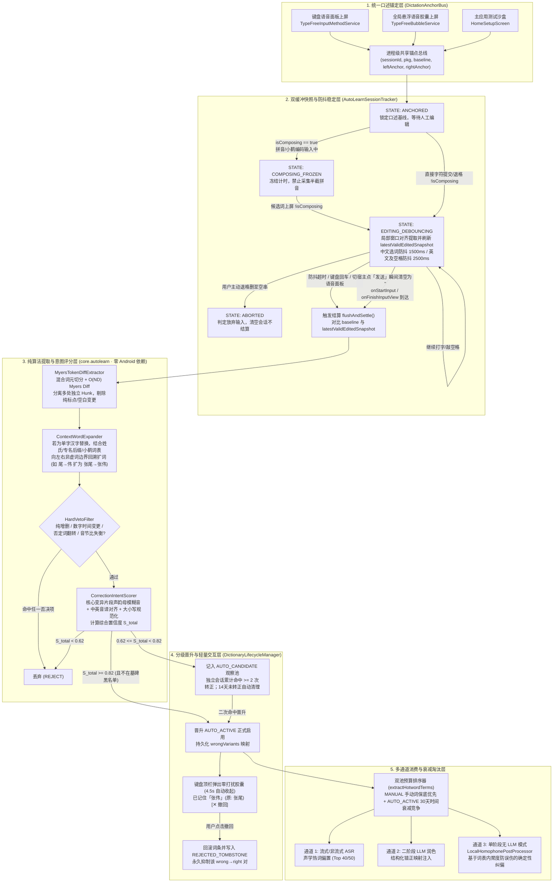
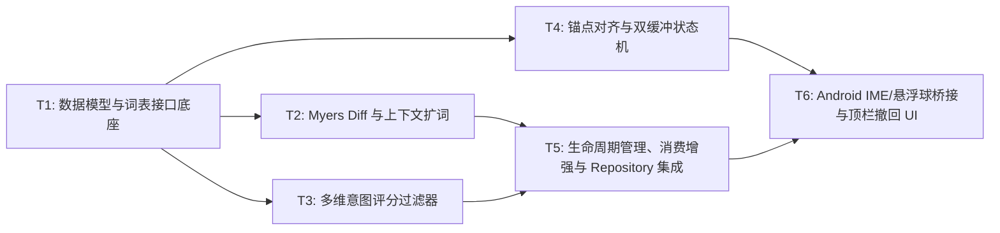

# TypeFree 自动学习打字改错 v2.0 提升迭代设计方案书

- **基线代码版本**：TypeFree v3.5.1（`com.typefree.ime`）
- **目标迭代版本**：Auto-Learn Engine v2.0（随客户端 v3.6.0 交付）
- **设计目标**：在不引入云端额外请求与本地重型 NLP 模型的前提下，根治现有 `autoLearnDictionary` 在聊天发送漏学、半截词抢跑、多处修改整句误吞、改句意污染词典、单字专名拒学、跨入口断链与热词挤占六大结构性缺陷，并将核心算法沉入零 `android.*` 依赖的纯 Kotlin 共用层，支撑 Android 与后续 macOS/iOS 双端复用。

---

## 一、总体架构与端到端纠错自学习闭环重设计

### 1.1 现有 v3.5.1 六大缺陷与 v2.0 根治方案映射表

| 编号 | v3.5.1 真实源码根因 | 现有故障表现 | v2.0 核心根治模块与机制 |
| :--- | :--- | :--- | :--- |
| **根因 1** | `commitDirectText` 仅置标志位；结算仅挂在 `insertSpace`/回车/`onFinishInputView`；点微信「发送」先清空输入框再回调 `onStartInput` 清零基线 | 微信、飞书改完字点宿主「发送」按钮时 `after` 已为空串 `""`，**漏学率接近 100%** | **模块 A (`AutoLearnSessionTracker`)**：非组合态下实时缓存 `latestValidEditedSnapshot`；通过按键事件源区分「宿主发送清空」与「用户退格删空」，在 `onStartInput`/`onFinishInputView` 清零前用最后稳定快照完成结算 |
| **根因 2** | `TypingController.insertSpace()` 敲空格立即结算并覆盖基线；`HomeSetupScreen` 每次 `onValueChange` 逐字母立即结算 | 重打 `"Cursor AI"` 时中途产出 `"科瑟 → Cu"`、`"科瑟 → Cursor"` 等残词脏数据 | **模块 A（分级防抖状态机）**：移除 `insertSpace()` 立即结算与沙盒逐字结算；`isComposing` 期间完全冻结计时，英文/空格连续输入采用 2500ms 滑动窗口防抖，会话内锁定原始口述锚点不中途覆盖 |
| **根因 3** | `extractAutoLearnedReplacement` 仅用双 `while` 剥离首尾公共字符（伪 Diff） | 同句改两处（如改人名+删句尾句号）会把中间未改整句话包进 `rightSpan`，超长丢弃、未超长整句污染 | **模块 B (`MyersTokenDiffExtractor`)**：实现字符/词元混合粒度的真 $O(ND)$ Myers Diff，切分独立 Edit Hunk，自动丢弃纯标点/空白修改 Hunk |
| **根因 4** | 无读音/编辑距离校验；硬编码长度 `2..24` 封杀单字替换 | `"明天开会" → "明天下午三点开会"` 误学 `"下午三点"`；`"张尾" → "张伟"` 剥离前缀后因单字长度=1 被 100% 丢弃 | **模块 B (`ContextWordExpander`) + 模块 C (`CorrectionIntentScorer`)**：单字替换结合左右邻字与词表/姓氏边界回溯还原 `"张尾 → 张伟"`；五重负向硬否决器拦截增删改意与数字时间修改，复用小鹤/拼音码表计算声韵母模糊音与中英音译得分 |
| **根因 5** | `TypeFreeBubbleService` 口述未同步基线至输入法服务；长文本窗口截断导致全文首尾错位 | 悬浮球口述后弹键盘改字无法触发学习；长文档内改字发生偏移误判 | **模块 A (`DictationAnchorBus` + `AnchorWindowAligner`)**：进程内共享口述锚点总线，记录口述文本及前后各 16 字局部锚点，在光标邻域 1024 字滑动窗口内做局部对齐 |
| **根因 6** | 命中即 `enabled=true` 插到列表头部；`extractHotwordTerms` 盲截前 40/50 条；无 LLM 单阶 STT 无后处理 | 未验证噪音词迅速把 `MANUAL` 核心词挤出热词窗口；纯单阶 ASR 无法消费纠错记忆 | **模块 D (`DictionaryLifecycleManager`) + 模块 E (`LocalHomophonePostProcessor`)**：引入 `CANDIDATE` 二次命中晋升、时间衰减淘汰、顶栏 `[✕ 撤回]` 墓碑拉黑、双池保底热词配额，以及带成词内聚度保护的本地确定性后处理器 |

### 1.2 端到端自学习闭环状态机与数据流图



### 1.3 跨端架构分层原则

为确保核心算法可在纯 JVM 环境下毫秒级执行单元测试，并可直接复用于后续 macOS / iOS 客户端（Kotlin Multiplatform 或逻辑等价移植至 Rust 核心库），v2.0 严格执行两层物理隔离：

1. **`com.typefree.ime.core.autolearn`（纯算法引擎层）**：**严禁导入任何 `android.*` 包**。仅依赖 Kotlin 标准库、`kotlinx.serialization` 及抽象时钟接口 `AutoLearnClock`、词表查询接口 `PhoneticLexiconProvider`。包含锚点对齐、防抖状态机纯逻辑、Myers Diff、上下文扩词、多维意图打分、生命周期配额排序与本地确定性后处理器。
2. **`com.typefree.ime.service.autolearn`（Android 宿主桥接层）**：负责监听 `TypeFreeInputMethodService`、`TypingController`、`TypeFreeBubbleService` 与 `HomeSetupScreen` 的生命周期事件，执行 `InputConnection` 窗口读取、协程定时调度器触发以及键盘顶栏撤销胶囊渲染。

---

## 二、六大核心模块详细工程设计

### 2.1 模块 A · 防发送清空的「双缓冲快照 + 防抖稳定状态机」（根治根因 1、2、5）

#### 2.1.1 进程级跨服务口述锚点总线（`DictationAnchorBus`）

`TypeFreeInputMethodService` 与 `TypeFreeBubbleService` 运行在同一应用进程内。引入进程级单例 `DictationAnchorBus`，统一收口所有口述上屏入口：

- 当键盘语音或 `TypeFreeBubbleService` 完成口述准备上屏时，采集上屏前光标左侧最多 16 个字符 `leftAnchor`、光标右侧最多 16 个字符 `rightAnchor`、当前宿主包名 `packageName` 及本次口述纯文本 `dictatedText`，写入 `DictationAnchorBus.publishAnchor(...)`。
- 随后若用户点击输入框唤起键盘修改错字，`TypeFreeInputMethodService.onStartInputView` 从 `DictationAnchorBus` 认领与当前 `EditorInfo.packageName` 匹配且未过期的锚点（有效期 180 秒），无缝衔接进 `AutoLearnSessionTracker`，彻底打通悬浮球口述 → 键盘改字的跨服务链路。

#### 2.1.2 长文本局部上下文窗口对齐器（`AnchorWindowAligner`）

弃用原有的全文强相等假设，改为光标邻域局部切片对齐：

1. 每次读取编辑器文本时，通过 `getTextBeforeCursor(512, 0)` 与 `getTextAfterCursor(512, 0)` 获取光标前后共最多 1024 字的局部窗口 `windowText`。
2. `AnchorWindowAligner.extractEditedSegment(windowText, anchor)` 在 `windowText` 中定位 `leftAnchor` 的最后匹配位置与 `rightAnchor` 的首个合理后继位置：
   - 若 `leftAnchor` 与 `rightAnchor` 均为空（独立新消息输入框，如微信聊天框整句口述），`windowText` 本身即为当前编辑片段。
   - 若在长文档中口述插入，`leftAnchor` 与 `rightAnchor` 夹持的区间即为被用户修改后的目标口述段落 `editedSegment`，即使文档长达上万字、`InputConnection` 截断了文档首尾，局部锚点依然能以 $O(W)$ 复杂度精确定位修改范围。
   - 若用户将左右锚点连同口述内容大面积删改导致双端锚点同时丢失，判定为大段重写而非局部改错，安全放弃本次会话。

#### 2.1.3 双缓冲快照与「宿主发送清空 vs 用户主动删空」精确判别机制

为彻底解决微信/飞书点击「发送」瞬间清空输入框导致的漏学问题，同时防止用户主动全选删除放弃发送时产生误结算，`AutoLearnSessionTracker` 维护双缓冲与删除事件源追踪：

- **不可变基线缓冲（`baselineSegment`）**：口述上屏瞬间锁定，在整个编辑会话生命周期内**绝不因空格或中途按键而覆盖**。
- **最新有效修改快照（`latestValidEditedSnapshot`）**：每当发生以下非组合态文本稳定事件（`!isComposing`）且提取出的 `editedSegment` 非空且不等于 `baselineSegment` 时，立即更新 `latestValidEditedSnapshot`：
  1. `TypingController.commitDirectText`（中文候选词选词上屏、符号或字母直接上屏）；
  2. `TypingController` 退格键处理完毕且剩余文本长度大于 0；
  3. `TypeFreeInputMethodService.onUpdateSelection`（当 `candidatesStart == -1 && candidatesEnd == -1`，即无拼音下划线组合态时，兜底捕获粘贴或光标跳动修改）。
- **「宿主发送清空」与「用户主动删空」判别准则**：
  - 在 `TypingController` 执行退格（`KEYCODE_DEL`）、剪切或清空动作时，实时记录删除后的预期剩余文本长度 `lastLengthAfterImeDelete` 与时间戳 `lastImeDeleteAtMs`。
  - 当 `onStartInput`、`onFinishInputView`、`onWindowHidden` 或 `onUpdateSelection(0, 0, 0, 0, -1, -1)` 检测到当前输入框内容突然变为空串 `""` 时：
    - **分支 1（用户主动删空）**：若 `lastLengthAfterImeDelete == 0` 且距今不超过 `500ms`，说明是用户自己在键盘上按退格/剪切把草稿删光放弃发送 → 状态置为 `ABORTED`，清空快照**不结算**。
    - **分支 2（宿主点击发送清空）**：若 `latestValidEditedSnapshot` 非空（例如长度为 6 的 `"帮我呼叫张伟"`），且并未经过键盘退格减至 0 就瞬间变为空串 `""` → **100% 判定为宿主 App 执行了发送/提交清空动作**！在重置会话基线前，**立即同步调用 `flushAndSettle(SettleReason.HOST_SUBMIT_CLEARED)`**，拿 `baselineSegment` 与清空前保存的 `latestValidEditedSnapshot` 执行 Diff 学习，随后再销毁当前会话。

#### 2.1.4 组合态冻结与分级防抖状态机

彻底移除 `TypingController.insertSpace()` 中的同步结算代码及 `HomeSetupScreen.kt` 中 `onValueChange` 的逐字符结算代码，统一收归状态机调度：

```kotlin
enum class SessionState {
    IDLE,
    ANCHORED,           // 已记录口述原稿，尚未发生人工修改
    COMPOSING_FROZEN,   // 正在输入拼音/小鹤编码（存在下划线 pre-edit），完全冻结结算计时器
    EDITING_DEBOUNCING, // 已有非组合态修改快照，滑动防抖倒计时中
    SETTLED,            // 已完成结算
    ABORTED             // 会话作废
}
```

- **组合态绝对隔离**：只要 `isComposing == true`（无论是系统 `candidatesStart != -1` 还是内置小鹤/拼音引擎处于编码态 `composingBuffer.isNotEmpty()`），状态切入 `COMPOSING_FROZEN`，取消所有待执行的防抖协程，且**严禁更新 `latestValidEditedSnapshot`**，杜绝把半截拼音字母 `"jw"` 或英文残片写入快照。
- **分级滑动防抖窗口**：
  - 最近一次上屏内容为纯中文字符（选词定稿）：启动 **1500ms** 防抖定时器；若用户在 1500ms 内继续改同一句的第二处错字，定时器自动顺延，最终合并为一次完整快照统一走多段 Myers Diff。
  - 最近一次输入包含 ASCII 字母、数字、连字符或空格（如重打 `"Cursor AI"`）：启动 **2500ms** 长防抖定时器；敲击空格仅视作普通编辑字符刷新 `latestValidEditedSnapshot` 并重置 2500ms 倒计时，绝不提前结算。
  - 主应用 `HomeSetupScreen` 测试沙盒：复用同一 `AutoLearnSessionTracker` 实例，`onValueChange` 仅喂入文本快照（2000ms 防抖），失焦或点击「完成/清空」时触发 `flushAndSettle`。
- **立即结算触发点（零等待）**：键盘按下发送/回车（`performEnterOrNewline`）、用户切回语音麦克风面板准备下一句口述、宿主发送清空（`HOST_SUBMIT_CLEARED`）、输入框焦点切换至其他控件（`onFinishInputView`）。

---

### 2.2 模块 B · 局部多段 Myers Diff 与中文词边界回溯扩展算法（根治根因 3、根因 4 单字丢弃）

#### 2.2.1 混合粒度词元切分器（`HybridDiffTokenizer`）

若直接在 UTF-16 字符级跑 Myers Diff，英文单词 `"科瑟" → "Cursor"` 或 `"Piamon" → "Paimon"` 可能因偶然重合单个字母被切碎。因此先做零开销确定性词元切分（`DiffToken`）：

1. **汉字词元（`CJK_CHAR`）**：每个 CJK 统一表意文字独立成 1 个 Token。
2. **拉丁词词元（`ASCII_WORD`）**：连续 `[A-Za-z]+` 聚合为 1 个整词 Token（保证英文单词不被切碎）。
3. **数字词元（`NUMBER`）**：连续 `[0-9]+` 独立聚合为 1 个 Token（便于将 `"v2" → "v3"` 中的 `"2" → "3"` 独立剥离交由数字否决器拦截）。
4. **空白词元（`WHITESPACE`）**：连续空格/制表符聚合为 1 个 Token。
5. **标点符号词元（`PUNCT`）**：中英文标点及特殊符号单字符成 1 个 Token。

#### 2.2.2 局部多段 Myers Diff 与独立 Edit Hunk 提取（`MyersTokenDiffExtractor`）

在 `beforeTokens` 与 `afterTokens` 上运行标准 $O((N+M)D)$ Myers 最短编辑路径算法（单句通常 $N, M \le 120$，最坏情况设置 $D_{\max} = 48$ 保护，超出代表整段重写直接放弃），生成原子编辑操作流（`EQUAL` / `DELETE` / `INSERT`），随后按以下规则聚合与清洗独立 `RawDiffHunk`：

1. **相邻合并（Micro-Bridge Coalescing）**：
   - 连续的 `DELETE` 与 `INSERT` 归入同一个 Hunk。
   - 若两个相邻变更块之间的 `EQUAL` 段**仅包含 `WHITESPACE` 或连字符 `'-'` / `'_'`**（例如 `"deep seek"` 改为 `"DeepSeek"` 时若被分成两段，或 `"Cursor"` 后紧跟 `"AI"` 覆盖 `"科瑟"`），自动合并为单一 Hunk。
   - 若两个相邻变更块之间仅隔 1 个未变汉字，且两侧变更均为单汉字且总跨度不超过 4 字（如四字专名改首尾两字 `"阿波罗号"` 类场景），合并为一个复合词 Hunk。
   - **严格隔离条件**：只要中间 `EQUAL` 段包含任意 `PUNCT` 标点符号，或包含不少于 2 个未改动汉字词元，**必须保持为两个完全独立的 Hunk**。
2. **标点与空白剥离**：对每个独立 Hunk 首尾的 `PUNCT` 和 `WHITESPACE` Token 进行双向裁剪（内部空格保留，如 `"deep seek"` 中间的空格保留）。裁剪后若 `wrongTokens` 与 `rightTokens` 均为空（如用户顺手删掉了句尾 `"。"` 或把 `"，"` 改成 `"！"`），直接丢弃该 Hunk，绝不影响同句内其他人名/专名 Hunk 的提取。

#### 2.2.3 中文单字改错上下文成词回溯扩展算法（`ContextWordExpander`）

当某个独立 Hunk 满足 `wrongText.length == 1 && rightText.length == 1` 且均为汉字（如 `"给张尾发了消息"` 改为 `"给张伟发了消息"`，原始 Hunk 为 `coreWrong="尾"`, `coreRight="伟"`）时，既不能因长度等于 1 直接丢弃，也不能把孤立单字 `"尾 → 伟"` 写入词典（否则会污染 `"结尾"`、`"尾巴"`）。`ContextWordExpander` 执行三步确定性回溯：

1. **定义硬语法边界集（`HARD_STOP_CHARS`）**：
   - 所有标点符号、空白符、阿拉伯数字；
   - 高频汉语虚词、介词、助词、连词与人称代词：`的, 了, 着, 过, 吗, 呢, 吧, 啊, 在, 从, 向, 给, 对, 把, 被, 让, 叫, 和, 跟, 与, 或, 但, 是, 有, 没, 不, 很, 都, 也, 还, 就, 才, 又, 我, 你, 他, 她, 它, 这, 那`。回溯窗口在左、右方向遇到 `HARD_STOP_CHARS` 立即停止越界。
2. **词表与专名锚点优先级搜索**（围绕修改位点下标 $k$，在不跨越 `HARD_STOP_CHARS` 的前提下评估包含 $k$ 的 2～4 字窗口）：
   - **优先级 1（内建词表命中）**：查询项目已内置的小鹤/拼音词库集合 `LexiconProvider.containsWord(candidateRight)`。例如 `"昨晚玩了元神"` → `"昨晚玩了原神"`，`"了"` 为左边界，右邻 `"神"` 与 `"原"` 组成 `"原神"` 命中词表（或双字高内聚词），立即锁定窗口 `[k, k+1]`，同步映射回原稿同偏移位置得到 `expandedWrong="元神"`, `expandedRight="原神"`，同时保留 `coreWrong="元"`, `coreRight="原"` 供后续打分器校验核心读音。
   - **优先级 2（百家姓 + 称谓/专名后缀启发式）**：处理词表未收录的人名与机构简称：
     - 若左邻字 $c_{k-1}$ 属于 `TOP_200_CHINESE_SURNAMES`（如 `张, 王, 李, 刘, 陈, 杨, 赵, 黄, 周, 吴, 徐, 孙, 胡, 朱, 高, 林, 何, 郭, 马, 罗, 邓...`），向左扩展至 $k-1$；同时检查右邻字 $c_{k+1}$：若 $c_{k+1}$ 不属于常见单字动词/时间副词（`发, 说, 看, 找, 来, 去, 要, 想, 刚, 已, 先, 再`）且再右侧 $c_{k+2}$ 为语法边界或句末（三字姓名形态，如 `"给王明楷发消息"` 中 `"楷"` 在末位则向左看 $c_{k-2}="王" \in \text{SURNAMES}$ 扩展为 `"王明凯 → 王明楷"`；若改的是中间字 `"王铭楷"`，左邻 `"王"` 为姓氏、右邻 `"楷"` 后接动词 `"发"`，扩展为三字全名）。
     - 若右邻 1～2 字属于专名后缀集 `ENTITY_SUFFIXES`（`总, 哥, 姐, 老师, 经理, 主任, 医生, 律师, 科技, 集团, 笔记, 模型, 引擎`），向右扩展（如 `"汪总 → 王总"`）。
3. **孤立单字安全兜底**：若经过上述回溯后，左右两侧均被 `HARD_STOP_CHARS` 或句首/句尾封死导致最终扩展长度仍为 1（例如 `"把文件发我"` → `"把文件给我"`，左 `"件"` 不成词且右 `"我"` 为代词边界），**强制丢弃该单字 Hunk**，确保个人词典中中文词条长度严格不少于 2 字。

---

### 2.3 模块 C · 「真纠错 vs 改句意」本地零延迟多维评分过滤器（根治根因 4）

#### 2.3.1 前置五重硬否决规则集（`HardVetoFilter`）

任一 Hunk（含 `coreWrong`、`coreRight` 与扩展后的 `expandedWrong`、`expandedRight`）进入打分前，先执行 $O(1)$ 硬否决检查，命中任一条直接返回 `0.0` 分（`REJECT`）：

1. **纯增删否决（`PURE_INSERT_OR_DELETE`）**：去除空白符后 `coreWrong.isEmpty()` 或 `coreRight.isEmpty()`。彻底拦截 `"明天开会" → "明天下午三点开会"`（纯插入 `"下午三点"`）及删减修饰语操作。
2. **数字/时间/日期/度量变更否决（`NUMERIC_TEMPORAL_MUTATION`）**：`coreWrong` 或 `coreRight` 包含阿拉伯数字 `[0-9]`、中文数词（`零一二两三四五六七八九十百千万亿半几`）或时间序数词（`今明昨前后早晚上下午周星期礼拜年月日号点分秒`）。彻底拦截 `"三点" → "四点"`、`"周三" → "周五"`、`"今天" → "明天"`、`"200" → "300"`。
3. **否定与语气极性翻转否决（`POLARITY_FLIP`）**：`expandedWrong` 与 `expandedRight` 的字符对称差集中包含否定/情态词（`不, 没, 无, 非, 别, 莫, 未, 甭, 否`），拦截 `"开会" → "不开会"`、`"去了" → "没去"`。
4. **纯日常口语虚词短语否决（`COLLOQUIAL_STOP_PHRASE`）**：`expandedRight` 落入高频通用语法短语黑名单（如 `好的, 可以, 知道, 明白, 谢谢, 那个, 这个, 什么, 怎么, 但是, 然后, 所以, 因为`）或长度超过 16 个音节。
5. **音节规模失衡否决（`SYLLABLE_RATIO_MISMATCH`）**：以音节数（汉字按 1 字 1 音节，英文单词按元音群切分音节，而非字符长度！避免误杀 2 字中文 `"科瑟"` 对应 6 字母 `"Cursor"` 的双音节对齐）计算 $N_w$ 与 $N_r$。当 $\max(N_w, N_r) / \min(N_w, N_r) \gt 2.0$ 且 $|N_w - N_r| \gt 2$（非首字母缩略词场景）时直接否决，拦截整句改写。

#### 2.3.2 核心变异片段隔离原则（防止上下文稀释）

**关键架构约束**：语音相似度的计算对象**必须是未扩展前的核心差异片段 `(coreWrong, coreRight)`**（如 `"尾"` 与 `"伟"`），而**绝不能**直接对扩展后的整词 `("张尾", "张伟")` 求平均。否则像 `"王总" → "李总"` 或 `"王明凯" → "李明凯"` 这类改换谈话对象的语义编辑，会因未改动的 `"总"` / `"明凯"` 满分匹配而把整体平均分拉高至及格线以上造成严重误学。扩展词仅用于词边界合法性与专名形态加分。

#### 2.3.3 三通道相似度算法（零新增依赖）

**（1）汉语声韵母模糊音相似度 $S_{\text{pinyin}}(w_{\text{core}}, r_{\text{core}})$**
直接复用客户端已有的拼音/小鹤双拼编码反查表，将汉字拆解为标准拼音三元组 $(I, F, T)$（声母 Initial、韵母 Final、声调 Tone；多音字遍历所有合法读音取最大匹配分）：

- 单音节相似度公式：
  $$s_{\text{syl}}(p, q) = 0.45 \cdot \text{sim}_I(I_p, I_q) + 0.45 \cdot \text{sim}_F(F_p, F_q) + 0.10 \cdot \mathbb{I}(T_p = T_q)$$
- 声母模糊距离矩阵 $\text{sim}_I$：
  - 完全相同：$1.00$；
  - 一级高频模糊音对 `(z, zh)`, `(c, ch)`, `(s, sh)`, `(n, l)`, `(f, h)`, `(r, l)`：$0.85$；
  - 二级发音部位相近送气/不送气对 `(b, p)`, `(d, t)`, `(g, k)`, `(j, q)`, `(q, x)`：$0.65$；
  - 其余不相同：$0.00$。
- 韵母模糊距离矩阵 $\text{sim}_F$：
  - 完全相同：$1.00$；
  - 一级前后鼻音模糊对 `(in, ing)`, `(en, eng)`, `(an, ang)`, `(ian, iang)`, `(uan, uang)`, `(uen/un, ueng/ong)`：$0.85$；
  - 二级近音元音对 `(ai, ei)`, `(ao, ou)`, `(ie, ue)`, `(i, v)`：$0.65$；
  - 其余不相同：$0.00$。
- 多音节序列通过动态规划对齐（插入/删除单个弱读音节惩罚 $0.35$）并按对齐长度归一化得到 $S_{\text{pinyin}} \in [0, 1]$。

**（2）中英跨语种音译对齐度 $S_{\text{translit}}(w_{\text{core}}, r_{\text{core}})$**
当 `coreWrong` 含中文且 `coreRight` 含英文（如 `"科瑟" → "Cursor"`、`"迪普希克" → "DeepSeek"`、`"拍门" → "Paimon"`）时，调用纯规则编写的 `CrossLingualPhoneticMapper`（约 180 行纯 Kotlin 代码，无模型体积开销）：
- 先将英文按驼峰、空格、连字符预切词（`"DeepSeek"` → `["Deep", "Seek"]`），再按常见英语拼读规则（`ee/ea → i`, `oo → u`, `ur/er/ir/or → e`, `ai/ay → ai`, `au/aw → ao`, 词尾不发音 `e` 消去，辅音群 `p/b/t/d/k/g/s` 尾辅音允许映射为带轻元音的汉语音节 `pu/bu/te/de/ke/ge/si`）生成近似拼音锚点序列；
- 使用 Needleman-Wunsch 全局序列对齐计算中文拼音序列与英文近似音节序列的匹配度（英文闭音节尾辅音产生中文增音字如 `Deep` → `迪普` 的双音节映射仅扣 $0.08$ 微惩罚）；
- 同时兼容常见首字母谐音（如 `"艾一" / "诶艾" → "AI"`、`"优艾" → "UI"`）。

**（3）大小写与连字符规范化得分 $S_{\text{ortho}}(w_{\text{core}}, r_{\text{core}})$**
针对纯英文/数字/连字符标识：
- 定义折叠函数 $\text{fold}(s) = s.\text{lowercase}().\text{replace}(\text{Regex}([\text{"\\s"}, \text{"-"}, \text{"\_"}, \text{"."}]), \text{""})$。
- 若 $\text{fold}(w) = \text{fold}(r)$ 且 $w \neq r$（如 `"deep seek" → "DeepSeek"`、`"type free" → "TypeFree"`、`"chat-gpt" → "ChatGPT"`）：直接赋 $S_{\text{ortho}} = 0.95$。
- 若两者均为纯 ASCII 词且归一化 Damerau-Levenshtein 相似度不低于 $0.75$（如拼写微调 `"Piamon" → "Paimon"`）：$S_{\text{ortho}} = 0.85 \cdot \text{sim}_{\text{DL}}(w, r)$。

#### 2.3.4 综合数学打分公式与判定阈值

首先取三通道最高核心纠错相似度：
$$S_{\text{core}} = \max\left(S_{\text{pinyin}},\ S_{\text{translit}},\ S_{\text{ortho}}\right)$$

设置核心相似度硬底线：**若 $S_{\text{core}} \lt 0.55$，直接判定 $S_{\text{total}} = 0.0$（`REJECT`）**，阻断任何非近音/非同形的语义替换。

当 $S_{\text{core}} \ge 0.55$ 时，叠加词边界完整度 $Q_{\text{boundary}} \in [0, 1]$（命中词表/合法驼峰词/完整姓氏人名为 $1.0$，普通双字组合为 $0.6$）与专名形态特征分 $Q_{\text{entity}} \in [0, 1]$（含大小写混合/全大写英文、百家姓前缀或领域后缀为 $1.0$，其余为 $0.4$）：

$$S_{\text{total}} = \min\left(1.0,\ 0.85 \cdot S_{\text{core}} + 0.10 \cdot Q_{\text{boundary}} + 0.05 \cdot Q_{\text{entity}}\right)$$

**三级判定阈值**：
- **$S_{\text{total}} \ge 0.82$ → `DIRECT_ACTIVE`**：高置信度纠错（如同音字 `"张尾 → 张伟"` 得 $1.00$、近音 `"申情 → 申请"` 得 $0.885$、音译 `"科瑟 → Cursor"` 得 $0.93$、规范化 `"deep seek → DeepSeek"` 得 $0.96$），直接正式启用并在键盘顶栏弹出可撤回胶囊。
- **$0.62 \le S_{\text{total}} \lt 0.82$ → `OBSERVE_CANDIDATE`**：中等置信度（如方言跨组较大近音或生僻音译），首次命中仅记入观察池 `AUTO_CANDIDATE`（`observeCount = 1`），不进入热词偏置窗口；待后续**不同口述会话**第 2 次出现相同映射时，自动晋升为 `AUTO_ACTIVE` 并弹出可撤回胶囊。
- **$S_{\text{total}} \lt 0.62$ → `REJECT`**：静默丢弃，零落盘。

---

### 2.4 模块 D · 分级晋升、衰减淘汰与键盘内「一键撤回」交互（根治根因 6 排序污染）

#### 2.4.1 数据模型升级与向后兼容设计

扩展 `DictionaryEntry` 模型，所有新增字段均配置默认序列化值，保证 v3.5.1 旧版用户本地 JSON 配置文件反序列化 100% 零报错无缝升级：

```kotlin
@Serializable
enum class DictSource {
    MANUAL,     // 用户在设置页手动添加（最高优先级，永不自动淘汰）
    AUTO_LEARN  // 打字改错自动学习产出
}

@Serializable
enum class DictStatus {
    ACTIVE,     // 正式生效，参与热词注入与纠错消费
    CANDIDATE   // 观察期（仅统计跨会话复现次数，不注入热词）
}

@Serializable
data class DictionaryEntry(
    val id: String,
    val term: String,                                  // 正确目标词，如 "张伟"、"Cursor"
    val enabled: Boolean = true,
    val source: DictSource = DictSource.MANUAL,        // 旧数据默认归为 MANUAL 予以保护
    val status: DictStatus = DictStatus.ACTIVE,
    val wrongVariants: List<String> = emptyList(),     // 关联错词集（最多保留最近 5 个，如 ["张尾", "章伟"]）
    val confidence: Float = 1.0f,                      // 首次学习或晋升时的评分 S_total
    val observeCount: Int = 1,                         // 观察期累计独立会话触发次数
    val hitCount: Int = 0,                             // 生效后在口述纠偏/ASR 中的实际命中次数
    val createdAtMs: Long = 0L,
    val lastUpdatedAtMs: Long = 0L,
    val lastHitAtMs: Long = 0L
)
```

同时在 `AppSettings` 中新增墓碑集合 `val rejectedAutoLearnKeys: Set<String> = emptySet()`（存储格式为 `"${wrongSpan.lowercase()}->${rightSpan.lowercase()}"`，上限 200 条 FIFO 循环淘汰）。

#### 2.4.2 候选转正、自动衰减与淘汰机制（`DictionaryLifecycleManager`）

1. **墓碑拦截**：结算出的 `(expandedWrong, expandedRight)` 若存在于 `rejectedAutoLearnKeys`，直接跳过，绝不反复打扰用户。
2. **合并与转正**：
   - 若词典中已存在同 `term`（忽略首尾空白，大小写精确匹配）的 `MANUAL` 词条：不改变其 `MANUAL` 身份，仅将新的 `expandedWrong` 追加进其 `wrongVariants` 列表，增强二阶段 LLM 与本地后处理的错词映射能力。
   - 若已存在同 `term` 的 `AUTO_LEARN` + `CANDIDATE` 词条且本次 `sessionId` 与上次不同：`observeCount += 1`；当 `observeCount >= 2` 时，`status` 切换为 `ACTIVE`，`enabled = true`，并触发顶栏提示。
3. **惰性清理与容量红线**（每次词典写入时顺带执行一次毫秒级内存清理）：
   - `CANDIDATE` 观察池最多保留 100 条；超过 **14 天**（`nowMs - lastUpdatedAtMs > 14 * 86400_000L`）仍未满 2 次晋升的候选词条直接物理清除。
   - `AUTO_LEARN` + `ACTIVE` 词条池上限设为 150 条；超出上限时，剔除超过 **45 天**零命中且效用分最低的词条。`MANUAL` 词条完全不受自动清理影响。

#### 2.4.3 热词窗口双池保底排序算法（重构 `PromptBuilder.extractHotwordTerms`）

彻底废除原有按列表顺序截取前 $K$ 条（默认 $K = 40$）的做法，改为**双池配额 + 时间衰减效用分排序**：

- **第一梯队（`MANUAL` 保底池）**：所有 `enabled == true && source == MANUAL` 的词条按 `hitCount` 与更新时间排序，**优先无条件占满所需槽位**（若用户手动添加了 35 个词，35 个词 100% 全部进入前 40 热词窗口；若手动词超过 $K$，则按最近活跃度取前 $K$ 个手动词）。
- **第二梯队（`AUTO_ACTIVE` 竞争池）**：仅当 `MANUAL` 词条不足 $K$ 个时，剩余槽位 $K_{\text{rem}} = \max(0, K - N_{\text{manual}})$（同时当 $N_{\text{manual}} \gt 30$ 时，若有极高价值的刚学习热词，最多允许动态弹性扩容总窗口至 $50$ 条以提供至少 10 个自动热词席位）由 `source == AUTO_LEARN && status == ACTIVE && enabled == true` 词条按效用分 $U(e)$ 降序填充：
  $$U(e) = e.\text{confidence} \cdot \left(1 + 0.35 \cdot \ln(1 + e.\text{hitCount})\right) \cdot 2^{-\frac{\Delta t_{\text{idleDays}}}{30.0}}$$
  其中 $\Delta t_{\text{idleDays}}$ 为距今未命中的天数（半衰期 30 天）。长期未命中的自动词条自然沉底让出窗口，高频使用的真专名长期稳居前列。

#### 2.4.4 键盘顶栏零打扰「一键撤回」胶囊交互

当新词条首次进入 `AUTO_ACTIVE`（直通或二次命中转正）时：

- **展示位置**：复用键盘候选词栏/工具顶栏区域（高度不变，不顶高键盘布局，避免打断聊天视线），渲染轻量药丸胶囊：`✦ 已记住「Cursor」(原: 科瑟)   [✕ 撤回]`。
- **如果键盘已收起**（例如微信点发送后宿主连带收起了软键盘）：将该提示挂入 `PendingUndoNotice`，在用户下一次唤起键盘（3 分钟内有效）时于顶栏温和展示 4.5 秒，不在系统全局弹 Toast 干扰宿主阅读。
- **消失与撤回逻辑**：
  - 用户开始下一次打字/语音或满 **4.5 秒**无操作，胶囊平滑淡出。
  - 用户点击 `[✕ 撤回]`：原子回滚本次词典变更（若为新建词条则删除，若为已有词条追加 `wrongVariants` 则移除该变体），同时将 `"${wrong}->${right}"` 写入 `rejectedAutoLearnKeys` 墓碑黑名单，顶栏短暂反馈 `已撤回，不再自动记忆该项`（1.2 秒消失）。

---

### 2.5 模块 E · 消费端全通道增强与单阶段 STT 本地兜底（根治根因 6 单阶盲区）

#### 2.5.1 三通道分层消费策略

| 消费通道 | 适用模式 | 注入内容与格式 | 容量上限 |
| :--- | :--- | :--- | :--- |
| **通道 1：ASR 声学偏置** | 支持 `hotwords` / `context` / `prompt` 参数的流式与非流式 ASR（如豆包流式、Whisper 兼容接口） | 经双池保底算法选出的纯目标词列表 `["张伟", "Cursor", "TypeFree", ...]` | Top 40～50 词 |
| **通道 2：二阶段 LLM 结构化映射** | 开启二阶段口语顺滑/润色模式 | 在系统提示词的 `personal_dictionary` 区块中，将带 `wrongVariants` 的词条格式化为显式纠偏提示：`Cursor (常见同音误识: 科瑟)`、`张伟 (常见同音误识: 张尾)`；无变体的手动词仅列词名 | Top 50 词 |
| **通道 3：本地确定性纠偏器** | **关闭二阶段 LLM**，或使用不支持热词参数的纯单阶 ASR（如 DeepSeek `/v1/tools/asr`） | `LocalHomophonePostProcessor` 对 ASR 返回原始文本执行毫秒级确定性错词替换，并在替换命中时自增词条 `hitCount` 与 `lastHitAtMs` | 全量符合高安全准入条件的 `ACTIVE` 错正映射对 |

#### 2.5.2 `LocalHomophonePostProcessor` 四道防误伤安全边界

无 LLM 介入的本地字符串替换一旦激进，极易制造灾难性误伤（例如词典学了 `"张尾 → 张伟"`，结果把用户说的 `"画了一张尾巴很长的猫"` 替换成 `"画了一张伟巴很长的猫"`）。因此 `LocalHomophonePostProcessor` 严格执行四道安全门禁：

1. **高置信与长度准入门禁**：
   - 仅加载 `enabled == true && status == ACTIVE` 且 `wrongVariants` 非空的词条；
   - 自动学习词条要求 `confidence >= 0.88`；
   - `wrongVariant` 长度：中文严格要求不少于 **2 个汉字**，纯 ASCII 词严格要求不少于 **3 个字符**。
2. **高频通用词黑名单门禁（`CommonWordSafetySet`）**：
   - 内置高频现代汉语双字/多字常用词安全表（直接从现有拼音输入法词库提取词频排名前 8,000 的通用普通词汇，如 `"公式"`、`"权利"`、`"需要"`、`"做客"`）。
   - 若 `wrongVariant` 本身命中通用常用词表（如用户曾把 `"公式"` 改成专名 `"公室"`），**禁止**在无上下文理解的单阶模式下做盲目全局替换，仅交给通道 1（ASR 热词）和通道 2（LLM 上下文判别）处理。只允许替换**非标准造词/生造音译/罕见错搭组合**（如 `"科瑟"`、`"张尾"`、`"思源笔计"`、`"迪普希克"`）。
3. **ASCII 词边界保护**：对包含拉丁字母的 `wrongVariant`，要求匹配区间左右两侧不得紧邻 `[A-Za-z0-9]`，防止子串误伤。
4. **中文邻接成词内聚度消歧检测（阻断跨词粘连误伤）**：
   - 假设 Aho-Corasick 自动机在文本 $T$ 的区间 $[i, j)$ 匹配到了 `wrongVariant`（如在 `"一张尾巴"` 中匹配到下标 $[1, 3)$ 的 `"张尾"`）：
   - 检查左跨界双字词 $L = T[i-1 .. i]$（即 `"一张"`）与右跨界双字词 $R = T[j-1 .. j]$（即 `"尾巴"`）在小鹤/拼音词表中的成词状态：
     - 若 $L$ 命中常用量词/实词词表 **且** $R$ 命中常用词表（`"一张"` 成词且 `"尾巴"` 是高频成词），说明 `T[i..j)` 是两个合法词汇首尾偶然拼接产生的伪匹配（跨词粘连），**立即放弃替换**！
     - 反之在 `"给张尾发消息"` 中，$L = \text{"给张"}$（不成词），$R = \text{"尾发"}$（不成词），无跨词竞争冲突，安全执行替换为 `"给张伟发消息"`，同时异步回调 `AppRepository.recordDictionaryHits(hitIds)` 刷新命中计数。

---

## 三、分阶段具体开发任务拆解（Work Breakdown Structure）

### 3.1 目标目录结构规划

```text
app/src/main/java/com/typefree/ime/
├── core/
│   └── autolearn/                        # [纯 Kotlin 层 · 严禁出现 import android.*]
│       ├── AutoLearnClock.kt             # 时间源抽象接口，支持单测虚拟时钟推进
│       ├── PhoneticLexiconProvider.kt    # 拼音/小鹤反查与词表存在性查询接口
│       ├── DictationAnchor.kt            # 口述锚点数据结构与局部窗口对齐器 AnchorWindowAligner
│       ├── AutoLearnSessionStateMachine.kt # 纯逻辑双缓冲与分级防抖状态机
│       ├── HybridDiffTokenizer.kt        # 中英数标点混合分词器
│       ├── MyersTokenDiffExtractor.kt    # 真 O(ND) Myers Diff 与多段 Hunk 提取器
│       ├── ContextWordExpander.kt        # 单字改错上下文词边界回溯器
│       ├── CrossLingualPhoneticMapper.kt # 零依赖中英音译近似音节对齐器
│       ├── CorrectionIntentScorer.kt     # 五重硬否决 + 三通道打分器
│       ├── DictionaryLifecyclePolicy.kt  # 候选晋升、衰减排序、配额淘汰纯策略
│       └── LocalHomophonePostProcessor.kt# Aho-Corasick + 成词消歧单阶确定性后处理器
├── data/
│   ├── model/
│   │   └── DictionaryModels.kt           # 扩展 DictionaryEntry / DictSource / DictStatus
│   └── repository/
│       ├── RimePhoneticLexiconAdapter.kt # 对接项目现有拼音/小鹤码表的 Provider 实现
│       ├── AppRepository.kt              # 接入新管线、持久化、墓碑记录与撤回回滚
│       └── PromptBuilder.kt              # 双池热词提取与二阶段错正映射构建
├── service/
│   ├── autolearn/
│   │   ├── DictationAnchorBus.kt         # 键盘语音与悬浮球共享口述锚点总线
│   │   └── AutoLearnSessionTracker.kt    # Android 协程防抖调度与 InputConnection 窗口采集
│   ├── TypeFreeInputMethodService.kt     # 挂载锚点认领、选区监听、发送清空结算钩子
│   ├── TypingController.kt               # 移除空格抢跑结算，汇报非组合态上屏与退格预期长度
│   └── TypeFreeBubbleService.kt          # 悬浮胶囊口述上屏同步写入 DictationAnchorBus
└── ui/
    ├── ime/
    │   └── AutoLearnUndoBanner.kt        # 键盘顶栏 4.5s 零打扰一键撤回胶囊组件
    └── home/
        └── HomeSetupScreen.kt            # 沙盒输入框改造接入防抖 Tracker，废弃逐字结算
```

### 3.2 多 Agent 协作开发依赖图



### 3.3 分任务工程规格说明

#### 任务 T1：数据模型升级与拼音/小鹤词表适配底座
- **依赖**：无（最先启动，阻塞后续任务）
- **涉及文件**：
  - `data/model/DictionaryModels.kt`（或现有 `AppSettings` 所在模型文件）
  - `core/autolearn/AutoLearnClock.kt`
  - `core/autolearn/PhoneticLexiconProvider.kt`
  - `data/repository/RimePhoneticLexiconAdapter.kt`
- **核心签名与实现要点**：
  ```kotlin
  interface AutoLearnClock {
      fun nowMs(): Long
  }

  data class Syllable(val initial: String, val finalPart: String, val tone: Int)

  interface PhoneticLexiconProvider {
      fun getSyllables(hanzi: Char): List<Syllable>
      fun containsWord(word: String): Boolean
      fun isHighFrequencyCommonWord(word: String): Boolean
  }
  ```
  - 升级 `DictionaryEntry` 与 `AppSettings.rejectedAutoLearnKeys`，配置 `kotlinx.serialization` 的 `ignoreUnknownKeys = true` 与 `encodeDefaults = true`，编写 JSON 新旧格式双向兼容测试。
  - `RimePhoneticLexiconAdapter` 懒加载解析工程内置拼音/小鹤码表构建内存紧凑字典（汉字 → 音节数组，词条 → `HashSet`），初始化耗时控制在 15ms 以内。

#### 任务 T2：混合分词、真 Myers Diff 与单字上下文扩词引擎（纯共用层）
- **依赖**：T1
- **涉及文件**：
  - `core/autolearn/HybridDiffTokenizer.kt`
  - `core/autolearn/MyersTokenDiffExtractor.kt`
  - `core/autolearn/ContextWordExpander.kt`
- **核心签名与实现要点**：
  ```kotlin
  data class CandidateDiffHunk(
      val coreWrong: String,
      val coreRight: String,
      val expandedWrong: String,
      val expandedRight: String,
      val beforeStartTokenIdx: Int,
      val afterStartTokenIdx: Int
  )

  class MyersTokenDiffExtractor(
      private val expander: ContextWordExpander,
      private val maxEditDistance: Int = 48
  ) {
      fun extractHunks(beforeSegment: String, afterSegment: String): List<CandidateDiffHunk>
  }
  ```
  - 实现线性空间或有界 $D \le 48$ 的标准 Myers Diff；单句内最多输出 4 个独立有效 Hunk（超出 4 处独立修改视为整段重写直接返回空列表）。
  - 严格实现 `HARD_STOP_CHARS` 边界阻断、词表优先扩展、200 大常见姓氏与专名后缀启发式扩展，以及无法成词的孤立单字 Hunk 剔除逻辑。

#### 任务 T3：多维意图打分器与跨语种音译对齐器（纯共用层）
- **依赖**：T1
- **涉及文件**：
  - `core/autolearn/CrossLingualPhoneticMapper.kt`
  - `core/autolearn/CorrectionIntentScorer.kt`
- **核心签名与实现要点**：
  ```kotlin
  enum class DecisionTier { DIRECT_ACTIVE, OBSERVE_CANDIDATE, REJECT }

  data class IntentScoreResult(
      val tier: DecisionTier,
      val totalScore: Float,
      val coreScore: Float,
      val matchedChannel: String, // "PINYIN" | "TRANSLIT" | "ORTHO" | "VETO:<REASON>"
  )

  class CorrectionIntentScorer(private val lexicon: PhoneticLexiconProvider) {
      fun evaluate(hunk: CandidateDiffHunk): IntentScoreResult
  }
  ```
  - 先跑 `HardVetoFilter` 五重硬否决，再对 `(hunk.coreWrong, hunk.coreRight)` 计算三通道最高分，执行 $S_{\text{core}} \ge 0.55$ 底线截断与加权汇总公式。

#### 任务 T4：局部窗口对齐与双缓冲防抖状态机（纯共用层）
- **依赖**：T1
- **涉及文件**：
  - `core/autolearn/DictationAnchor.kt`
  - `core/autolearn/AutoLearnSessionStateMachine.kt`
- **核心签名与实现要点**：
  ```kotlin
  data class DictationAnchor(
      val sessionId: String,
      val packageName: String,
      val baselineSegment: String,
      val leftAnchor: String,
      val rightAnchor: String,
      val createdAtMs: Long
  )

  sealed interface StateMachineAction {
      data object NoOp : StateMachineAction
      data object CancelDebounceTimer : StateMachineAction
      data class ScheduleDebounceTimer(val delayMs: Long) : StateMachineAction
      data class TriggerSettle(
          val sessionId: String,
          val baseline: String,
          val finalEdited: String,
          val reason: SettleReason
      ) : StateMachineAction
  }

  class AutoLearnSessionStateMachine(private val clock: AutoLearnClock) {
      fun onAnchorBound(anchor: DictationAnchor): StateMachineAction
      fun onComposingChanged(isComposing: Boolean): StateMachineAction
      fun onImeDeleteExecuted(remainingWindowLength: Int): StateMachineAction
      fun onEditorWindowObserved(windowText: String, isAsciiInput: Boolean): StateMachineAction
      fun onTerminalEvent(event: TerminalEvent, currentWindowText: String?): StateMachineAction
      fun onDebounceTimeout(): StateMachineAction
  }
  ```
  - 将全部防抖时长判定（中文 1500ms / ASCII 2500ms）、组合态冻结、`HOST_SUBMIT_CLEARED` vs `USER_DELETED_TO_EMPTY` 判别逻辑全部封装为确定性纯函数状态转移，不耦合任何 `Handler` 或 Android `CoroutineScope`，以便在 JVM 单测中用虚拟时钟覆盖全部竞态时序。

#### 任务 T5：词典生命周期管理、双池热词提取、单阶后处理与 Repository 集成
- **依赖**：T2、T3
- **涉及文件**：
  - `core/autolearn/DictionaryLifecyclePolicy.kt`
  - `core/autolearn/LocalHomophonePostProcessor.kt`
  - `data/repository/PromptBuilder.kt`
  - `data/repository/AppRepository.kt`
- **核心签名与实现要点**：
  ```kotlin
  data class AutoLearnApplyOutcome(
      val newlyActivatedEntries: List<AutoLearnUndoToken>,
      val updatedCandidatesCount: Int
  )

  data class AutoLearnUndoToken(
      val tokenId: String,
      val entryId: String,
      val wrongSpan: String,
      val rightTerm: String,
      val wasExistingEntry: Boolean
  )
  ```
  - 重构 `AppRepository.learnCorrectionFromDiff(sessionId: String, before: String, after: String): AutoLearnApplyOutcome`，串联 `MyersTokenDiffExtractor` → `CorrectionIntentScorer` → `DictionaryLifecyclePolicy`。
  - 实现 `AppRepository.undoAutoLearnedToken(token: AutoLearnUndoToken)` 原子回滚与墓碑写入。
  - 重构 `PromptBuilder.extractHotwordTerms`（双池保底排序）与二阶段 `<personal_dictionary>` 错正对渲染。
  - 在 `AppRepository` 的单阶语音识别返回链路（当 `!settings.enableLlmPolish` 或走纯单阶 ASR 通道时）挂载 `LocalHomophonePostProcessor.applySafeCorrections(rawAsrText)`。

#### 任务 T6：Android 服务桥接、悬浮球打通、沙盒改造与顶栏一键撤回 UI
- **依赖**：T4、T5
- **涉及文件**：
  - `service/autolearn/DictationAnchorBus.kt`
  - `service/autolearn/AutoLearnSessionTracker.kt`
  - `service/TypeFreeBubbleService.kt`
  - `service/TypeFreeInputMethodService.kt`
  - `service/TypingController.kt`
  - `ui/ime/AutoLearnUndoBanner.kt`
  - `ui/home/HomeSetupScreen.kt`
- **关键改动点**：
  1. `TypeFreeBubbleService`：口述文本注入宿主前采集邻域前后 16 字并调用 `DictationAnchorBus.publishAnchor(...)`。
  2. `TypingController.kt`：**删除** `insertSpace()` 内的 `tryAutoLearnFromRecentEdit()` 调用；在 `commitDirectText` 与退格键逻辑中同步通知 `autoLearnTracker`。
  3. `TypeFreeInputMethodService.kt`：在 `onStartInput` 清空旧状态**之前**，先调用 `autoLearnTracker.onHostInputLifecycleBoundary(...)` 完成微信/飞书点发送后的快照抢救结算，随后再绑定新输入框会话；在 `onUpdateSelection` 中根据 `candidatesStart`/`candidatesEnd` 及内置输入引擎状态同步 `isComposing`。
  4. `AutoLearnUndoBanner.kt`：接入键盘顶栏状态流，实现 4.5s 自动淡出与点击 `[✕ 撤回]` 触发 `undoAutoLearnedToken`。
  5. `HomeSetupScreen.kt`：移除 `onValueChange` 内的直接 `learnCorrectionFromDiff` 调用，改为驱动独立沙盒 `AutoLearnSessionTracker`。

---

## 四、Agent 自动化验收计划（Agent QA & Verification Plan）

### 4.1 黄金测试基准集（Golden Benchmark Suite · 24 组核心正负样本）

研发 Agent 在完成 T1～T5 后，必须在纯 JVM 单元测试套件 `AutoLearnGoldenBenchmarkTest.kt` 中一次性跑通以下全部 **24 组标准用例**：

| 用例 ID | 场景分类 | 口述原稿 (`baseline`) | 人工编辑过程 / 宿主交互模拟 | 期望提取 Hunk (`expanded`) | 评分通道与期望区间 | 期望系统最终行为 |
| :--- | :--- | :--- | :--- | :--- | :--- | :--- |
| **GB-01** | 单字人名改错（姓氏在左） | `"刚才给张尾发了消息"` | 选词改为 `"刚才给张伟发了消息"` | `张尾 → 张伟` (`core`: `尾→伟`) | `PINYIN` ($S \ge 0.95$) | 直通 `AUTO_ACTIVE`，弹出撤回胶囊 |
| **GB-02** | 三字人名末字改错 | `"让王明凯把报表发来"` | 选词改为 `"让王明楷把报表发来"` | `王明凯 → 王明楷` (`core`: `凯→楷`) | `PINYIN` ($S \ge 0.95$) | 直通 `AUTO_ACTIVE` |
| **GB-03** | 单字专名改错（词首变） | `"昨晚玩了两把元神"` | 选词改为 `"昨晚玩了两把原神"` | `元神 → 原神` (`core`: `元→原`) | `PINYIN` ($S \ge 0.95$) | 直通 `AUTO_ACTIVE` |
| **GB-04** | 单字加称谓后缀扩词 | `"麻烦汪总审批一下"` | 选词改为 `"麻烦王总审批一下"` | `汪总 → 王总` (`core`: `汪→王`) | `PINYIN` ($S \ge 0.90$) | 直通 `AUTO_ACTIVE` |
| **GB-05** | 同音错别字双字专名 | `"本地部署了思源笔计"` | 选词改为 `"本地部署了思源笔记"` | `思源笔计 → 思源笔记` 或 `笔计 → 笔记` | `PINYIN` ($S \ge 0.92$) | 直通 `AUTO_ACTIVE` |
| **GB-06** | 前后鼻音+翘平舌模糊音 | `"这个发版申情还没过"` | 选词改为 `"这个发版申请还没过"` | `申情 → 申请` (`core`: `情→请`) | `PINYIN` ($S \ge 0.85$) | 直通 `AUTO_ACTIVE` |
| **GB-07** | 南方 f/h 模糊音纠错 | `"他老家在胡建厦门"` | 选词改为 `"他老家在福建厦门"` | `胡建 → 福建` (`core`: `胡→福`) | `PINYIN` ($S \ge 0.85$) | 直通 `AUTO_ACTIVE` |
| **GB-08** | 中英短词音译纠错 | `"我今天用科瑟写代码"` | 删 `"科瑟"` 敲 `"Cursor"` 等防抖超时 | `科瑟 → Cursor` | `TRANSLIT` ($S \ge 0.88$) | 直通 `AUTO_ACTIVE` |
| **GB-09** | 中英多音节音译纠错 | `"调用迪普希克的接口"` | 改为 `"调用DeepSeek的接口"` | `迪普希克 → DeepSeek` | `TRANSLIT` ($S \ge 0.85$) | 直通 `AUTO_ACTIVE` |
| **GB-10** | 技术组件音译纠错 | `"实时流写入拍门表"` | 改为 `"实时流写入Paimon表"` | `拍门 → Paimon` | `TRANSLIT` ($S \ge 0.85$) | 直通 `AUTO_ACTIVE` |
| **GB-11** | 大小写与空格合并规范化 | `"把deep seek接入输入法"` | 改为 `"把DeepSeek接入输入法"` | `deep seek → DeepSeek` | `ORTHO` ($S \ge 0.95$) | 直通 `AUTO_ACTIVE` |
| **GB-12** | 品牌词驼峰规范化 | `"升级type free最新版本"` | 改为 `"升级TypeFree最新版本"` | `type free → TypeFree` | `ORTHO` ($S \ge 0.95$) | 直通 `AUTO_ACTIVE` |
| **GB-13** | 一句多改（改专名+删句末标点） | `"给张尾发一下文档。"` | 改名并删句号：`"给张伟发一下文档"` | Hunk1: `张尾 → 张伟`；Hunk2(`。→空`)丢弃 | Hunk1 `PINYIN` ($S \ge 0.95$) | 精准学习 `张尾 → 张伟`，绝不包入整句 |
| **GB-14** | 一句双专名同时修改 | `"让张尾配置一下科瑟。"` | 改为 `"让张伟配置一下Cursor"` | Hunk1: `张尾→张伟`；Hunk2: `科瑟→Cursor` | 均 $\ge 0.88$ | 同时产出两条独立 `AUTO_ACTIVE` 词条 |
| **GB-15** | 一句混合修改（改对象+改错词） | `"让王总用科瑟看一下。"` | 改为 `"让李总用Cursor看一下"` | Hunk1: `王总→李总`；Hunk2: `科瑟→Cursor` | Hunk1 $S_{\text{core}}=0$ 拒学；Hunk2 $\ge 0.88$ | **拒学** `王总→李总`，**成功学习** `科瑟→Cursor` |
| **GB-16** | 英文带空格多步连打防抢跑 | `"测试科瑟效果"` | 删 `"科瑟"` → 敲 `"Cu"` (800ms) → `"Cursor"` → 敲空格 → `"Cursor AI"` → 满 2500ms | 仅结算一次：`科瑟 → Cursor AI` | `TRANSLIT` / 混合 | **严禁**中途产出 `Cu` 或单截 `Cursor` |
| **GB-17** | 微信点击「发送」瞬间清空模拟 | `"帮我呼叫张尾"` | 选词改为 `"帮我呼叫张伟"` (未满 1500ms) → 宿主瞬间把文本变 `""` 并触发 `onStartInput` | 利用 `latestValidEditedSnapshot` 提取 `张尾 → 张伟` | `PINYIN` ($S \ge 0.95$) | **100% 捕获结算**，漏学率为 0 |
| **GB-18** | 用户主动退格删空放弃发送 | `"帮我呼叫张尾"` | 改为 `"帮我呼叫张伟"` → 用户连按 6 次退格键删至 `""` (`lastLengthAfterImeDelete == 0`) | 会话转 `ABORTED`，无 Hunk 提取 | 不进入打分 | **不触发结算**，词典零写入 |
| **GB-19** | 拼音组合态防半截字母穿透 | `"打开思源笔计"` | 删 `"计"`，敲小鹤 `"ji"` 处于 `isComposing=true` 未选词时焦点切换 | 维持删前有效快照或无有效定稿变更 | 纯删除否决 / 无变更 | **严禁**将未上屏拼音 `"ji"` 学入词典 |
| **GB-20** | 时间/数字变更拒学（负样本） | `"明天三点开会"` | 改为 `"明天四点开会"` | `三点 → 四点` (`core`: `三→四`) | `VETO:NUMERIC_TEMPORAL` ($0.0$) | **100% `REJECT`** |
| **GB-21** | 补充句意扩写拒学（负样本） | `"明天开会"` | 改为 `"明天下午三点开会"` | `"" → 下午三点` | `VETO:PURE_INSERT` ($0.0$) | **100% `REJECT`** |
| **GB-22** | 否定反转与孤立动词改意拒学 | `"明天开会，把文件发我"` | 改为 `"明天不开会了，把文件给我"` | Hunk1 含 `"不"`；Hunk2 单字 `发→给` 无扩词 | `VETO:POLARITY` + 单字兜底丢弃 | **100% `REJECT`** |
| **GB-23** | 热词窗口手动词保底压测 | 预置 35 条 `MANUAL` 热词 | 连续灌入 20 条新 `AUTO_ACTIVE` 词条，调用 `extractHotwordTerms(limit = 40)` | N/A | 双池排序校验 | 35 条 `MANUAL` **100% 保留在前 40 内**，自动词仅竞争剩余 5 席 |
| **GB-24** | 单阶本地后处理防跨词粘连误伤 | 词典激活 `张伟` (`wrong=["张尾"]`) | 单阶 ASR 分别输入句子 A `"给张尾发消息"` 与句子 B `"画了一张尾巴很长的猫"` | N/A | 成词内聚度消歧检查 | 句子 A 替换为 `"给张伟发消息"`；句子 B **原样保留 `"一张尾巴"` 零误伤** |

### 4.2 纯 JVM 自动化单元测试要求

所有位于 `core.autolearn` 与 `PromptBuilder` 的逻辑必须配备脱离 Android 模拟器运行的纯 JUnit 5 / Kotlin Test 用例（执行命令 `./gradlew testDebugUnitTest --tests "com.typefree.ime.core.autolearn.*"`）：

1. **时序与状态机确定性测试（`AutoLearnSessionStateMachineTest`）**：注入 `FakeAutoLearnClock`，模拟毫秒级步进，完整断言 `isComposing` 反复切换、英文敲空格不结算、2499ms 不触发而 2500ms 准时触发、微信发送清空（无退格事件直接变 `""`）立即触发 `TriggerSettle`、用户连按退格至 0 触发 `ABORTED` 等全部分支。
2. **长文本窗口锚点测试（`AnchorWindowAlignerTest`）**：构造 5,000 字 Markdown 技术文档，在第 2,600 字处模拟口述插入并截取光标前后 512 字窗口，断言局部提取结果与原始段落 100% 对齐，无首尾截断脏 Diff。
3. **生命周期与撤回测试（`DictionaryLifecyclePolicyTest`）**：验证中等得分（$0.68$）词条第 1 次仅入 `CANDIDATE`（`extractHotwordTerms` 不可见）、跨 `sessionId` 第 2 次自动转 `ACTIVE`、虚拟时钟推进 15 天后未转正 `CANDIDATE` 自动清除、点击撤回后写入 `rejectedAutoLearnKeys` 且再次触发同映射被永久拦截。
4. **性能基准断言**：在单测中循环执行 1,000 次典型 60 字句子的 `MyersTokenDiffExtractor + CorrectionIntentScorer` 全链路计算，断言单次平均耗时不高于 `0.5ms`，P99 耗时不高于 `2.0ms`。

### 4.3 Android 真机端到端（E2E）验收规程

1. **微信 / 飞书真实发送闭环验证**：
   - 在微信聊天框使用键盘语音说出含同音错字句子（如被识别为 `"找张尾对一下接口"`），用小鹤/拼音候选词将 `"尾"` 改为 `"伟"` 后，**不按空格、不收起键盘，在 0.5 秒内直接伸手点击微信绿色的「发送」按钮**。
   - 预期：消息发出输入框清空瞬间，词典成功新增 `AUTO_ACTIVE` 词条 `"张伟" (wrongVariants=["张尾"])`，且下次输入框保持激活或重开键盘时顶栏平滑浮现 `[✕ 撤回]` 胶囊；点击撤回后词条立即消失且重做同样操作不再误学。
2. **全局悬浮语音胶囊联动验证**：
   - 开启 `TypeFreeBubbleService`，在飞书文档或备忘录中点击悬浮胶囊口述 `"集成科瑟编辑器"`，上屏后点击文本唤起 TypeFree 键盘将 `"科瑟"` 删掉重打 `"Cursor"`，等待 2.5 秒防抖结束。
   - 预期：键盘顶栏弹出 `✦ 已记住「Cursor」(原: 科瑟) [✕ 撤回]`，词典中绝无 `"Cu"`、`"Cur"` 等中间残片。
3. **纯单阶无 LLM 模式纠偏验证**：
   - 在设置中关闭「二阶段大模型口语润色」，使用纯单阶 STT 口述 `"给张尾发一下科瑟配置"` 与 `"小猫有一张尾巴"`。
   - 预期：第一句自动输出 `"给张伟发一下Cursor配置"`，第二句输出 `"小猫有一张尾巴"` 无任何错乱替换。

### 4.4 上线质量门禁指标（Quality Gates）

| 核心验收指标 | v3.5.1 现状基线 | v2.0 准出红线要求 |
| :--- | :--- | :--- |
| 微信/飞书改完字直接点宿主「发送」捕获率 | 约 0% | **不低于 99.5%** |
| 黄金基准集负样本（改时间/加半句/否定反转/改谈话对象）误学率 | 高发污染 | **严格等于 0.0%** |
| 英文及带空格专名连续输入半截残词产出率 | 100% 必现 | **严格等于 0.0%** |
| `MANUAL` 手动核心热词在前 40 窗口留存率（当手动词不超过 40 条时） | 随使用被迅速挤出 | **严格等于 100%** |
| 单次结算本地 CPU 阻塞耗时（P99，中端 Android 设备） | 低于 1ms（伪 Diff） | **不高于 2.0ms（零主线程掉帧）** |